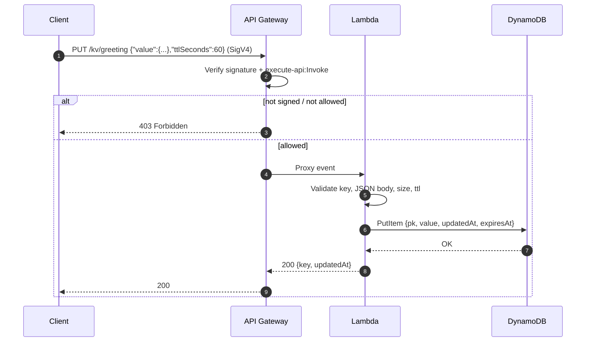
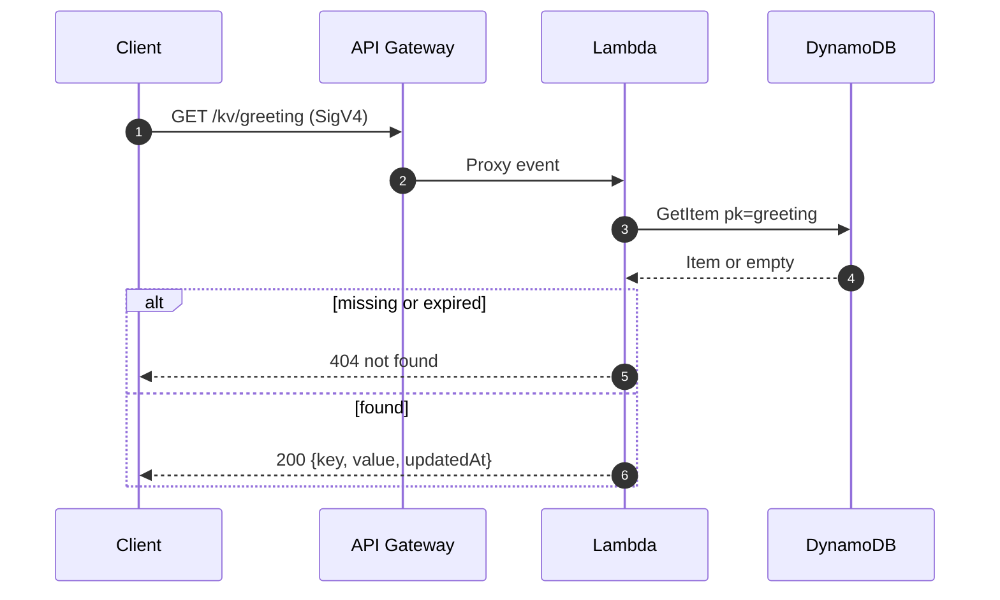
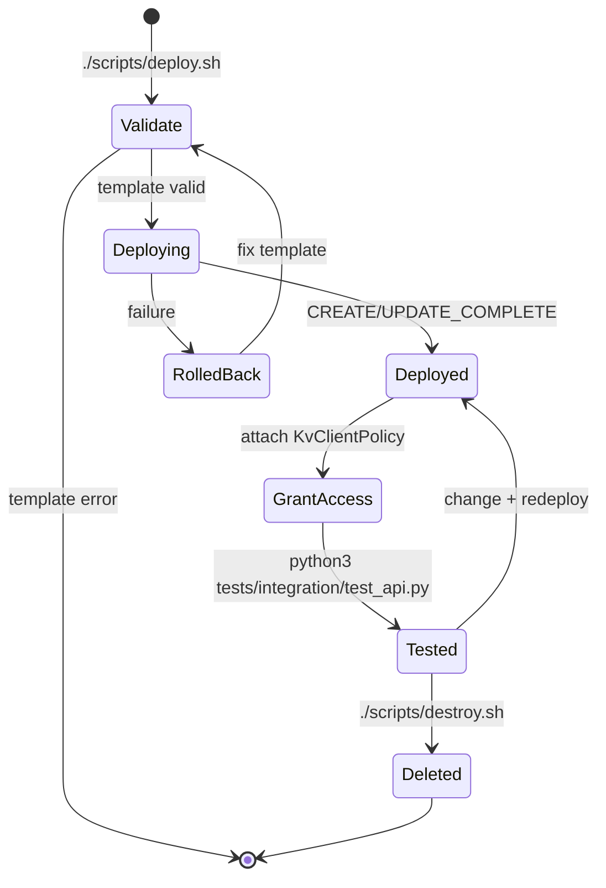

# Workflow · 01 Key-Value Store

[← Project README](../README.md)

## PUT a key

## GET a key

`DELETE /kv/{key}` follows the same path with `DeleteItem` (`ReturnValues=ALL_OLD` → 404 if nothing existed). `GET /kv` runs a `Scan` limited to 100 keys.

## Deploy lifecycle

## Smoke test checks (`tests/integration/test_api.py`)

| # | Check | Expected |
|---|-------|----------|
| 1 | Unsigned `GET /kv` | 403 (IAM gate works) |
| 2 | `PUT /kv/greeting` | 200 |
| 3 | `GET /kv/greeting` | 200, value matches |
| 4 | `GET /kv` | 200, contains `greeting` |
| 5 | `DELETE /kv/greeting` | 200 |
| 6 | `GET /kv/greeting` | 404 |
