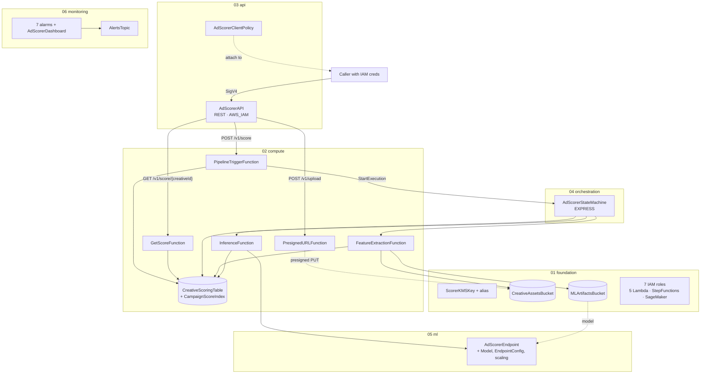
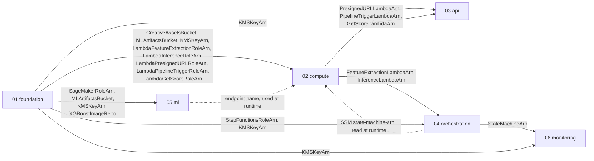
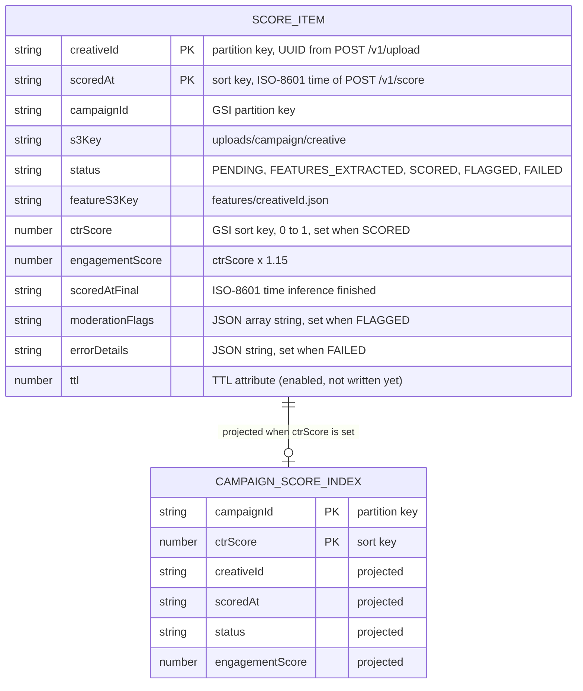
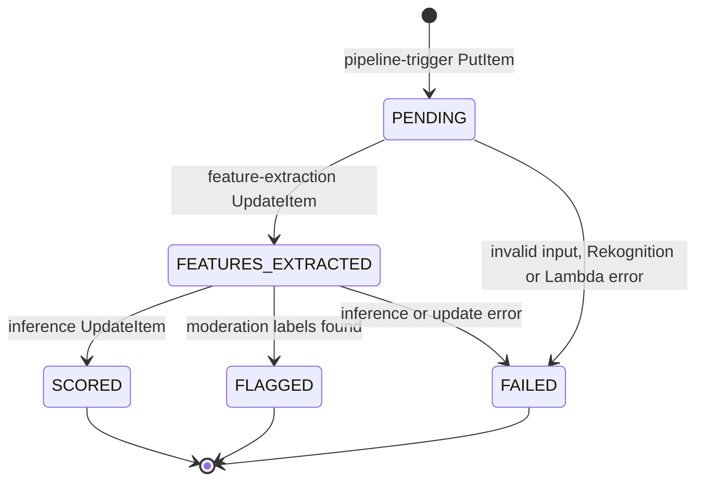

# Architecture · 02 Ad Creative Scorer

[← Project README](../README.md) · [Architecture image](images/architecture.png) · [Workflows](workflow.md)

## Components per stack

Six stacks, deployed in order by [`scripts/deploy.sh`](../scripts/deploy.sh). Stack names are `ad-scorer-<env>-<suffix>`.



### 01 foundation ([`01-foundation.yaml`](../infrastructure/01-foundation.yaml))

| Logical ID | Type | Purpose |
|------------|------|---------|
| `ScorerKMSKey`, `ScorerKMSAlias` | `AWS::KMS::Key`, `AWS::KMS::Alias` | One CMK (rotation on, Retain) for all data at rest; alias `alias/ad-scorer-<env>-key` |
| `CreativeAssetsBucket` + `CreativeAssetsBucketPolicy` | `AWS::S3::Bucket`, `BucketPolicy` | Uploaded creatives under `uploads/`. SSE-KMS, versioned, Glacier after `RetentionDays` (90), EventBridge notifications on, BPA on, TLS-only, Retain |
| `MLArtifactsBucket` + `MLArtifactsBucketPolicy` | `AWS::S3::Bucket`, `BucketPolicy` | `training-data/`, `models/`, `checkpoints/`, `features/`, `data-capture/`. SSE-KMS, versioned, BPA on, TLS-only, Retain |
| `LambdaFeatureExtractionRole` | `AWS::IAM::Role` | `s3:GetObject` on `uploads/*`, `s3:PutObject` on `features/*`, 4 Rekognition `Detect*`, `dynamodb:UpdateItem`, KMS, X-Ray, own logs |
| `LambdaInferenceRole` | `AWS::IAM::Role` | `sagemaker:InvokeEndpoint` on the one endpoint, `dynamodb:UpdateItem`, KMS, X-Ray, own logs |
| `LambdaPresignedURLRole` | `AWS::IAM::Role` | `s3:PutObject` on `uploads/*`, `kms:GenerateDataKey`, X-Ray, own logs |
| `LambdaPipelineTriggerRole` | `AWS::IAM::Role` | `dynamodb:PutItem`, KMS, `states:StartExecution` on the pipeline, `ssm:GetParameter` on its ARN parameter, X-Ray, own logs |
| `LambdaGetScoreRole` | `AWS::IAM::Role` | Read-only: `dynamodb:Query`, `kms:Decrypt`/`DescribeKey`, X-Ray, own logs |
| `SageMakerExecutionRole` | `AWS::IAM::Role` | ML bucket read/write, KMS (+ `CreateGrant` for AWS resources), ECR pull of `sagemaker-xgboost`, `/aws/sagemaker/*` logs, namespace-scoped metrics |
| `StepFunctionsRole` | `AWS::IAM::Role` | Invoke the 2 pipeline Lambdas, `dynamodb:UpdateItem`, KMS, `events:PutEvents` on the default bus, X-Ray, log delivery |
| `SSMCreativeAssetsBucketName`, `SSMMLArtifactsBucketName`, `SSMKMSKeyArn` | `AWS::SSM::Parameter` | Resource names under `/ad-scorer/<env>/` for scripts and tools |
| Mapping `XGBoostRegistry` | Mapping | XGBoost image account for us-east-1, us-east-2, us-west-2, eu-west-1 (other regions fail at `FindInMap`) |

### 02 compute ([`02-compute-and-storage.yaml`](../infrastructure/02-compute-and-storage.yaml))

| Logical ID | Type | Purpose |
|------------|------|---------|
| `CreativeScoringTable` | `AWS::DynamoDB::Table` | Score records (see [data model](#data-model)). On-demand by default, SSE-KMS with the CMK, PITR on, TTL attribute `ttl`, Delete with stack |
| `PresignedURLFunction` | `AWS::Lambda::Function` | [`src/presigned_url`](../src/presigned_url/handler.py), 256 MB, 30 s. `POST /v1/upload` |
| `PipelineTriggerFunction` | `AWS::Lambda::Function` | [`src/pipeline_trigger`](../src/pipeline_trigger/handler.py), 256 MB, 30 s. `POST /v1/score`; reads the state machine ARN from SSM at runtime |
| `GetScoreFunction` | `AWS::Lambda::Function` | [`src/get_score`](../src/get_score/handler.py), 256 MB, 10 s. `GET /v1/score/{creativeId}` |
| `FeatureExtractionFunction` | `AWS::Lambda::Function` | [`src/feature_extraction`](../src/feature_extraction/handler.py), 1024 MB, 300 s, reserved concurrency 50. `ExtractFeatures` state |
| `InferenceFunction` | `AWS::Lambda::Function` | [`src/inference`](../src/inference/handler.py), 512 MB, 60 s. `RunInference` state |
| `FeatureExtractionLogGroup`, `InferenceLambdaLogGroup`, `PresignedURLLogGroup`, `PipelineTriggerLogGroup`, `GetScoreLogGroup` | `AWS::Logs::LogGroup` | `/aws/lambda/ad-scorer-<fn>-<env>`, 30 days, KMS |

All five functions run Python 3.12 with X-Ray active tracing, use `Handler: handler.handler`, and are packaged from `Code: ../src/<fn>/`.

### 03 api ([`03-api-gateway.yaml`](../infrastructure/03-api-gateway.yaml))

| Logical ID | Type | Purpose |
|------------|------|---------|
| `AdScorerAPI` | `AWS::ApiGateway::RestApi` | REGIONAL REST API `ad-scorer-api-<env>` |
| `V1Resource`, `UploadResource`, `ScoreResource`, `ScoreByIdResource` | `AWS::ApiGateway::Resource` | `/v1`, `/v1/upload`, `/v1/score`, `/v1/score/{creativeId}` |
| `UploadPostMethod`, `ScorePostMethod`, `ScoreGetMethod` | `AWS::ApiGateway::Method` | `AWS_IAM` auth, `AWS_PROXY` to the 3 API Lambdas |
| `RequestBodyValidator`, `UploadRequestModel`, `ScoreRequestModel` | Validator, `Model` | JSON Schema checks on POST bodies (enum content types, ID patterns) |
| `PresignedURLLambdaPermission`, `PipelineTriggerLambdaPermission`, `GetScoreLambdaPermission` | `AWS::Lambda::Permission` | Each Lambda invocable only by its own method and path |
| `APIDeployment`, `APIStage` | Deployment, `Stage` | Stage `<env>`: throttle 50 rps / burst 100, X-Ray, metrics, ERROR logging, JSON access logs |
| `APIAccessLogGroup` | `AWS::Logs::LogGroup` | `/aws/apigateway/ad-scorer-access-<env>`, 30 days, KMS |
| `APIGatewayCloudWatchRole`, `APIGatewayAccount` | IAM role, `AWS::ApiGateway::Account` | Lets API Gateway write logs (per-region account setting) |
| `AdScorerClientPolicy` | `AWS::IAM::ManagedPolicy` | `execute-api:Invoke` on `<api>/<env>/*/v1/*`; attach to callers |
| `AdScorerAPIKey`, `AdScorerUsagePlan`, `APIKeyUsagePlanLink` | API key, usage plan | Only when `EnableAPIKey=true` (default `false`); 10,000 requests/day quota, not auth |

### 04 orchestration ([`04-step-functions.yaml`](../infrastructure/04-step-functions.yaml))

| Logical ID | Type | Purpose |
|------------|------|---------|
| `AdScorerStateMachine` | `AWS::StepFunctions::StateMachine` | EXPRESS `ad-scorer-pipeline-<env>`, logging `ALL` with execution data, X-Ray. States in [workflow.md](workflow.md#step-functions-state-machine) |
| `StateMachineLogGroup` | `AWS::Logs::LogGroup` | `/aws/states/ad-scorer-pipeline-<env>`, 30 days, KMS |
| `SSMStateMachineArn` | `AWS::SSM::Parameter` | `/ad-scorer/<env>/stepfunctions/state-machine-arn`, read by the trigger Lambda |

### 05 ml ([`05-sagemaker.yaml`](../infrastructure/05-sagemaker.yaml))

| Logical ID | Type | Purpose |
|------------|------|---------|
| `AdScorerModel` | `AWS::SageMaker::Model` | Built-in XGBoost `1.7-1` image, `ModelDataUrl` = `s3://<ml-bucket>/<ModelS3Key>`, network isolation. Name generated so a new model can replace it |
| `AdScorerEndpointConfig` | `AWS::SageMaker::EndpointConfig` | Variant `Primary`, `InferenceInstanceType` (default `ml.t2.medium`), 1 instance, KMS, data capture of 20 % of input/output to `data-capture/` |
| `AdScorerEndpoint` | `AWS::SageMaker::Endpoint` | Fixed name `ad-scorer-scoring-endpoint-<env>` (used by the inference Lambda, its role, and the alarms) |
| `EndpointScalingTarget`, `EndpointScalingPolicy` | Application Auto Scaling | 1–10 instances, target 70 invocations/instance, scale-out cooldown 60 s, scale-in 300 s |
| `SSMEndpointName` | `AWS::SSM::Parameter` | `/ad-scorer/<env>/sagemaker/endpoint-name` |

The training job is not a stack resource. [`scripts/train.sh`](../scripts/train.sh) runs it with the CLI and prints the `ModelS3Key` parameter value.

### 06 monitoring ([`06-monitoring.yaml`](../infrastructure/06-monitoring.yaml))

| Logical ID | Type | Purpose |
|------------|------|---------|
| `AlertsTopic` | `AWS::SNS::Topic` | KMS-encrypted, email subscription to `AlertEmail` |
| `FeatureExtractionErrorAlarm`, `InferenceLambdaErrorAlarm` | `AWS::CloudWatch::Alarm` | Lambda `Errors` ≥ `LambdaErrorThreshold` (5) in 5 min |
| `SageMakerLatencyAlarm` | `AWS::CloudWatch::Alarm` | Endpoint p99 `ModelLatency` > `SageMakerLatencyThresholdMicros` (500000 µs) for 2 periods |
| `SageMakerInvocationErrorAlarm` | `AWS::CloudWatch::Alarm` | `Invocation4XXErrors` ≥ 5 in 5 min |
| `APIGateway5xxAlarm` | `AWS::CloudWatch::Alarm` | `5XXError` ≥ `APIGateway5xxThreshold` (10) in 5 min |
| `StepFunctionsFailureAlarm` | `AWS::CloudWatch::Alarm` | `ExecutionsFailed` ≥ 3 in 5 min |
| `DynamoDBThrottleAlarm` | `AWS::CloudWatch::Alarm` | `ThrottledRequests` ≥ 10 in 5 min |
| `AdScorerDashboard` | `AWS::CloudWatch::Dashboard` | Lambda errors and p99 duration, SageMaker latency, API requests/errors, Step Functions executions, DynamoDB capacity |

## Stack dependencies

Arrows point from the exporting stack to the importing stack. Labels are the export names, without the `ad-scorer-<env>-` prefix.



Dotted links are by name, not by import, so stack 02 can deploy before 04 and 05:

- The trigger Lambda reads the SSM parameter `/ad-scorer/<env>/stepfunctions/state-machine-arn` (written by 04) on its first request.
- The inference Lambda calls the endpoint `ad-scorer-scoring-endpoint-<env>` (created by 05). Until 05 exists, `RunInference` fails and items end `FAILED`.
- Stack 06 alarms refer to the endpoint, table and API by name, so 06 deploys even when 05 is skipped.

## Data model



- Each `POST /v1/score` writes a new item with a new `scoredAt`, so one creative can have several records. `GET /v1/score/{creativeId}` returns the newest (`ScanIndexForward=False, Limit=1`).
- `CampaignScoreIndex` (projection `INCLUDE`) is sparse: only `SCORED` items have `ctrScore`, so only they appear. It supports "top creatives in a campaign" queries; no API uses it yet.

Item status lifecycle:



## Training CSV schema

`scripts/train.sh` reads CSV files (no header row; XGBoost reads raw CSV) from the ML artifacts bucket:

```text
s3://ad-scorer-ml-artifacts-<account>-<env>/
  training-data/
    train/          ← 80% of labelled creative data
      creative_features.csv
    validation/     ← 20% of labelled creative data
      creative_features.csv
```

```text
<label>,<face_present>,<face_count>,<emotion_confidence>,<word_count>,<label_count>,<moderation_flag_count>,<color_saturation>
```

| Column Index | Feature Name           | Type  | Notes                             |
|-------------|------------------------|-------|-----------------------------------|
| 0           | label (CTR)            | float | 1 = clicked, 0 = not clicked. For regression: actual CTR float (0.0–1.0) |
| 1           | face_present           | int   | 0 or 1                            |
| 2           | face_count             | int   | Number of faces detected          |
| 3           | emotion_confidence     | float | Confidence of dominant emotion    |
| 4           | word_count             | int   | Words detected by Rekognition OCR |
| 5           | label_count            | int   | Number of Rekognition object labels |
| 6           | moderation_flag_count  | int   | Number of moderation labels       |
| 7           | color_saturation       | float | 0.0–1.0 (compute via PIL/Pillow)  |

Example rows:

```text
1,1,2,94.5,8,14,0,0.72
0,0,0,0.0,24,6,0,0.41
1,1,1,87.2,3,18,0,0.85
0,0,0,0.0,0,2,1,0.30
```

Columns 1–7 must stay in the order of `feature_vector()` in [`src/inference/handler.py`](../src/inference/handler.py), which builds the same 7 values from the Rekognition features at scoring time. Two caveats: the feature Lambda does not compute `color_saturation` yet, so inference always sends `0.5`; and the default objective `binary:logistic` expects 0/1 labels (set `HP_OBJECTIVE=reg:squarederror` or similar for CTR floats).

## Design decisions

| Decision | Chosen | Alternatives | Why |
|----------|--------|--------------|-----|
| Upload path | Presigned S3 PUT URL | Upload through API Gateway | API Gateway payloads cap at 10 MB; S3 takes the bytes directly and the URL is limited to one key under `uploads/` |
| Scoring style | Async: `202` then poll | Synchronous API call | Rekognition + inference can take seconds; API Gateway integrations time out at 29 s |
| Orchestration | Step Functions EXPRESS | STANDARD, Lambda chaining | Short runs (<5 min), cheap per execution, built-in retries, catches and direct DynamoDB/EventBridge integrations |
| Input validation in the pipeline | `Choice` state | Lambda `VALIDATE` call | No extra Lambda cost or second Rekognition run; the trigger already validates |
| Feature extraction | Rekognition `DetectLabels/Faces/Text/ModerationLabels` | Custom CV model | Managed, no training; moderation labels double as a safety gate |
| Model | SageMaker built-in XGBoost, real-time endpoint | Serverless Inference, Batch Transform | Tabular features, low latency; serverless/batch listed as next steps for cost |
| Training | `scripts/train.sh` (CLI) | `AWS::SageMaker::TrainingJob` | CloudFormation has no training-job resource; a script waits for completion and prints the model key |
| Auth | IAM / SigV4 on every method | API key, Cognito | Callers are AWS principals; API keys are not authentication |
| IAM | One role per function, plus SFN and SageMaker roles | Shared role, managed full-access policies | Each component gets only the actions and resources it uses |
| Encryption | One customer-managed KMS key | AWS-owned keys | One key policy covers S3, DynamoDB, logs, SNS and SageMaker; access is auditable |
| Stack split | 6 stacks, numbered | One stack | Layers change at different rates; the ML stack can only deploy after training |
| Code packaging | `src/` + `aws cloudformation package` | Inline `ZipFile` | Real files are lintable and testable |
| Cross-stack links | Exports for deploy-time values, SSM/name for runtime | Exports only | Lets 02 deploy before 04 and 05 exist |
| Data retention | Retain buckets + key; delete table and logs | Retain everything | Creatives, training data and models are source data; scores are derived |

## Limits

- Express executions: 5 minutes in total. `ExtractFeatures` times out at 300 s and `RunInference` at 60 s.
- Rekognition image APIs accept JPEG and PNG only (max 15 MB from S3). GIF, WebP and video uploads are accepted by the API but end `FAILED`.
- API stage throttle: 50 rps steady, 100 burst.
- Presigned URLs expire after 3600 s, or earlier if the Lambda's session credentials expire first.
- Regions: the 4 in the `XGBoostRegistry` mapping.
