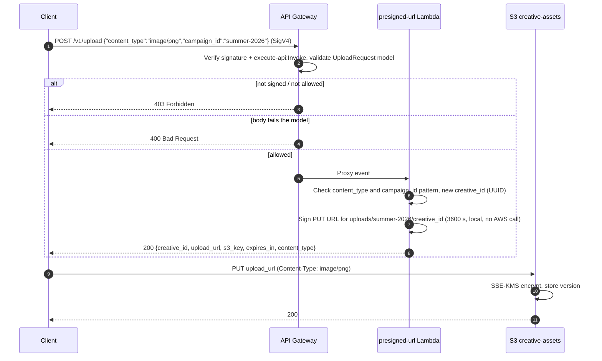
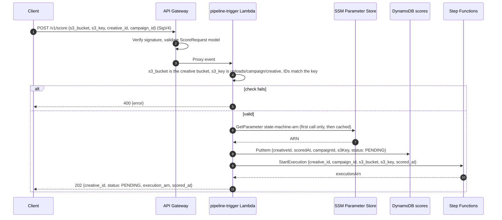
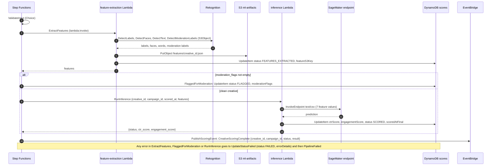
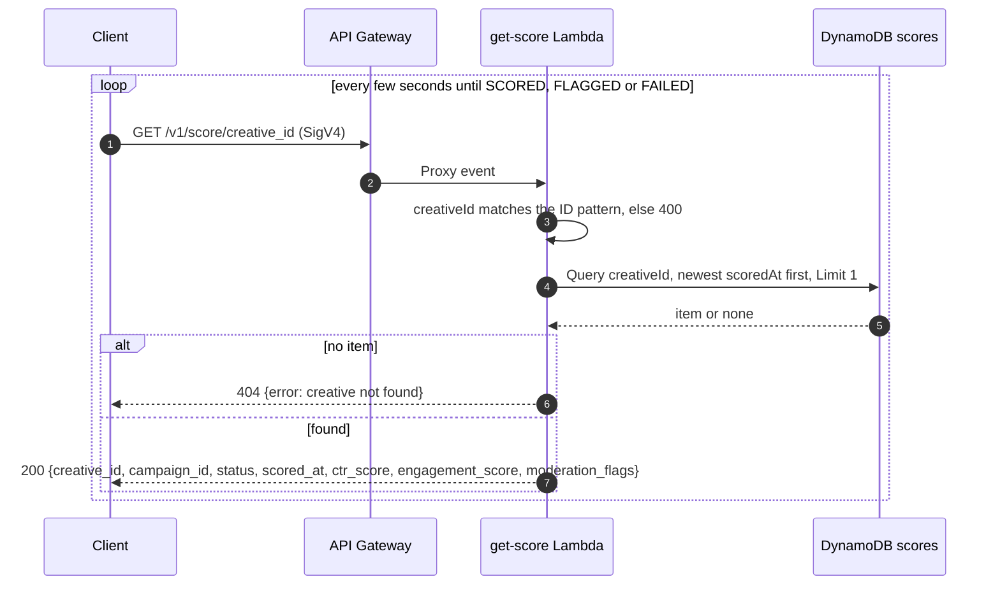
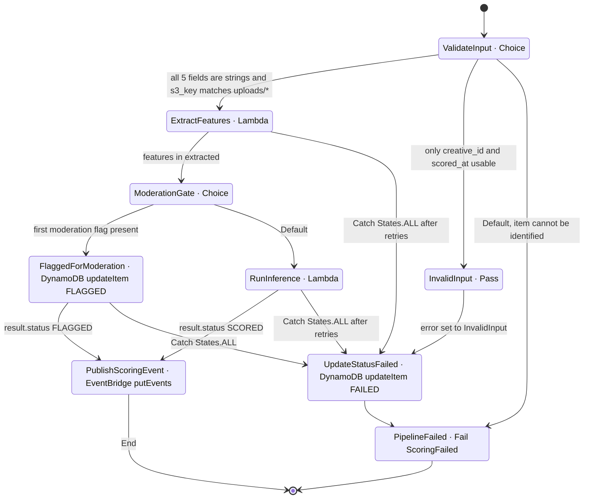
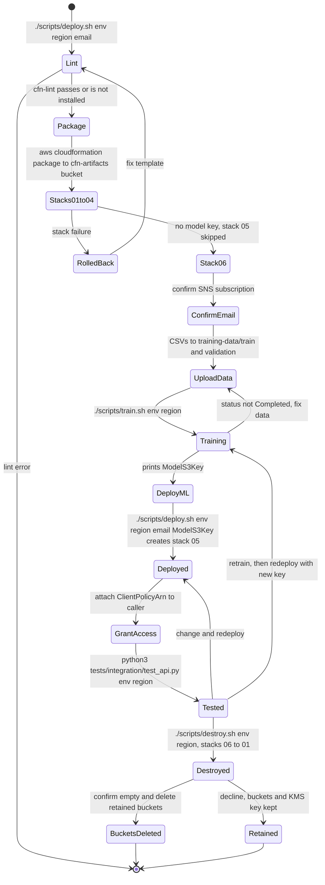

# Workflow · 02 Ad Creative Scorer

[← Project README](../README.md) · [Architecture](architecture.md)

## 1. Get an upload URL and upload the creative

## 2. Submit for scoring

## 3. Pipeline run (async)

## 4. Poll for the result

## Step Functions state machine

Mirrors the ASL in [`04-step-functions.yaml`](../infrastructure/04-step-functions.yaml) (`AdScorerStateMachine`, EXPRESS).

| State | Type | Retry | On error |
|-------|------|-------|----------|
| `ValidateInput` | Choice | — | — |
| `InvalidInput` | Pass (sets `$.error`) | — | — |
| `ExtractFeatures` | Task `lambda:invoke`, 300 s timeout | Lambda service/throttle errors and Rekognition throughput: 3 attempts, 5 s × 2 backoff, full jitter | `UpdateStatusFailed` |
| `ModerationGate` | Choice on `$.extracted.features.moderation_flags[0]` | — | — |
| `FlaggedForModeration` | Task `dynamodb:updateItem` | — | `UpdateStatusFailed` |
| `RunInference` | Task `lambda:invoke`, 60 s timeout | `Lambda.ServiceException`, `SageMaker.ModelError`: 2 attempts, 3 s × 1.5 | `UpdateStatusFailed` |
| `PublishScoringEvent` | Task `events:putEvents` (source `ad-scorer.scorer`) | — | none (execution fails; item keeps its SCORED/FLAGGED status) |
| `UpdateStatusFailed` | Task `dynamodb:updateItem` | — | — |
| `PipelineFailed` | Fail (`ScoringFailed`) | — | Counted by the `ExecutionsFailed` alarm |

## Deploy lifecycle

Each `deploy.sh` run deploys stacks in order 01, 02, 03, 04, then 05 (only with a model key), then 06, using `--no-fail-on-empty-changeset`, so rerunning it only changes what changed. A new `ModelS3Key` replaces the model and endpoint config; the endpoint keeps its name. The KMS key always survives `destroy.sh`, and the script prints the `schedule-key-deletion` command.

## Integration test checks (`tests/integration/test_api.py`)

| # | Check | Expected |
|---|-------|----------|
| 1 | Unsigned `POST /v1/upload` | 403 (IAM gate) |
| 2 | Unsigned `GET /v1/score/{id}` | 403 (IAM gate) |
| 3 | `POST /v1/upload` with `campaign_id` `../evil` | 400 |
| 4 | `POST /v1/upload` | 200 with `upload_url` |
| 5 | `PUT` a generated 128×128 PNG to the presigned URL | 200 |
| 6 | `POST /v1/score` with a foreign bucket | 400 |
| 7 | `POST /v1/score` | 202, `status` `PENDING` |
| 8 | Poll `GET /v1/score/{id}` for up to 90 s | `SCORED` or `FLAGGED` |
| 9 | `GET /v1/score/does-not-exist-0000` | 404 |

Check 8 needs all six stacks, including a trained model in stack 05.
