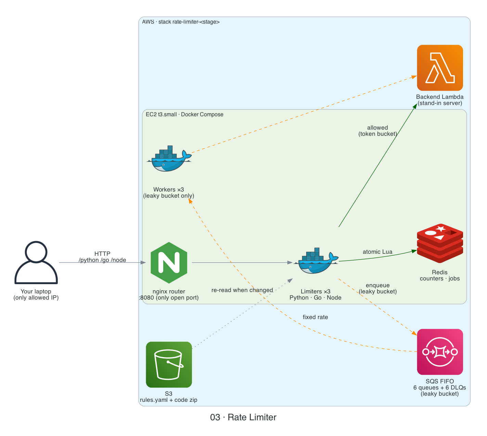
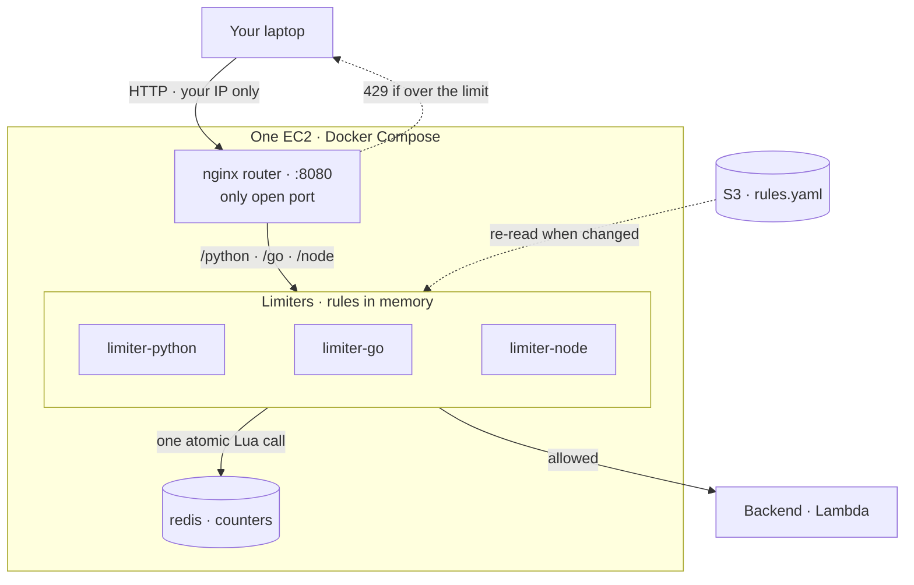

# 03 · Rate Limiter


[← Portfolio](../README.md) · [Architecture](docs/architecture.md) · [Workflows](docs/workflow.md) · [Template](infrastructure/template.yaml) · [Code](src/)



## Summary

A rate limiter that sits **between the client and the servers** ([why there](docs/architecture.md#where-the-rate-limiter-sits)). It runs on one EC2 with Docker Compose, keeps its counters in Redis, and sends allowed requests to a Lambda backend (a cheap stand-in for a real server). Rule one: **measure the latency at every step**.

The project is built in small steps. Each step is designed and agreed before it's built.

| Fact | Value |
|------|-------|
| Status | 🟡 Prototype: token bucket deployed and measured; leaky bucket, sliding window log and fixed window counter built, not deployed yet |
| Where it runs | One EC2 (t3.small) + Docker Compose: nginx router, one limiter per language, Redis |
| Languages | Python, Go, Node (same algorithm, compared side by side) |
| Algorithms | [Token bucket](docs/token_bucket/README.md) · [Leaky bucket (SQS queue)](docs/leaky_bucket/README.md) · [Sliding window log](docs/sliding_window_log/README.md) · [Fixed window counter](docs/fixed_window_counter/README.md) ([comparison](docs/architecture.md#algorithm-comparison)) |
| Who is limited | User id + cookie + IP, checked together ([details](docs/architecture.md#identifying-the-caller)) |
| Rules | `rules.yaml` in S3, kept in limiter memory, re-read when it changes |
| Backend | AWS Lambda (stand-in for a real server) |
| Access | Public IP, but only the owner's IP is allowed (added by hand). No auth, short-lived test only ([details](docs/architecture.md#security)) |
| Infra as code | [`infrastructure/template.yaml`](infrastructure/template.yaml) |
| Cost | $0 once deleted; small hourly EC2 cost while running |

## Architecture



The leaky bucket adds SQS queues and one worker per language to this picture: see [its diagram](docs/leaky_bucket/README.md#how-it-works).

## Latency

Every step adds a row here.

| Step | What changed | Latency | Notes |
|------|--------------|---------|-------|
| 1 | Token bucket, phase 1: t3.small, nginx → limiter → Redis (same box) → Lambda backend, us-east-1 | Limiter overhead **~0.3–0.7 ms** p50; Redis call **0.31–0.53 ms** p50 | Lambda invoke (~20 ms) is most of the server time; client round trip ~122–125 ms is mostly the laptop → us-east-1 link |

<details><summary>Step 1 · full results per language (100 requests each, ~6 req/s, all allowed)</summary>

| Language | client p50 | client p99 | server total p50 | redis p50 | redis p99 | backend p50 | limiter overhead p50 (total − backend) |
|---|---|---|---|---|---|---|---|
| Python | 125.22 | 144.55 | 22.30 | 0.53 | 1.01 | 21.63 | ~0.67 |
| Go | 122.19 | 134.96 | 19.89 | 0.31 | 2.29 | 19.55 | ~0.34 |
| Node | 123.18 | 134.85 | 20.57 | 0.47 | 0.79 | 19.99 | ~0.58 |

All values in ms. Not yet measured: the nginx router hop (from the router's `request_time − upstream_time` log). At this light load the three languages are within ~0.3 ms of each other; Go has the fastest Redis p50 but a higher p99 outlier.

</details>

## How it works

| Step | What happens |
|------|--------------|
| 1 | You call `http://<ip>:8080/<language>/...`. nginx sends it to that language's limiter. |
| 2 | The limiter works out who you are (user id, cookie, IP) and which rules apply. |
| 3 | One Redis call runs the algorithm's Lua script on all your counters at once. |
| 4 | Allowed → the request goes to the backend. Not allowed → `429` + `Retry-After`. |
| 5 | Every response has a `Server-Timing` header showing where the time went. |

| Read next | For |
|-----------|-----|
| [docs/architecture.md](docs/architecture.md) | Placement, identity, rules, security, all decisions |
| [docs/workflow.md](docs/workflow.md) | Deploy → boot → test → destroy, step by step |
| [Token bucket README](docs/token_bucket/README.md) | Algorithm 1, its Redis data and memory sizing |
| [Leaky bucket README](docs/leaky_bucket/README.md) | Algorithm 2, the queue, API and retries |
| [Sliding window log README](docs/sliding_window_log/README.md) | Algorithm 3, exact window, its Redis data and memory sizing |
| [Fixed window counter README](docs/fixed_window_counter/README.md) | Algorithm 4, cheap counter, the boundary weakness, memory sizing |

## Repo layout

```text
03-rate-limiter/
├── README.md                 ← this file
├── docs/
│   ├── architecture.md       ← placement, routing, identity, security, decisions
│   ├── workflow.md           ← deploy lifecycle and request flow
│   ├── token_bucket/         ← README.md (how it works, Redis data) + CODE_STRUCTURE.md (Merkle-tree file map)
│   ├── leaky_bucket/         ← README.md (queue, API, retries) + CODE_STRUCTURE.md (Merkle-tree file map)
│   ├── sliding_window_log/   ← README.md + CODE_STRUCTURE.md
│   ├── fixed_window_counter/ ← README.md + CODE_STRUCTURE.md
│   ├── diagram.py            ← diagram-as-code (AWS icons)
│   └── images/architecture.png
├── infrastructure/
│   └── template.yaml         ← CloudFormation stack
├── src/
│   ├── token_bucket/
│   │   ├── token_bucket.lua  ← the algorithm (runs in Redis)
│   │   ├── rules.yaml        ← rate limit rules
│   │   ├── docker-compose.yml, router/nginx.conf
│   │   └── python/ go/ node/ ← one limiter server per language
│   ├── leaky_bucket/
│   │   ├── accept.lua, finish.lua ← door guard and job bookkeeping (run in Redis)
│   │   ├── rules.yaml        ← tiers, queue settings, poll limits
│   │   ├── docker-compose.yml
│   │   └── python/ go/ node/ ← one limiter server and one worker per language
│   ├── sliding_window_log/   ← sliding_window_log.lua, rules.yaml, docker-compose.yml, python/ go/ node/
│   ├── fixed_window_counter/ ← fixed_window_counter.lua, rules.yaml, docker-compose.yml, python/ go/ node/
│   └── backend/handler.py    ← backend Lambda (token bucket call, plus chat mode for the leaky bucket)
├── tests/
│   └── integration/
│       ├── latency.py        ← token bucket live test
│       ├── leaky_latency.py  ← leaky bucket live test (bursts, polling, failure, p50/p90)
│       ├── window_latency.py ← window algorithms live test (limit, boundary, p50/p90/p99)
│       └── sigv4.py          ← helper
└── scripts/
    ├── deploy.sh             ← lint, package src/, deploy, print outputs
    └── destroy.sh            ← delete stack
```

## Deploy / Test / Teardown

The third `deploy.sh` argument picks the algorithm (default `token_bucket`). Step-by-step manual version: [docs/workflow.md](docs/workflow.md).

| Algorithm | 1. Deploy (~5–15 min) | 3. Test |
|-----------|-----------------------|---------|
| Token bucket | `./scripts/deploy.sh dev us-east-1` | `python3 tests/integration/latency.py http://<PublicIp>:8080 100` |
| Leaky bucket | `./scripts/deploy.sh dev us-east-1 leaky_bucket` | `python3 tests/integration/leaky_latency.py http://<PublicIp>:8080 3` (3 rounds per language) |
| Sliding window log | `./scripts/deploy.sh dev us-east-1 sliding_window_log` | `python3 tests/integration/window_latency.py http://<PublicIp>:8080 sliding_window_log 100` |
| Fixed window counter | `./scripts/deploy.sh dev us-east-1 fixed_window_counter` | `python3 tests/integration/window_latency.py http://<PublicIp>:8080 fixed_window_counter 100` |

| Step (all algorithms) | What to do |
|------|------------|
| 2. Allow your IP | Console: add ONE inbound rule to the `SecurityGroupId` output: TCP 8080, `<your-ip>/32` |
| 4. Tear down | `./scripts/destroy.sh dev us-east-1` |

Run from `03-rate-limiter`.

| Good to know | |
|--------------|---|
| Leaky bucket extras | Adds 6 SQS FIFO queues + 6 dead-letter queues. The template needs `CAPABILITY_AUTO_EXPAND`, which the script passes. |
| Change only `rules.yaml` | Re-run `deploy.sh`; limiters pick it up within ~30 s, no instance replacement. |
| Change code | The instance is replaced (new public IP; your security group rule stays). |
| Org-managed accounts | If `iam:DeleteRole` is denied, `destroy.sh` keeps the two IAM roles (free, unused) so the stack still finishes deleting, and lists them so you can remove them later. |

## Cost & security notes

| Topic | Note |
|-------|------|
| Cost | EC2 billed hourly while up; delete the stack after each test. |
| Access | Deliberate exception to the repo's IAM-auth default. Only the router port is open, to the owner's IP, added by hand (never stored in this repo). No SSH; SSM for shell. See [Security](docs/architecture.md#security). |
| Least privilege | Instance role can only invoke the backend Lambda and read `rules.yaml`. With the leaky bucket it may also use this stage's `rate-limiter-<stage>-*` SQS queues, and nothing else. |
| Data | Test data only (plain HTTP). Redis is never published. |

## What I learned / next steps

| Done | |
|------|---|
| ✅ Token bucket | Lua, multi-bucket, all-or-nothing ([details](docs/token_bucket/README.md)) |
| ✅ Limiter servers | Python, Go, Node |
| ✅ Router + Compose | nginx, Redis with a password, one published port |
| ✅ CloudFormation | VPC, EC2 t3.small, security group (no inbound), instance role, backend Lambda (cfn-lint clean) |
| ✅ Scripts + live test | `deploy.sh`, `destroy.sh`, `tests/integration/latency.py` |
| ✅ Token bucket live run | Deployed, tested, step 1 latency recorded |
| ✅ Leaky bucket design | SQS FIFO per language and tier, the worker sets the rate, Redis is the door guard, 2 minute retention, 5 attempts then failed ([details](docs/leaky_bucket/README.md)) |
| ✅ Leaky bucket code | `accept.lua`, `finish.lua`, limiter + worker in 3 languages, Compose, `Algorithm` parameter, queues + dead-letter queues, `deploy.sh` third argument |
| ✅ Leaky bucket test script | `tests/integration/leaky_latency.py` (checked against a local stand-in only) |
| ✅ Architecture image | `docs/diagram.py` → `docs/images/architecture.png`, both algorithms |
| ✅ Sliding window log + fixed window counter | Lua scripts, limiters in 3 languages, Compose, `Algorithm` values, `deploy.sh` names, `window_latency.py` (checked against a local stand-in only) ([comparison](docs/architecture.md#algorithm-comparison)) |

| Next | |
|------|---|
| ⬜ Leaky bucket live run | Deploy with `leaky_bucket`, run the live test, record its latency |
| ⬜ Window algorithms live run | Deploy with `sliding_window_log` and `fixed_window_counter`, run `window_latency.py`, record latency and the boundary result |
| ⬜ Phase 2 | Scale out (more instances, ElastiCache), more algorithms |
