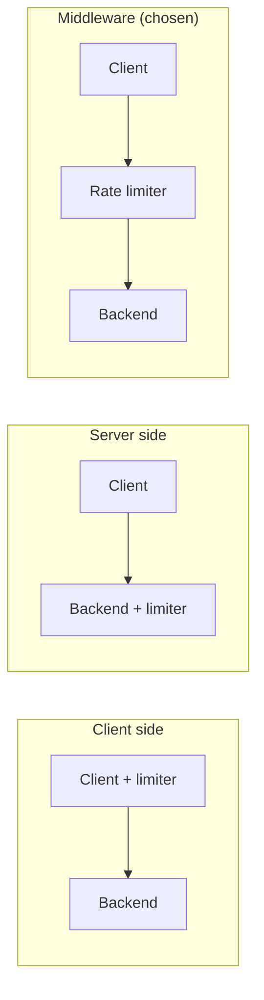
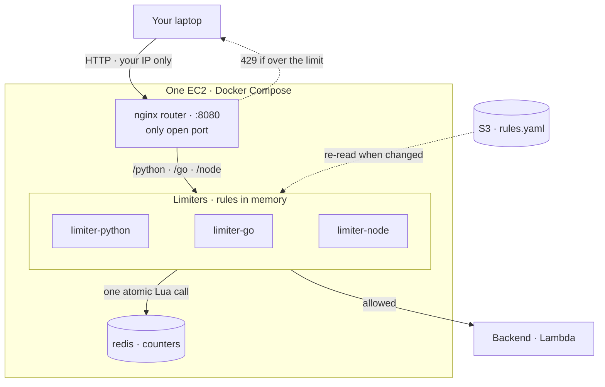
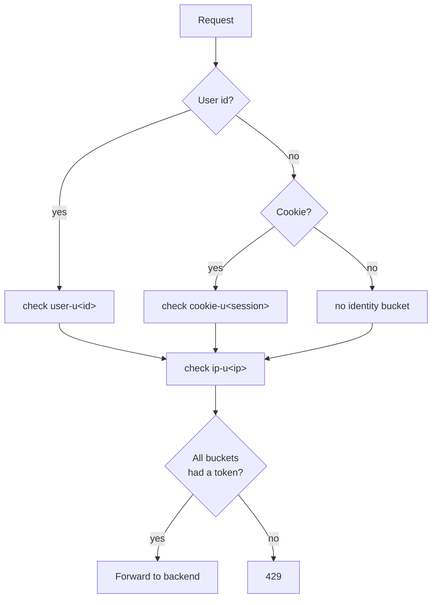

# Architecture · 03 Rate Limiter

[← Project README](../README.md) · [Architecture image](images/architecture.png) · [Workflows](workflow.md)

This page covers what every algorithm shares: where the limiter sits, the setup, who gets limited, where rules live, security and decisions. Each algorithm's own details are in its folder ([token bucket](token_bucket/README.md), [leaky bucket](leaky_bucket/README.md)).

## Where the rate limiter sits



| | Client side | Server side (inside the backend) | **Middleware (chosen)** |
|---|---|---|---|
| Can the caller bypass it? | Yes: the client controls the code, and other callers (scripts, curl, other SDKs) ignore it | No | No |
| Rejected requests reach the backend? | Yes | Yes: every request runs the backend first. On Lambda that's a paid invocation and used concurrency | **No: only allowed traffic gets through** |
| Protects against floods? | No | No: a spike still uses up backend capacity before being rejected | Yes |
| Shared counters | n/a | Needed: many stateless copies (e.g. Lambda), so in-memory counts are wrong and must live in an external store, adding a hop | Needed once it runs on more than one instance |
| Race conditions | n/a | Copies update one counter at once, so increments must be atomic | Same, solved with atomic Lua in Redis |
| Coupling | n/a | Limit logic mixed with business logic; every service repeats it; changing a limit means redeploying | Limits live in one place |
| Good for | Being polite only | | Enforcing limits |

What we accept with middleware, and measure:

| Trade-off | What it means |
|-----------|---------------|
| Extra hop | Every request passes through it. This is the latency we track at every step. |
| Critical dependency | It must scale with traffic, and we must choose fail open or fail closed (parked for now). |

## The setup



| Piece | Job | On every request? |
|-------|-----|-------------------|
| EC2 | One small x86 instance (t3.small) running Docker Compose. Deleted after each test | Yes |
| Router | nginx container. The only published port (8080). Routes `/python/...`, `/go/...`, `/node/...` to the matching limiter | Yes, small fixed hop |
| Limiter (per language) | Finds the rule (in memory), asks Redis, forwards or rejects | Yes |
| Redis | Holds the live counters ([token bucket data](token_bucket/README.md#data-model-redis)). Docker network only, never published, password required | Yes, one round trip |
| S3 | The source of truth for the rules (`rules.yaml`) | No |
| Backend | Lambda stand-in for a real server. Called with the EC2 instance role (SigV4). Only sees allowed requests | Only when allowed |
| SQS + workers | Leaky bucket only: the queue and the fixed-rate workers ([diagram](leaky_bucket/README.md#how-it-works)) | Leaky bucket only |

Rule format and example rules: [token bucket rules](token_bucket/README.md#rules).

| Why not Lambda for the limiter? | |
|---|---|
| Cold starts | Add latency that a real long-running server doesn't have |
| No shared memory | Each copy has its own memory |
| Needs a VPC | To reach Redis |
| Result | The numbers would mostly measure Lambda, not the limiter |

## Identifying the caller

### Possible identifiers

| Identifier | Where it comes from | Can the caller fake it? | Good for |
|------------|---------------------|-------------------------|----------|
| User id (authenticated) | Verified token (e.g. JWT `sub`) | No | Per-user fairness; most accurate |
| API key / client id | Header, checked against issued keys | No, once checked | Public APIs, partners, paid tiers |
| Account / tenant / org | Looked up from the user | No | One shared limit per company |
| IP address | Network connection | Hard to fake, but shared and changing | Anonymous traffic, login/sign-up |
| IP range (IPv4 /24, IPv6 /64) | Derived from the IP | Hard to fake | Attackers rotating nearby IPs |
| Session / cookie id | Cookie | Yes: clear it, get a new one | Logged-out website visitors |
| Device id | Mobile app install id | Yes: reinstall | Mobile apps |
| Global (no caller) | Nothing | n/a | Capping total backend load |

| Watch out for | Why |
|---------------|-----|
| Raw headers (`X-User-Id`, `X-Forwarded-For`) | The client can set them to anything. Trust only verified ids, or the IP our own nginx records. |
| Shared IPs | One IP can hide thousands of users (office, school, mobile carrier), so IP limits should be looser. |
| Device fingerprinting | Identifying users from browser/device traits without consent is a privacy problem. Not used. |

### Chosen: user id + cookie + IP, checked together

A request is allowed only if **every** bucket that applies to it has a token.

| Layer | Applies when | Key | Stops |
|-------|--------------|-----|-------|
| User id | Request has a user id | `user-u42` | One user overusing the API |
| Cookie | No user id, but has a session cookie | `cookie-u9f2c1a` | Logged-out visitors overusing it |
| IP | Always | `ip-u3405803783` | Anyone dodging the other layers (no id, clearing cookies), and floods from one address |



| Question | Answer |
|----------|--------|
| Why separate layers, not one combined key? | A combined key changes when any part changes, so clearing a cookie or switching networks would give a fresh, full bucket. With layers, the IP bucket still holds. |
| What if one layer says no? | All-or-nothing: no bucket loses a token. The Lua script checks every bucket in one Redis call ([details](token_bucket/README.md#the-lua-script)). |
| Test-only shortcut 1 | The user id comes from an `X-User-Id` header, which a caller can fake. In real use it would come from a verified login token. |
| Test-only shortcut 2 | The cookie is a random session id the client sends; we don't issue or sign it. |

## Where the rules are stored

**Chosen: S3.** Each limiter loads `rules.yaml` at startup and keeps it in memory. Every N seconds it asks S3 for the file only if the ETag changed; an unchanged file returns a tiny "not modified" answer. Reading a rule on a request is a memory lookup.

| Option | Cost | Read speed | Fits when |
|--------|------|-----------|-----------|
| **S3 (YAML file)** (chosen) | ~$0 at this scale | Tens of ms, but only when loading | Rules change rarely, edited as a file, versioned |
| DynamoDB | Pay-per-request, ~$0 at idle | Single-digit ms | Many rules, per-customer rules, changed often by an API |
| AWS AppConfig | Small per-request fee | Fast, built-in caching | Need validation and staged rollout of rule changes |
| EFS / EBS (literal disk) | Paid while it exists, EFS needs a VPC | Fast | Not a good fit: more cost and setup for no gain here |

## Algorithms

| Algorithm | In short | Status | Details |
|-----------|----------|--------|---------|
| Token bucket | A bucket per caller holds up to `bucket_size` tokens and refills at `refill_rate`/s. Each request takes a token; empty bucket → 429. One atomic Lua script in Redis. | Deployed, measured | [docs/token_bucket/README.md](token_bucket/README.md) |
| Leaky bucket (queue) | Requests wait in an SQS FIFO line per tier; a worker processes them at a fixed rate (regular 1/s, business 5/s). Full line → 429. The client gets a job id and polls each second. Redis only counts who is waiting. Example: a chat agent. Deploy with `./scripts/deploy.sh dev us-east-1 leaky_bucket`. | Built, not deployed yet | [docs/leaky_bucket/README.md](leaky_bucket/README.md) |

## Code and container layout

One folder per algorithm. Each has a Compose file that starts the router, one limiter per language and Redis (the leaky bucket also starts one worker per language).

```text
src/
├── token_bucket/
│   ├── docker-compose.yml   ← router + one limiter per language + Redis
│   ├── token_bucket.lua     ← the algorithm (runs atomically in Redis, multi-bucket)
│   ├── rules.yaml           ← default rules (uploaded to S3 on deploy)
│   ├── router/nginx.conf    ← nginx: routes /python, /go, /node (also used by leaky_bucket)
│   ├── python/              ← app.py, requirements.txt, Dockerfile
│   ├── go/                  ← main.go, go.mod, Dockerfile (go.sum made at build)
│   └── node/                ← server.js, package.json, package-lock.json, Dockerfile
└── leaky_bucket/
    ├── docker-compose.yml   ← router + Redis + one limiter and one worker per language
    ├── accept.lua           ← the door guard: tier, line count, ticket (runs atomically in Redis)
    ├── finish.lua           ← job bookkeeping: processing / done / failed / expired
    ├── rules.yaml           ← tiers, queue settings, poll limits (uploaded to S3 on deploy)
    ├── python/              ← app.py (limiter), worker.py, common.py, requirements.txt, 2 Dockerfiles
    ├── go/                  ← main.go, limiter.go, worker.go, common.go, go.mod, 2 Dockerfiles (one binary, two modes)
    └── node/                ← server.js (limiter), worker.js, common.js, package files, 2 Dockerfiles
```

| Good to know | |
|---|---|
| Shared files | The leaky bucket reuses `router/nginx.conf` (mounted by its Compose file) and `token_bucket.lua` (for the polling limit) instead of copying them. Its Docker build context is `src/` for that reason. |
| File maps | [Token bucket](token_bucket/CODE_STRUCTURE.md), [leaky bucket](leaky_bucket/CODE_STRUCTURE.md): every file and what it does. |
| What goes to GitHub | Only source files and Dockerfiles (each ~10–20 lines). Images are built on the EC2 and never committed. |

## Latency measurement

| What | Where it's measured |
|------|---------------------|
| The limiter's own latency (request in → decision out, Redis time) | `Server-Timing` header from each limiter |
| End-to-end latency from a real client | From your laptop, direct to the EC2 public IP |

Languages are tested one at a time on the same instance so they don't compete for CPU.

## Security

This project **deliberately breaks** the repo default of IAM (SigV4) auth on every API. It's an explicit, short-lived test choice. Don't copy this pattern for anything long-lived.

| Area | Setting |
|------|---------|
| Network | The EC2 has a public IP. The security group ships with **no inbound rules**; after deploy the owner adds their own IP by hand, so no IP is ever stored in this public repo. |
| Open ports | Only the router port (8080), and only to that IP. No SSH; shell access via SSM Session Manager. |
| Auth | None on the endpoint. Anyone behind the allowed IP can reach it while it's up. |
| Transport | Plain HTTP over the internet. Test data only. |
| Redis | Never published; reachable only on the Docker network. Password required. |
| Backend | Invoked with the instance role (least privilege: `lambda:InvokeFunction` on that one function). |
| SQS (leaky bucket) | The role may use only this stage's queues: send, receive, delete, change visibility, read attributes on `rate-limiter-<stage>-*`. |
| Lifetime | The stack is deleted after each test session. |

## Build phases

| Phase | What |
|-------|------|
| 1 · Single server (now) | One EC2 with Docker Compose: router, limiter per language, Redis container, Lambda backend |
| 2 · Scale out | More instances (e.g. ECS), shared Redis (e.g. ElastiCache), load tuning |

Parked: fail open vs fail closed.

## Design decisions

| Decision | Chosen | Alternatives | Why |
|----------|--------|--------------|-----|
| Rate limiter placement | Middleware between client and servers | Client side, server side | Can't be bypassed, keeps rejected traffic off the backend, separates limits from business logic |
| Backend | AWS Lambda (test stand-in for a real server) | | Cheap for testing |
| Algorithm | Token bucket (bucket size, refill rate), then leaky bucket as a queue | | Token bucket first; leaky bucket second, same router, Redis and EC2, selected by the `Algorithm` stack parameter |
| Leaky bucket queue | SQS FIFO, one queue per language and tier | Redis list on the EC2 | Queue lives outside the instance, strict order, built-in retries and dead-letter queue |
| Who sets the leak rate | The worker (one pacing loop per tier) | Redis delaying the reply | The worker starts one job every `1 / leak_rate` s; Redis only does bookkeeping |
| Limiter compute (phase 1) | One EC2 + Docker Compose | Lambda | Behaves like the real long-running server; no cold starts or VPC complexity |
| Lambda as the limiter | Rejected | Concurrency 1, normal concurrency | Cold starts, no shared memory, throttling at concurrency 1; measures Lambda, not the limiter |
| Counter store | Redis container on the same EC2 | ElastiCache | Cheapest for phase 1; ElastiCache in phase 2 |
| Redis key | `<rule>-u<caller>`, e.g. `user-u42`; IPv4 stored as a number | `tb:default-per-user:user42` | Shorter key = less memory per user; same lookup speed |
| Token storage | Whole milli-tokens (1 token = 1000), fields `t` and `ts` | Fractional tokens as text | Compact integer storage, no floating-point drift |
| Caller identity | User id + cookie + IP, layered: allow only if every bucket has a token | One combined key; IP only; API keys | Resetting one id (e.g. clearing cookies) still hits the IP bucket |
| Rule match | Caller + endpoint | Caller only, endpoint only | Different limits per endpoint for each caller |
| Rules store | S3 YAML, in limiter memory, refreshed by ETag | DynamoDB, AppConfig, EFS/EBS, Redis | Cheapest, versioned, memory-speed reads |
| Rule loading | Poll S3 with ETag | Loader Lambda push, pull on miss | No extra Lambda; a long-running server can poll cheaply |
| Container layout | One Compose per algorithm, one Dockerfile per language | One Dockerfile with all languages | Small, separate builds; one process per container |
| Network access | Public IP, security group allows owner's IP only (added manually) | SSM tunnel | Owner wants direct laptop → AWS latency; the tunnel adds a noisy hop |

## Limits

| Limit | Why |
|-------|-----|
| No high availability | Phase 1 is a single instance |
| No auth on the endpoint | See [Security](#security) |
