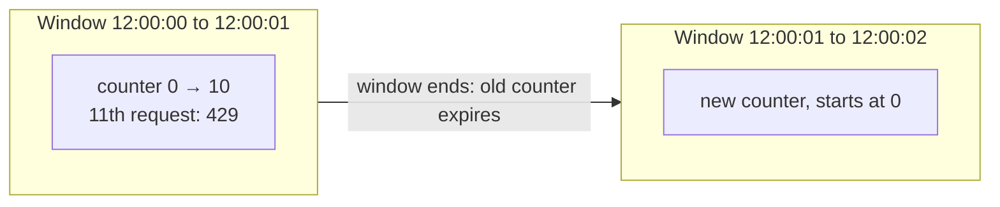
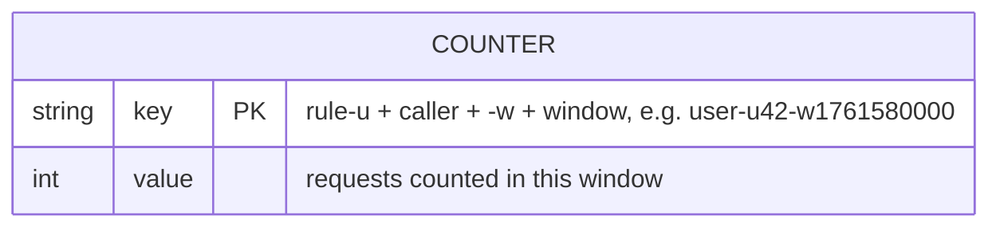

# Fixed window counter

[← Architecture](../architecture.md) · [Project README](../../README.md) · [Lua script](../../src/fixed_window_counter/fixed_window_counter.lua) · [Rules](../../src/fixed_window_counter/rules.yaml) · [Code structure](CODE_STRUCTURE.md) · [Sliding window log](../sliding_window_log/README.md)

The simplest window algorithm. Time is cut into fixed windows (e.g. every whole second). Each caller gets one counter per window. Same router, Redis, servers and API as the [token bucket](../token_bucket/README.md); only the Lua script and the rule fields change.

| Status | Built and tested locally, not deployed yet. Latency: to be measured after deploy |
|---|---|

## How it works



| Step | What happens |
|------|--------------|
| 1 | Window number = `floor(now_ms / window_ms)`, from the Redis clock |
| 2 | Read the counter for this caller and window |
| 3 | `count + 1 <= limit` → add 1, allowed. Else `429` until the window ends |

**Known weakness:** the counter resets at each boundary, so up to **2 × limit** can pass in a short time around it.

| Time | Requests | Window | Allowed |
|------|----------|--------|---------|
| 12:00:00.900 | 10 | first | 10 |
| 12:00:01.050 | 10 | second (fresh counter) | 10 |
| **150 ms in total** | 20 | | **20** (limit is 10 per second) |

## The Lua script

[`fixed_window_counter.lua`](../../src/fixed_window_counter/fixed_window_counter.lua) runs inside Redis, so read → check → count is one step.

| Idea | What it means |
|------|---------------|
| Window in the key | The script adds `-w<window number>` to each key, so a new window is simply a new key |
| All-or-nothing | One call checks every counter (e.g. `user` + `ip`). If one is full, none is increased |
| Redis clock | Uses Redis `TIME`, so all servers agree on which window it is |
| Self-cleaning | Each counter expires when its window ends (+1 s grace) |
| Single Redis only | Key names are built inside the script; Redis Cluster would need hash tags |

Returns `[allowed, remaining, retry_after_ms, denied_by]`. `retry_after_ms` = time until the denying window ends.

## Rules

| Rule | Limits | Limit | Window |
|------|--------|-------|--------|
| `user` | Each logged-in user, every path | 10 | 1 s |
| `cookie` | Each logged-out visitor (no user id), every path | 5 | 1 s |
| `ip` | Each client IP, every path | 20 | 1 s |
| `login` | Each IP on `/login` | 5 | 60 s |

Who is the caller: [Identifying the caller](../architecture.md#identifying-the-caller). The live file is [`rules.yaml`](../../src/fixed_window_counter/rules.yaml).

## Data model (Redis)



| Part | Format | Example |
|------|--------|---------|
| Key | `<rule>-u<caller>-w<window number>` | `user-u42-w1761580000`, `ip-u3405803783-w1761580000` |
| Value | Whole number (Redis string) | `7` |
| Expiry | End of the window + 1 s | 1 s window → under 2 s |

## Capacity planning (Redis memory)

One counter is a small string key, about **150–200 bytes** with Redis bookkeeping. It lives one window (+1 s).

```text
counters in Redis ≈ requests per second × seconds each counter lives
memory            ≈ counters × ~200 bytes × 1.5 (safety margin)
```

Example at 10,000 requests per second (worst case: every request a different caller):

| Rule | Counters in Redis |
|------|-------------------|
| user / cookie | 10,000 × 2 s = 20,000 |
| ip | 10,000 × 2 s = 20,000 |
| login (2% of traffic) | 200 × 61 s ≈ 12,200 |
| **Total** | **~52,000 counters ≈ 16 MB** |

| How many callers fit in 128 MB | Value |
|------|-------|
| 128 MB ÷ 200 bytes | ~671k counters |
| ÷ 1.5 safety margin | ~447k counters |
| ÷ ~2 counters per caller (`user` or `cookie`, plus `ip`) | **~224k callers active in any 2 s** |

Memory per caller does **not** grow with `limit`: one number counts 10 or 10,000 requests.

## Deploy and test

| Step | Command |
|------|---------|
| Deploy | `./scripts/deploy.sh dev us-east-1 fixed_window_counter` |
| Allow your IP | Console: inbound TCP 8080 from `<your-ip>/32` on the `SecurityGroupId` output |
| Test | `python3 tests/integration/window_latency.py http://<PublicIp>:8080 fixed_window_counter 100` |
| Tear down | `./scripts/destroy.sh dev us-east-1` |

| Test check | Expect |
|------------|--------|
| 12 parallel requests as one user, just after a window starts | 10 × 200, 2 × 429 by `user` |
| 10 parallel 100 ms before a boundary + 10 right after | **20 allowed** (the 2 × limit weakness) |
| Latency run, paced under all limits | All allowed; p50/p90/p99 printed |

## What's checked and not

| Checked (locally) | Not checked yet |
|-------------------|-----------------|
| Lua script against fake Redis: limit, all-or-nothing, retry time, window rollover, expiry | Docker image builds |
| Python, Go and Node servers end to end against fake Redis: all 4 rules, 429 headers, Server-Timing, junk ids ignored | Real Redis, nginx, Lambda, S3 on AWS |
| `window_latency.py` against a local stand-in: 10 + 2, boundary 20 | Latency on the EC2 |
