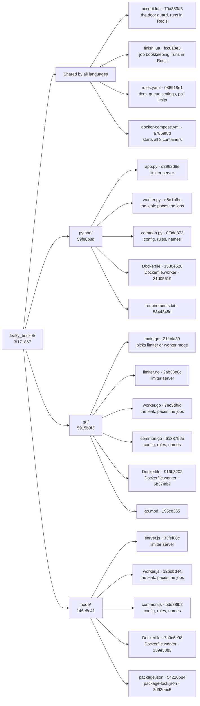
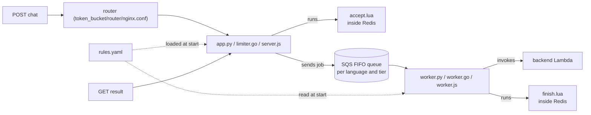

# Code structure · leaky bucket

[← Leaky bucket README](README.md) · [Architecture](../architecture.md) · [Token bucket code structure](../token_bucket/CODE_STRUCTURE.md)

A map of every file in `src/leaky_bucket/`, drawn as a Merkle tree: each file has a fingerprint (short SHA-256 hash), and each folder's fingerprint is made from its children's. Change one character anywhere and that file's hash, its folder's hash, and the root hash all change, so the tree shows exactly where code changed.

## The tree



"Shared by all languages" is a grouping for reading only; those files sit directly in `leaky_bucket/`. The nginx config and `token_bucket.lua` are **not** in this folder: the compose file and the Dockerfiles reuse the ones in [`src/token_bucket/`](../token_bucket/CODE_STRUCTURE.md).

## What each file does

| File | Job | Used by |
|------|-----|---------|
| `accept.lua` | The door guard: reads the user's tier, checks the line count against `max_waiting`, takes a ticket, creates the job record, all atomically | Every limiter sends it to Redis |
| `finish.lua` | Moves a job to `processing`, `done`, `failed` or `expired`; ending a job gives the place in line back and moves "now serving" on | Workers (and limiters for `expired` and send errors) |
| `rules.yaml` | Tiers (leak rate, max waiting), queue settings (2 minute retention, 5 attempts), poll limits, agent delay, test-only seed users | Limiters (from S3, refreshed by ETag) and workers (read at start) |
| `docker-compose.yml` | Starts router + Redis + 3 limiters + 3 workers; only the router publishes a port | Docker on the EC2 |
| `python/app.py` · `go/limiter.go` · `node/server.js` | Same job in 3 languages: validate, call `accept.lua`, send to SQS, answer polls (with the poll limit) | Their own limiter container |
| `python/worker.py` · `go/worker.go` · `node/worker.js` | Same job in 3 languages: one pacing loop per tier, start a job every `1 / leak_rate` s, call the backend, call `finish.lua`, delete the message | Their own worker container |
| `python/common.py` · `go/common.go` · `node/common.js` | Config from environment variables, `rules.yaml` loading (S3 or file), queue and key names | The limiter and the worker of that language |
| `go/main.go` | Go builds one program; this file picks `limiter` or `worker` mode | The two Go containers |
| `*/Dockerfile` · `*/Dockerfile.worker` | How to build each limiter and worker image (no logic). Build context is `src/` so they can also copy the token bucket script | `docker compose build` |
| `requirements.txt` · `go.mod` · `package*.json` | Pinned libraries for each language | The Docker build |

## How the files work together on one request



## How the hashes are made

- **File:** SHA-256 of the file's bytes.
- **Folder:** SHA-256 of its children's `name:hash` lines, sorted by name.
- **Shown:** first 8 characters. Skipped: `node_modules/`, `__pycache__/`, `.venv/`, and hidden files. This map and the README live in `docs/`, so they are not part of the hashes.

These hashes are a snapshot of the leaky bucket code at the time it was built (not yet deployed). To recompute them after a change, from `src/`:

```bash
python3 -c "
import hashlib,os
S={'node_modules','__pycache__','.venv'}
def t(p,d=0):
    if os.path.isfile(p):
        x=hashlib.sha256(open(p,'rb').read()).hexdigest();print('  '*d+os.path.basename(p),x[:8]);return x
    k=sorted(i for i in os.listdir(p) if i not in S and not i.startswith('.'))
    x=hashlib.sha256('\n'.join(f'{i}:{t(os.path.join(p,i),d+1)}' for i in k).encode()).hexdigest()
    print('  '*d+os.path.basename(p)+'/',x[:8]);return x
t('leaky_bucket')"
```
