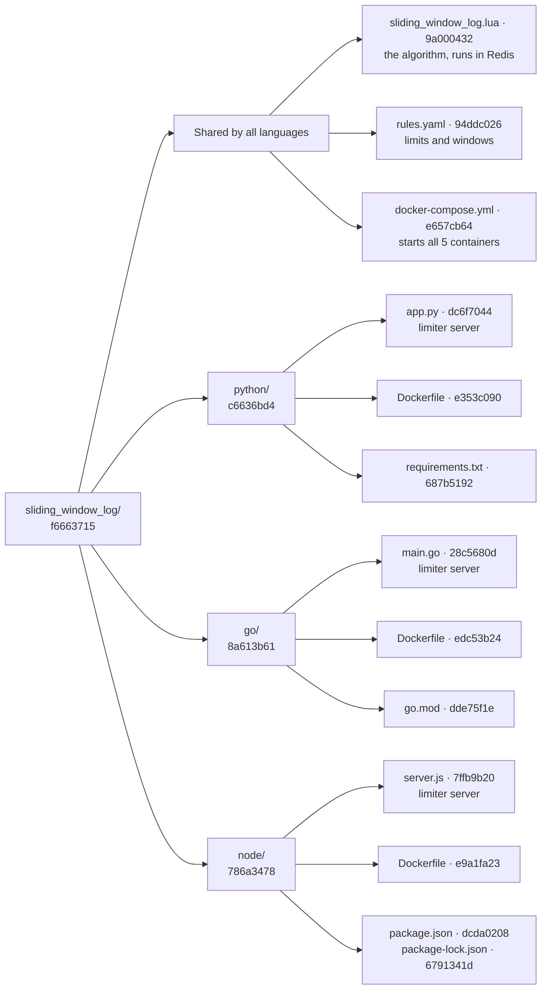

# Code structure · sliding window log

[← Sliding window log README](README.md) · [Architecture](../architecture.md) · [Token bucket code structure](../token_bucket/CODE_STRUCTURE.md)

A map of every file in `src/sliding_window_log/`, drawn as a Merkle tree: each file has a fingerprint (short SHA-256 hash), and each folder's fingerprint is made from its children's. Change one character anywhere and that file's hash, its folder's hash, and the root hash all change, so the tree shows exactly where code changed.

## The tree



"Shared by all languages" is a grouping for reading only; those files sit directly in `sliding_window_log/`. The nginx config is **not** in this folder: the compose file reuses the one in [`src/token_bucket/router/`](../token_bucket/CODE_STRUCTURE.md).

## What each file does

| File | Job | Used by |
|------|-----|---------|
| `sliding_window_log.lua` | The algorithm: trim old entries, count every log, add an entry to all only if all have room | Every limiter sends it to Redis |
| `rules.yaml` | Which logs exist (`user`, `cookie`, `ip`, `login`), their limit and window | Every limiter, loaded into memory from S3 |
| `docker-compose.yml` | Starts router + 3 limiters + Redis; only the router publishes a port | Docker on the EC2 |
| `python/app.py` · `go/main.go` · `node/server.js` | Same job in 3 languages: read caller ids, pick matching rules, one Redis call with a unique request id, then call the backend or return 429 | Their own container |
| `*/Dockerfile` | How to build each container image (no logic) | `docker compose build` |
| `requirements.txt` · `go.mod` · `package*.json` | Pinned libraries for each language | The Docker build |

## How the hashes are made

- **File:** SHA-256 of the file's bytes.
- **Folder:** SHA-256 of its children's `name:hash` lines, sorted by name.
- **Shown:** first 8 characters. Skipped: `node_modules/`, `__pycache__/`, `.venv/`, and hidden files. This map and the README live in `docs/`, so they are not part of the hashes.

To recompute them after a change, from `src/`:

```bash
python3 -c "
import hashlib,os
S={'node_modules','__pycache__','.venv'}
def t(p,d=0):
    if os.path.isfile(p):
        x=hashlib.sha256(open(p,'rb').read()).hexdigest();print('  '*d+os.path.basename(p),x[:8]);return x
    k=sorted(i for i in os.listdir(p) if i not in S and not i.startswith('.'))
    x=hashlib.sha256('\n'.join(f'{i}:{t(os.path.join(p,i),d+1)}' for i in k).encode()).hexdigest()
    print('  '*d+os.path.basename(p)+'/',x[:8]);return x
t('sliding_window_log')"
```
