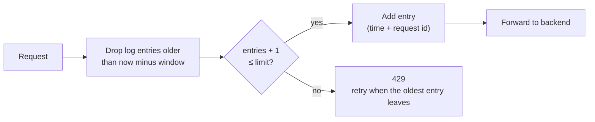
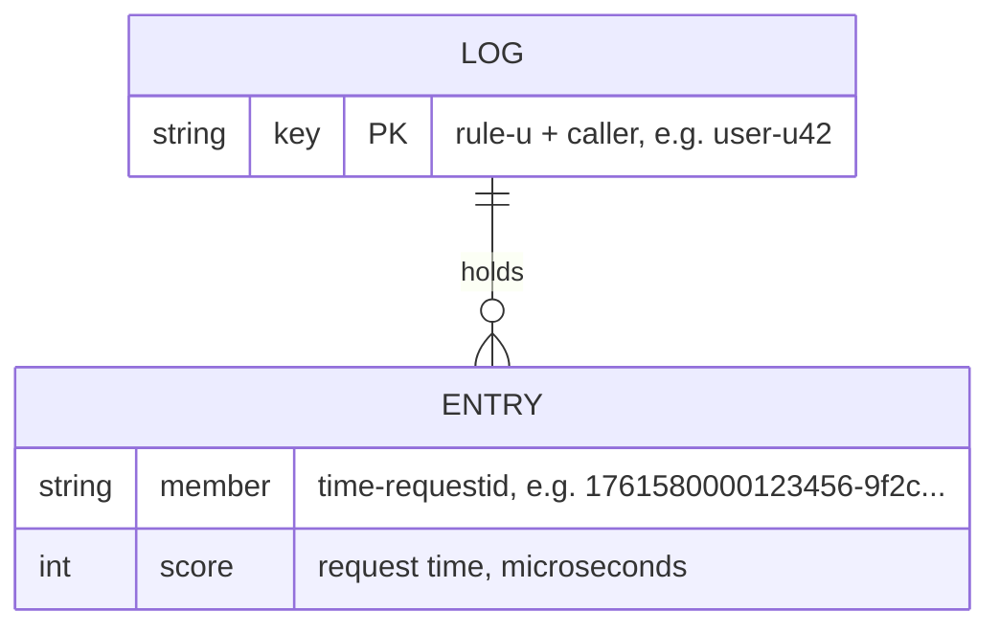

# Sliding window log

[← Architecture](../architecture.md) · [Project README](../../README.md) · [Lua script](../../src/sliding_window_log/sliding_window_log.lua) · [Rules](../../src/sliding_window_log/rules.yaml) · [Code structure](CODE_STRUCTURE.md) · [Fixed window counter](../fixed_window_counter/README.md)

The exact window algorithm. Redis keeps a log of the times of each caller's recent requests. A request is allowed only if fewer than `limit` requests happened in the **last** `window_s` seconds, counted back from now. Same router, Redis, servers and API as the [token bucket](../token_bucket/README.md); only the Lua script and the rule fields change.

| Status | Built and tested locally, not deployed yet. Latency: to be measured after deploy |
|---|---|

## How it works



| | Fixed window counter | Sliding window log |
|---|---|---|
| Window | Fixed slots (12:00:00–12:00:01, …) | Always "the last 1 s" from now |
| 10 requests at .900 + 10 at next .050 | 20 allowed | **10 allowed** |
| Memory per caller | One number | One entry per allowed request |

**Trade-off:** exact (never more than `limit` in any window), but memory grows with `limit`.

## The Lua script

[`sliding_window_log.lua`](../../src/sliding_window_log/sliding_window_log.lua) runs inside Redis, so trim → count → add is one step.

| Idea | What it means |
|------|---------------|
| Sorted set per key | Entry score = request time in microseconds (Redis `TIME`) |
| Unique entries | Entry name = time + a request id (uuid4 hex) from the server, so two requests in the same microsecond are two entries |
| All-or-nothing | One call checks every log (e.g. `user` + `ip`). If one is full, none gets an entry |
| Retry time | `oldest entry + window − now` (largest over the logs that said no) |
| Self-cleaning | Old entries are trimmed on each request; the whole key expires one window after the last allowed request |
| Single Redis only | Fine on one server; Redis Cluster would need hash tags so all keys of a request sit on one node |

Returns `[allowed, remaining, retry_after_ms, denied_by]`.

## Rules

| Rule | Limits | Limit | Window |
|------|--------|-------|--------|
| `user` | Each logged-in user, every path | 10 | 1 s |
| `cookie` | Each logged-out visitor (no user id), every path | 5 | 1 s |
| `ip` | Each client IP, every path | 20 | 1 s |
| `login` | Each IP on `/login` | 5 | 60 s |

Who is the caller: [Identifying the caller](../architecture.md#identifying-the-caller). The live file is [`rules.yaml`](../../src/sliding_window_log/rules.yaml).

## Data model (Redis)



| Part | Format | Example |
|------|--------|---------|
| Key | `<rule>-u<caller>` (a sorted set) | `user-u42`, `ip-u3405803783` |
| Entry | `<time µs>-<request id>`, score = time µs | `1761580000123456-9f2c…` |
| Size | At most `limit` entries | `ip` → up to 20 |
| Expiry | One window after the last allowed request | 1 s |

## Capacity planning (Redis memory)

| Part | Bytes |
|------|-------|
| One entry (49-byte name + score + bookkeeping) | ~60–100 |
| Key overhead (key text, table slot, expiry, sorted set) | ~150 |
| `user` key at its limit (10 entries) | ~1 KB |
| `ip` key at its limit (20 entries) | **~1.5–2 KB** |

```text
entries in Redis ≈ allowed requests per second × window (one entry per matching rule)
memory           ≈ (entries × ~80 bytes + keys × ~150 bytes) × 1.5 (safety margin)
```

Example at 10,000 requests per second (worst case: every request a different caller):

| Rule | Entries | Keys |
|------|---------|------|
| user / cookie | 10,000 × 1 s = 10,000 | 10,000 |
| ip | 10,000 | 10,000 |
| login (2% of traffic) | 200 × 60 s = 12,000 | 12,000 |
| **Total** | **32,000 × 80 B ≈ 2.6 MB** | **32,000 × 150 B ≈ 4.8 MB** → **~11 MB** with margin |

| How many callers fit in 128 MB (÷ 1.5 margin ≈ 85 MB) | Callers |
|------|---------|
| Light callers (1 request per window: `user` + `ip`, 2 keys × ~230 B) | ~185k |
| Heavy callers at the limit (`user` 10 + `ip` 20 entries ≈ 2.75 KB) | **~31k** |

Busy callers cost much more than in the fixed window, because every allowed request is stored.

## Deploy and test

| Step | Command |
|------|---------|
| Deploy | `./scripts/deploy.sh dev us-east-1 sliding_window_log` |
| Allow your IP | Console: inbound TCP 8080 from `<your-ip>/32` on the `SecurityGroupId` output |
| Test | `python3 tests/integration/window_latency.py http://<PublicIp>:8080 sliding_window_log 100` |
| Tear down | `./scripts/destroy.sh dev us-east-1` |

| Test check | Expect |
|------------|--------|
| 12 parallel requests as one user | 10 × 200, 2 × 429 by `user` |
| 10 parallel 100 ms before a boundary + 10 right after | **10 allowed** (no boundary burst) |
| Latency run, paced under all limits | All allowed; p50/p90/p99 printed |

## What's checked and not

| Checked (locally) | Not checked yet |
|-------------------|-----------------|
| Lua script against fake Redis: limit, all-or-nothing, retry time, old entries trimmed, expiry, unique entries in the same microsecond | Docker image builds |
| Python, Go and Node servers end to end against fake Redis: all 4 rules, 429 headers, Server-Timing, junk ids ignored | Real Redis, nginx, Lambda, S3 on AWS |
| `window_latency.py` against a local stand-in: 10 + 2, boundary 10 | Latency on the EC2 |
