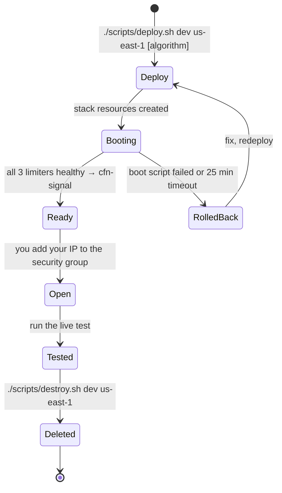
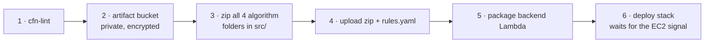
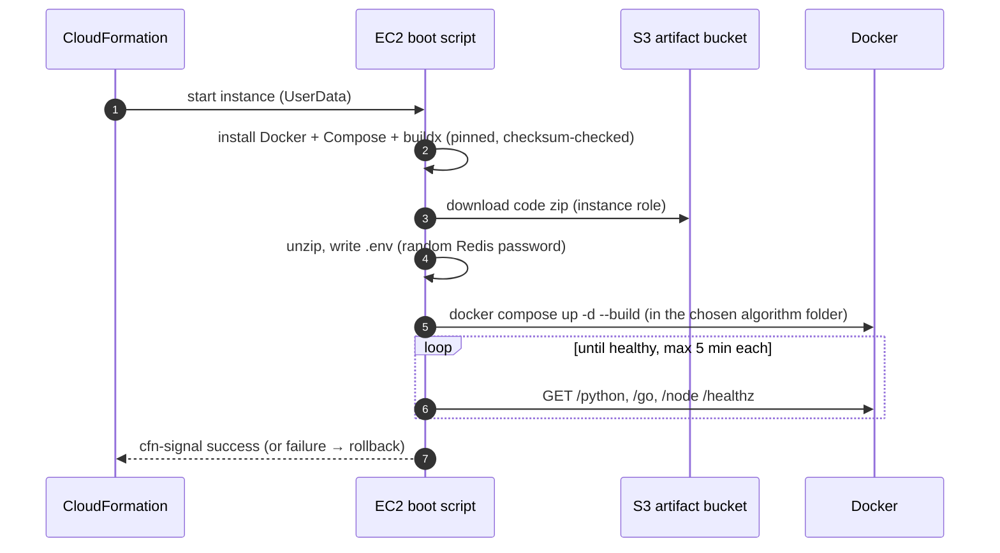
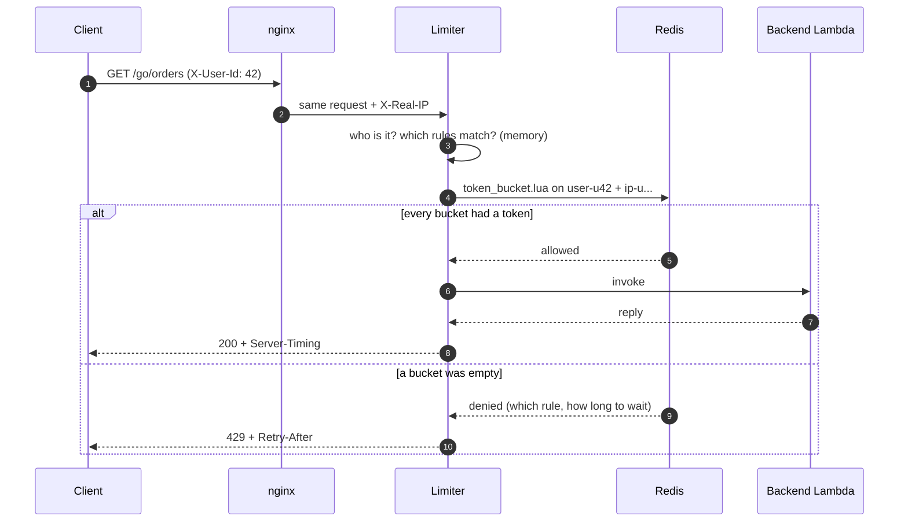

# Workflow · 03 Rate Limiter

[← Project README](../README.md) · [Architecture](architecture.md)

How a test session runs, from deploy to teardown, and what one request does inside.

## The whole session

## What `deploy.sh` does

The third argument picks the algorithm: `token_bucket` (default), `leaky_bucket`, `sliding_window_log` or `fixed_window_counter`.

| Step | What happens | Why |
|------|--------------|-----|
| 1. Lint | `cfn-lint` checks the template | Catch mistakes before AWS sees them |
| 2. Artifact bucket | `cfn-artifacts-<account>-<region>`, created once: private, encrypted | The handover point between your laptop and AWS |
| 3. Zip the code | All four algorithm folders; skips `node_modules`, `__pycache__`, `.venv`, `.env`. The S3 key includes a hash of the contents | New code = new key = CloudFormation replaces the instance. Same code = nothing to do |
| 4. Upload | Code zip + the chosen algorithm's `rules.yaml` | The EC2 downloads them with its own role |
| 5. Package | `cloudformation package` uploads `src/backend/` and points the template at it | CloudFormation can't read your laptop |
| 6. Deploy | Creates or updates the stack with `Algorithm`, `AppKey`, `RulesKey`; waits until the EC2 says it's healthy | One command for the whole stack |

Manual, one-command-at-a-time version of these steps: they map 1:1 to the commands in `scripts/deploy.sh`.

## What the EC2 does on first boot

| Detail | Value |
|--------|-------|
| Boot log | `/var/log/rate-limiter-setup.log` on the instance (or `aws ec2 get-console-output`) |
| Redis password | Made on the box with `openssl rand`, written only to `.env`, never leaves the instance |
| Timeout | The stack waits up to 25 minutes for the signal |
| Typical time | ~5–15 min, mostly building the Docker images (Go is the slowest) |

## One request: token bucket

## One request: sliding window log / fixed window counter

Same flow as the token bucket above. Only the script changes: `sliding_window_log.lua` (one log of request times per key) or `fixed_window_counter.lua` (one counter per key per window). Details: [sliding window log](sliding_window_log/README.md#how-it-works), [fixed window counter](fixed_window_counter/README.md#how-it-works).

## One request: leaky bucket

Full flow with polling, tiers and retries: [leaky bucket README](leaky_bucket/README.md#the-flow).

| Step | What happens |
|------|--------------|
| 1 | `POST /<lang>/chat` → the limiter asks Redis: user's tier, room in their line? |
| 2 | Room → message goes to that tier's SQS FIFO queue → `202 {job_id, position}`. No room → `429`. |
| 3 | The worker takes one message per tick (regular 1/s, business 5/s) and calls the backend. |
| 4 | The client polls `GET /<lang>/result/{job_id}` every second until `done`, `failed` or `expired`. |

## Test checks

| Check | Token bucket (`latency.py`) | Leaky bucket (`leaky_latency.py`) | Window algorithms (`window_latency.py`) |
|-------|-----------------------------|-----------------------------------|------|
| Router reachable | `/healthz` → 200 | `/healthz` → 200 | `/healthz` → 200 |
| Limit works | 12 parallel requests as one user → 10 × 200, 2 × 429 by `user` | Regular burst of 5 → 3 × 202, 2 × 429; business burst of 5 → all done within ~1.5 s | 12 parallel just after a window starts → 10 × 200, 2 × 429 by `user` |
| Boundary | n/a | n/a | 10 just before + 10 just after a boundary → fixed window 20, sliding log 10 |
| Polling limit | n/a | Rapid polls on one job → some 429 | n/a |
| Failure path | n/a | Job with `fail` → `failed` after 5 attempts | n/a |
| Latency | p50/p90/p99 of client, total, Redis, backend | p50/p90 of accept, queue wait, processing, end to end | p50/p90/p99 of client, total, Redis, backend |
| Without your IP | Request times out (no inbound rule) | Same | Same |

## Teardown

| Command | Removes |
|---------|---------|
| `./scripts/destroy.sh dev us-east-1` | The stack (EC2, VPC, Lambda, SQS queues, security group incl. your IP rule) and this stage's uploads in S3 |
| If IAM role deletion is denied | The script keeps the 2 roles (free, unused), finishes deleting the stack, and lists them |
| Check it's gone | `aws cloudformation describe-stacks --stack-name rate-limiter-dev` → "does not exist" |
