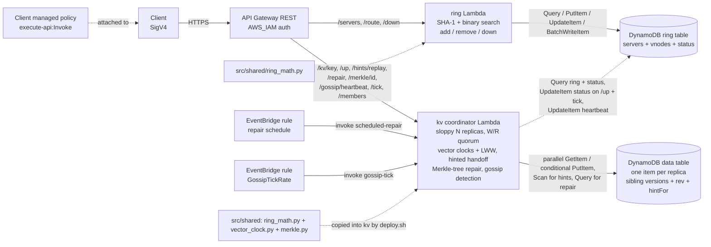

# 04 · Consistent Hashing


[← Portfolio](../README.md) · [Architecture](docs/architecture.md) · [Workflows](docs/workflow.md) · [Template](infrastructure/template.yaml) · [Code: ring](src/ring/handler.py) · [Code: kv](src/kv/handler.py)


## Summary
This project uses an example of a **distributed key-value store** — the kind of system that spreads data across many servers and keeps working when some of them fail. It is the design behind real databases like Amazon DynamoDB and Apache Cassandra, rebuilt here as a small AWS prototype.

Here we use **consistent hashing**: a way to decide which server owns which key so that adding or removing a server only moves a small slice of the data, instead of reshuffling everything. The ring lives in DynamoDB and is served by a Lambda behind an IAM-authorized API.

**What you can do with it:**
- Add and remove servers, and ask the API which server owns any given key.
- Store and read values, with copies kept on several servers for durability.
- Mark servers as down to simulate failures, then watch the system route around them and heal once they recover.

**Setup:** 
1. **The ring** — place servers and keys on a hash ring with virtual nodes; routing tells you who owns a key and which key ranges move when the ring changes.
2. **Replication + quorum** — each key is copied to N servers; a write needs W acks, a read needs R responses (`N=3, W=2, R=2` by default).
3. **Vector clocks** — track versions so concurrent writes become siblings instead of overwriting; conflicts are resolved server-side by last-write-wins.
4. **Sloppy quorum** — keep working through a failure instead of rejecting writes. If one of a key's home servers is down, the coordinator borrows the next healthy server on the ring as a temporary **stand-in**, so the write still reaches W acks and reads still find the value.
5. **Hinted handoff** — put the borrowed copies back where they belong. The stand-in saves a **hint** — a note of which down server the copy really belongs to. When that server returns, the stand-in replays the held data to it and deletes the hint, so every copy ends up on its proper home.
6. **Anti-entropy repair** — servers compare compact **Merkle-tree** summaries of their data and copy over only the keys that actually differ, so a permanently-failed server's replicas can be re-synced cheaply. A scheduled EventBridge rule runs this in the background.
7. **Gossip failure detection** — servers send **heartbeats**; a scheduled tick marks a server down when its heartbeat goes stale past a threshold and back up when a fresh one lands, which drives failover and recovery automatically. The gossip *algorithm* is real; its peer-to-peer network is *simulated* by the shared table plus the tick (see the caveat below).

The design docs walk through the theory first (the plain concepts, then the full key-value store design). New to this? Read [the architecture page](docs/architecture.md) before the code — it builds the ring idea from scratch with pictures.

| Fact | Value |
|------|-------|
| Status | 🟡 Prototype: 6-step implementation complete (ring → quorum → vector clocks → sloppy quorum/hinted handoff → Merkle repair → simulated gossip); not deployed yet |
| AWS services | API Gateway (REST) · Lambda (Python 3.12) · DynamoDB · EventBridge · IAM · CloudWatch Logs |
| Quorum | N=3, W=2, R=2 by default (stack parameters); per-request `?w=` / `?r=` overrides; sloppy stand-ins |
| Versioning | Vector clock per version; `MaxClockEntries`=10 threshold; server-side LWW on conflict |
| Temporary failures | Stand-in on a down primary; hint (`hintFor`) replayed on `/up` or `POST /hints/replay`, bounded + idempotent |
| Permanent failures | Merkle-tree anti-entropy: `POST /repair` + scheduled EventBridge pass; `MerkleBuckets`=16; moves only differing buckets |
| Failure detection | Simulated gossip: heartbeats + `POST /gossip/tick` (scheduled, `GossipTickRate`=rate(1 minute)); `GossipFailureThreshold`=90s drives `status` up/down, then failover + option-A hint replay |
| Auth | IAM / SigV4 on every method, client managed policy output |
| Infra as code | [`infrastructure/template.yaml`](infrastructure/template.yaml) |
| Cost at idle | ~$0 (on-demand DynamoDB, pay-per-request Lambda and API Gateway) |

## Architecture
The image above is generated by [`docs/diagram.py`](docs/diagram.py). The same flow in Mermaid:



## How it works
1. Each server gets `vnodes` virtual nodes (default 100). Vnode `i` of server `s` sits at position `SHA-1("s#i")` on a ring of `0 .. 2^160 - 1`.
2. Vnodes are stored with the position as the sort key (40 hex digits, zero-padded), so one `Query` returns the ring in clockwise order.
3. To route a key, the Lambda hashes it with SHA-1 and binary-searches for the first vnode at or after that position, wrapping to the first vnode. That vnode's server owns the key.
4. With `?n=3` the Lambda keeps walking clockwise and returns the first 3 distinct physical servers (the preference list from [replication](docs/kv-2-replication-consistency.md#4-data-replication-for-high-availability)), skipping extra vnodes of servers already chosen. The kv coordinator uses the same list to place replicas.
5. Adding or removing a server diffs the old and new ring and returns every key range `(start, end]` that changed owner, with `fromServer` and `toServer`. These are the [affected keys](docs/kv-1-partitioning.md#3-finding-affected-keys-on-addremove). Stored data is not moved yet.
6. **Coordinator**: the server that runs the write. By default it is the first up server in the preference list; `?coordinator=<serverId>` overrides it but must be in the preference list (else `400`) and up (else `503`). The coordinator increments its own entry in the [vector clock](docs/kv-2-replication-consistency.md#7-inconsistency-resolution-versioning-and-vector-clocks).
7. **Preference list and stand-ins (sloppy quorum)**: a key's N primary replicas are still the first N distinct servers clockwise. When a primary is `down`, the coordinator keeps walking the ring to the next healthy distinct server not already chosen and uses it as a **stand-in** for that primary. The target set is therefore one server per primary: the primary if up, else its stand-in. See [sloppy quorum and hinted handoff](docs/kv-3-failure-handling.md#9-handling-temporary-failures-sloppy-quorum-and-hinted-handoff).
8. **Sloppy write** (`PUT /kv/{key}`): the coordinator writes to the sloppy target set and collects W acks. If fewer than W targets are healthy even after walking (not enough servers) it returns 503 without writing. Otherwise it builds the new clock = the request `context` clock (empty if absent) with the coordinator's entry incremented, then truncated to `MaxClockEntries`. Each target merges the version into its sibling list under a conditional write on `rev` with bounded retry (drop superseded versions, keep concurrent ones, ignore a write a stored version already descends from). A **stand-in** write also records a **hint**: the attribute `hintFor` on that stand-in's replica item, a JSON list of the down primaries it is holding writes for. The hinted value keeps its vector clock, so replay merges cleanly. The response's `acked`/`failed` entries flag each target with `standIn` and its intended `primary`. A PUT without context can be concurrent with existing data.
9. **Sloppy read** (`GET /kv/{key}`): the read walks past down primaries to the same stand-ins, so it can read a value that currently lives only on a stand-in — the outage window a strict read would miss. It reads the target set in parallel, counts the first R responses, unions versions across primaries **and** stand-ins, and drops dominated versions. Each `replicas` entry carries a `role` of `primary` or `standIn` (with `standInFor`). If more than one concurrent version survives, `conflict.detected` is true and the coordinator resolves it **server-side by last-write-wins** (highest `timestamp`, tiebreak by highest coordinator serverId). The resolution is not written back (**no read repair**); the next PUT with the returned `context` collapses the siblings.
10. **Hinted handoff (recovery)**: `POST /servers/{id}/up` marks the server up **and** replays hints destined for it — every stand-in item whose `hintFor` lists the server is written back to the now-up primary with a vector-clock merge, then removed from `hintFor` (the attribute is dropped when the list empties). `POST /hints/replay` does the same on demand (optional `{"serverId"}`; without it, every hint whose intended server is up). Replay is **idempotent** (vector-clock merge + conditional write prevent clobbering, so a second run is a no-op) and **bounded** per call (`HintScanLimit` items scanned, `HintReplayLimit` hand-offs; a `more` flag signals a remainder). `POST /servers/{id}/down` sets `status = down`; the data stays in place.
11. **Anti-entropy repair (permanent failures)**: `POST /repair {serverA, serverB, range?}` builds a [Merkle tree](docs/kv-3-failure-handling.md#10-handling-permanent-failures-anti-entropy-with-merkle-trees) for each server's items (a key goes to bucket `SHA-1(key) mod MerkleBuckets`; a bucket hash covers each key's value **and** vector clock; parents are hashed pairwise to a root). If the roots match, nothing moves. Otherwise it walks only the differing branches to the differing bucket indices, and **only for keys in those buckets** merges the two sides by vector clock exactly like a read (drop dominated, keep concurrent siblings) and writes the merged set back to whichever side is missing or stale, via the same conditional-write merge, so a re-run is idempotent. The response reports `rootA`/`rootB`, `rootsMatch`, `differingBuckets`, `keysCompared` vs `keysRepaired`, and the resulting versions per repaired key — so "only differences move" is observable. Bounded by `REPAIR_KEY_LIMIT` keys and `MERKLE_SCAN_LIMIT` items read per server (`truncated`/`more` flag a remainder). `GET /merkle/{serverId}[?start=&end=]` returns a server's root and per-bucket leaf hashes for side-by-side inspection.
12. **Scheduled background repair** (Option B): an EventBridge rule (`RepairScheduleRate`, default `rate(1 hour)`; toggle with `RepairScheduleEnabled`) invokes the kv Lambda with `{"source": "scheduled-repair"}`. The handler repairs each **adjacent replica pair** on the ring (the servers whose preference lists overlap, so the ones most likely to share keys and drift), reusing the same `repair()` path, bounded by `REPAIR_PAIR_LIMIT` pairs. It needs no extra IAM: the scheduled path uses the existing ring-read + data read/write permissions.
13. **Simulated gossip failure detection** (step 6): each server carries gossip state on its ring row — a `heartbeat` counter and `heartbeatUpdatedAt` (epoch seconds), alongside the existing `status`. `POST /gossip/heartbeat {serverId}` is a node saying "I am alive": it bumps the counter and stamps the time (`404` if unknown). `POST /gossip/tick` runs one detection round over the membership list (every `SERVER#` row): if `now - heartbeatUpdatedAt > GossipFailureThreshold` and the server is up it is marked **down**; if a down server has heartbeated within the threshold it is marked **up** and (option A) its hints are replayed via the same path as `/up`, so a value that landed on a stand-in during the outage returns to the primary. `GET /gossip/members` lists every server's `heartbeat`, `heartbeatUpdatedAt`, `age` (now − updated) and `status` so you can watch detection. The tick writes the same `status` field sloppy quorum reads, so detection drives failover and recovery with no extra plumbing. An EventBridge rule (`GossipTickRate`, default `rate(1 minute)`; toggle with `GossipEnabled`) invokes the tick with `{"source": "gossip-tick"}` — a separate rule from the repair schedule so the two cadences tune independently.

> **This is a *simulation* of gossip, stated honestly.** The *algorithm* is real: a membership list, per-server heartbeat counters, a failure threshold, and propagation of the latest heartbeat view. The *peer-to-peer network transport* is **not** real — there is no node-to-node message exchange. A logical "server" here is a row in DynamoDB with no long-lived process, so instead of nodes gossiping to random peers every second, each node writes its heartbeat to the **shared DynamoDB table** and a single **scheduled tick** reads the whole membership list and applies the threshold centrally. The detection outcome matches gossip (stale heartbeat ⇒ down, fresh ⇒ up); the fan-out, anti-entropy of the membership list across peers, and resistance to a single broken link are not modelled.

14. **Gossip vs the manual overrides.** `POST /servers/{id}/down` and `/up` still force state for tests and demos. Precedence: the tick is authoritative on its next round because it drives `status` from the heartbeats. A server you manually mark **down** comes back **up** at the next tick if it is still heartbeating within the threshold; one you mark **up** goes **down** at the next tick if its heartbeat has gone stale. To keep a server down under gossip, stop heartbeating it (or disable the tick); to keep it up, keep heartbeating it. `/up` and a tick-driven recovery both replay hints, so recovery behaves the same either way.
15. If N is larger than the number of servers, all servers are used and the response reports the effective `n`. `w` and `r` overrides must be 1..N.

| Method | Path | Body | Result |
|--------|------|------|--------|
| `POST` | `/servers` | `{"serverId": "s0", "vnodes": 100}` | `201` vnodes added + changed ranges · `409` exists · `400` invalid |
| `GET` | `/servers` | | `200` servers, vnode counts, `sharePercent` of the ring |
| `DELETE` | `/servers/{serverId}` | | `200` vnodes removed + ranges and the server they move to · `404` |
| `GET` | `/route/{key}[?n=3]` | | `200` key position, owning vnode, `serverId`, optional `preferenceList` · `409` empty ring |
| `POST` | `/servers/{serverId}/down` | | `200` server marked down (simulated failure) · `404` |
| `POST` | `/servers/{serverId}/up` | | `200` server marked up **and** `hintReplay` summary (hints handed off to it) · `404` |
| `PUT` | `/kv/{key}[?w=2][&coordinator=s0]` | `{"value": "...", "context": "<opaque>"}` | `200` ≥ W acks via the sloppy target set: `coordinator`, `clock`, `context`, `acked`/`failed` (each with `standIn`, `primary`) · `400` bad context / coordinator not in preference list · `503` fewer than W healthy targets or coordinator has no stand-in · `409` empty ring |
| `GET` | `/kv/{key}[?r=2]` | | `200` winning `value`, `context`, `conflict` (`detected`, `versions`, `winner`, `discarded`) + every target's versions with `role` (`primary`/`standIn`, `standInFor`) · `404` not on the R targets counted · `503` fewer than R responses |
| `POST` | `/hints/replay` | `{"serverId": "s0"}` (optional) | `200` `hintReplay` summary (`hintsReplayed`, `keysReplayed`, `byServer`, `more`) · `400` bad serverId · `409` named server is not up |
| `POST` | `/repair` | `{"serverA": "s0", "serverB": "s1", "range": {"start": "<hex>", "end": "<hex>"}}` (range optional) | `200` repair summary (`rootA`, `rootB`, `rootsMatch`, `differingBuckets`, `keysCompared`, `keysRepaired`, `repaired[]`, `more`) · `400` bad serverId / equal servers / bad range |
| `GET` | `/merkle/{serverId}[?start=&end=]` | | `200` `root`, per-bucket `leaves`, `buckets`, `keyCount`, `truncated` · `400` invalid serverId or only one of start/end |
| `POST` | `/gossip/heartbeat` | `{"serverId": "s0"}` | `200` `{serverId, heartbeatUpdatedAt}` (counter bumped) · `400` bad serverId · `404` unknown server |
| `POST` | `/gossip/tick` | | `200` one detection round: `markedDown`, `markedUp`, `hintReplay` (per recovered server), `members` (with `age`), `threshold` |
| `GET` | `/gossip/members` | | `200` membership list: per server `heartbeat`, `heartbeatUpdatedAt`, `age`, `status`, plus `now` and `threshold` |

Validation: `serverId` is 1-64 chars of `A-Z a-z 0-9 _ . -`; `vnodes` is 1-500; route `key` is 1-256 bytes; `n` is 1-10. KV `key` is 1-256 chars of `A-Z a-z 0-9 _ . : -`; `value` is a string up to 10 KB; `w` and `r` are 1..N; `context` is base64url JSON of a vector clock, decoded size-limited to 4 KB and shape-checked.

More detail and the data model: [docs/workflow.md](docs/workflow.md).

<details><summary>Example responses</summary>

```text
// GET /route/user-42?n=3
{"key": "user-42", "position": "3f1c…", "serverId": "s2",
 "vnode": {"position": "40a7…", "serverId": "s2", "vnodeIndex": 17},
 "preferenceList": ["s2", "s0", "s3"]}

// PUT /kv/user-42  (primary s2 is down, so s1 stands in for it; W=2 still reached)
{"key": "user-42", "preferenceList": ["s2", "s0", "s3"], "coordinator": "s0", "n": 3, "w": 2,
 "clock": {"s0": {"counter": 1, "updatedAt": "…"}}, "context": "eyJzMCI6…",
 "acked": [{"serverId": "s1", "primary": "s2", "standIn": true},
           {"serverId": "s0", "primary": "s0", "standIn": false},
           {"serverId": "s3", "primary": "s3", "standIn": false}], "failed": []}

// POST /servers/s2/up   (s2 recovers; its hint on stand-in s1 is replayed and cleared)
{"serverId": "s2", "status": "up",
 "hintReplay": {"hintsReplayed": 1, "keysReplayed": 1, "byServer": {"s2": 1}, "scanned": 1, "more": false}}

// GET /kv/user-42   (two concurrent writes D3 at s0 and D4 at s3 -> conflict, LWW resolves)
{"key": "user-42", "value": "D4", "context": "eyJzMiI6…",
 "conflict": {"detected": true,
   "versions": [{"value": "D3", "clock": {…}, "timestamp": "…", "coordinator": "s0"},
                {"value": "D4", "clock": {…}, "timestamp": "…", "coordinator": "s3"}],
   "winner": {"value": "D4", …}, "discarded": [{"value": "D3", …}]},
 "replicas": [{"serverId": "s2", "role": "primary", "status": "ok", "found": true, "versions": [{…}], "counted": true},
              {"serverId": "s1", "role": "standIn", "standInFor": "s3", "status": "ok", "found": true, "versions": [{…}], "counted": true}, …]}

// POST /servers {"serverId": "s4", "vnodes": 100}
{"serverId": "s4", "vnodesAdded": 100, "affectedRanges": 84,
 "ranges": [{"start": "02b1…", "end": "02f9…", "fromServer": "s1", "toServer": "s4"}, …]}

// GET /merkle/s2   (16 buckets; most match a replica of the same range)
{"serverId": "s2", "buckets": 16, "root": "9a4f…", "keyCount": 200, "truncated": false,
 "leaves": ["da39…", "1b7c…", …]}

// POST /gossip/tick   (s2's heartbeat went stale past the 90s threshold)
{"mode": "gossip-tick", "now": 1730000120, "threshold": 90,
 "markedDown": ["s2"], "markedUp": [], "hintReplay": {},
 "members": [{"serverId": "s0", "status": "up", "heartbeat": 42, "heartbeatUpdatedAt": 1730000119, "age": 1},
             {"serverId": "s2", "status": "up", "heartbeat": 7, "heartbeatUpdatedAt": 1730000020, "age": 100}]}

// POST /gossip/tick   (s2 heartbeats again within the threshold: back up, hint replayed — option A)
{"mode": "gossip-tick", "now": 1730000185, "threshold": 90,
 "markedDown": [], "markedUp": ["s2"],
 "hintReplay": {"s2": {"hintsReplayed": 1, "keysReplayed": 1, "byServer": {"s2": 1}, "scanned": 1, "more": false}},
 "members": [{"serverId": "s2", "status": "down", "heartbeat": 8, "heartbeatUpdatedAt": 1730000184, "age": 1}, …]}

// GET /gossip/members
{"now": 1730000200, "threshold": 90,
 "members": [{"serverId": "s0", "status": "up", "heartbeat": 45, "heartbeatUpdatedAt": 1730000199, "age": 1},
             {"serverId": "s2", "status": "up", "heartbeat": 9, "heartbeatUpdatedAt": 1730000190, "age": 10}]}

// POST /repair {"serverA": "s0", "serverB": "s2"}   (s0 missed one write; only its bucket moves)
{"serverA": "s0", "serverB": "s2", "buckets": 16, "rootA": "71e2…", "rootB": "9a4f…",
 "rootsMatch": false, "totalKeysA": 199, "totalKeysB": 200,
 "differingBuckets": [11], "keysCompared": 13, "keysRepaired": 1,
 "repaired": [{"key": "user-37", "sides": ["s0"], "versions": [{"value": "mv2", "clock": {…}, …}]}],
 "truncated": false, "more": false}
```
</details>

Local check of the ring code (4 servers x 100 vnodes, 10,000 keys): shares were 21-27% per server. Adding a 5th server moved 1,965 keys (19.6%), all to the new server. Removing a server moved only its own 2,173 keys.

Local check of the coordinator (in-memory fake tables, N=3): replaying the docs' D1..D5 through the handler reproduced the documented clocks exactly — D3 `([Sx,2],[Sy,1])`, D4 `([Sx,2],[Sz,1])` (concurrent siblings), D5 `([Sx,3],[Sy,1],[Sz,1])` after a merge write. A GET over D3 and D4 reported `conflict.detected` with both versions and the LWW winner; the D5 write collapsed them so the next GET showed no conflict. For step 4 the same fake tables showed: a write with one primary down reaches W via a stand-in and records a `hintFor` naming the down primary; a sloppy read returns that value during the outage and flags the stand-in responder; `/up` replays the hint to the recovered primary and clears it; a second replay is a no-op (idempotent) and leaves a single version on the primary. Ancestor/concurrent comparisons, clock truncation at 10 entries, the LWW tiebreak, and the re-run step-2 quorum cases (W=2 with one down via stand-in, W=3 with too few live targets → 503, invalid coordinator rejected, `r` out of range → 400) all passed.

Local check of step 5 (in-memory fake tables, 16 buckets): two identical servers (40 keys) produced equal Merkle roots and a repair that moved nothing. Diverging 3 of 200 keys per server made exactly 3 buckets differ (`[1, 11, 14]`); `/repair` then compared **34 keys** (the keys in those 3 buckets), not the 200 total — the efficiency property — repaired the 3, and the roots matched afterwards. Concurrent (sibling) versions were preserved on both sides rather than lost. A second repair pass repaired 0 (idempotent). Re-running the step-2 (W=2/W=3/`r` out of range), step-3 (D1..D5 clocks, conflict + LWW, D5 collapse) and step-4 (sloppy write/read via stand-in, `/up` hint replay, idempotent replay) checks through the handler all still passed — 22/22 total.

Local check of step 6 (in-memory fake tables, injectable clock, threshold 90s): heartbeating all four servers then ticking kept them up (all `age` 0); advancing the clock 95s while only the other servers heartbeated made the tick mark the stale server **down** (`age` 95 > 90); a write then failed over to a stand-in and a sloppy read returned the fresh value during the outage; resuming the server's heartbeat and ticking marked it **up** and replayed its one hint back to the primary (option A), with a second tick a no-op (no transitions, no hand-off). A heartbeat for an unknown server returned 404. Re-running the step-2, step-3, step-4 and step-5 checks through the same handler all still passed — **23/23 total**.

## Design docs
<details><summary>Concepts and key-value store design (sections 1-17)</summary>

Phase 1, concepts, in [docs/architecture.md](docs/architecture.md):
1. [The rehashing problem](docs/architecture.md#1-the-rehashing-problem): why `hash(key) % n` moves most keys when `n` changes
2. [Hash space and hash ring](docs/architecture.md#2-hash-space-and-hash-ring)
3. [Hash servers onto the ring](docs/architecture.md#3-hash-servers-onto-the-ring)
4. [Hash keys onto the ring](docs/architecture.md#4-hash-keys-onto-the-ring)
5. [Server lookup](docs/architecture.md#5-server-lookup)
6. [Adding a server](docs/architecture.md#6-adding-a-server)
7. [Removing a server](docs/architecture.md#7-removing-a-server)
8. [Next: consistent hashing](docs/architecture.md#8-next-consistent-hashing)

Phase 2 designs a key-value store on top of the ring (Dynamo/Cassandra style):

[Part 1: partitioning](docs/kv-1-partitioning.md)

1. [Two issues with the basic approach](docs/kv-1-partitioning.md#1-two-issues-with-the-basic-approach)
2. [Virtual nodes](docs/kv-1-partitioning.md#2-virtual-nodes)
3. [Finding affected keys on add/remove](docs/kv-1-partitioning.md#3-finding-affected-keys-on-addremove)

[Part 2: replication and consistency](docs/kv-2-replication-consistency.md)

4. [Data replication for high availability](docs/kv-2-replication-consistency.md#4-data-replication-for-high-availability)
5. [Consistency and quorum (N, W, R)](docs/kv-2-replication-consistency.md#5-consistency-and-quorum-n-w-r)
6. [Consistency models](docs/kv-2-replication-consistency.md#6-consistency-models)
7. [Inconsistency resolution: versioning and vector clocks](docs/kv-2-replication-consistency.md#7-inconsistency-resolution-versioning-and-vector-clocks)

[Part 3: failure handling](docs/kv-3-failure-handling.md)

8. [Failure detection: gossip protocol](docs/kv-3-failure-handling.md#8-failure-detection-gossip-protocol)
9. [Handling temporary failures: sloppy quorum and hinted handoff](docs/kv-3-failure-handling.md#9-handling-temporary-failures-sloppy-quorum-and-hinted-handoff)
10. [Handling permanent failures: anti-entropy with Merkle trees](docs/kv-3-failure-handling.md#10-handling-permanent-failures-anti-entropy-with-merkle-trees)
11. [Handling data-centre outage](docs/kv-3-failure-handling.md#11-handling-data-centre-outage)

[Part 4: system architecture](docs/kv-4-system-architecture.md)

12. [The coordinator](docs/kv-4-system-architecture.md#12-the-coordinator)
13. [What a node contains](docs/kv-4-system-architecture.md#13-what-a-node-contains)
14. [Write path (Cassandra-style)](docs/kv-4-system-architecture.md#14-write-path-cassandra-style)
15. [Read path and Bloom filter](docs/kv-4-system-architecture.md#15-read-path-and-bloom-filter)
16. [Summary](docs/kv-4-system-architecture.md#16-summary)
17. [Next: implementation](docs/kv-4-system-architecture.md#17-next-implementation)

The concept images come from two matplotlib scripts (the second imports helpers from the first):
```bash
pip install matplotlib
python3 docs/diagram_ring.py   # phase 1: writes docs/images/*.png and prints the rehashing table
python3 docs/diagram_kv.py     # phase 2: writes docs/images/kv_*.png and prints example numbers
```
</details>

## Repo layout
```text
04-consistent-hashing/
├── README.md                          ← this file
├── docs/
│   ├── architecture.md                ← phase 1 concepts: hash ring, sections 1-8
│   ├── kv-1-partitioning.md           ← phase 2 design: sections 1-3
│   ├── kv-2-replication-consistency.md← phase 2 design: sections 4-7
│   ├── kv-3-failure-handling.md       ← phase 2 design: sections 8-11
│   ├── kv-4-system-architecture.md    ← phase 2 design: sections 12-17
│   ├── workflow.md                    ← data model, route/add-server + quorum PUT/GET sequences, test checks
│   ├── diagram.py                     ← hero image (AWS icons) → images/architecture.png
│   ├── diagram_ring.py                ← phase 1 concept images (matplotlib)
│   ├── diagram_kv.py                  ← phase 2 concept images (kv_*.png)
│   └── images/
├── infrastructure/
│   └── template.yaml                  ← 2 DynamoDB tables, 2 Lambdas, REST API (AWS_IAM), EventBridge repair + gossip-tick rules, client policy, N/W/R + MaxClockEntries + HintScan/ReplayLimit + MerkleBuckets + RepairSchedule + Gossip params
├── src/
│   ├── shared/
│   │   ├── ring_math.py               ← pure ring functions, copied into both functions by deploy.sh
│   │   ├── vector_clock.py            ← pure vector-clock ops (compare, merge, truncate, context), into kv
│   │   └── merkle.py                  ← pure Merkle-tree build + diff for anti-entropy repair, into kv
│   ├── ring/handler.py                ← servers, routing, down API (/up is served by kv for replay)
│   └── kv/handler.py                  ← sloppy quorum + vector clocks + LWW + hinted handoff + Merkle repair + gossip detection: /kv/{key}, /up, /hints/replay, /repair, /merkle/{id}, /gossip/*, scheduled
├── tests/
│   └── integration/
│       ├── sigv4.py                   ← stack outputs + SigV4-signed calls
│       └── test_api.py                ← end-to-end checks against the deployed stack
└── scripts/
    ├── deploy.sh                      ← stage src/ + shared module, lint, package, deploy, print outputs
    └── destroy.sh                     ← delete stack
```

## Deploy / Test / Teardown
```bash
cd 04-consistent-hashing
./scripts/deploy.sh dev us-east-1
# optional: QUORUM_N=3 QUORUM_W=1 QUORUM_R=3 MAX_CLOCK_ENTRIES=10 ./scripts/deploy.sh dev us-east-1
# check packaging only (no AWS calls): BUILD_ONLY=1 ./scripts/deploy.sh   -> build/stage/src/{ring,kv}
# attach the ClientPolicyArn output to your IAM user/role, then:
python3 tests/integration/test_api.py dev
./scripts/destroy.sh dev us-east-1
```

## Cost & security notes
- **Cost:** on-demand DynamoDB, Lambda and API Gateway are pay-per-request, so idle cost is ~$0. Adding a 100-vnode server is 100 writes. A KV write is 1 ring Query + per target a GetItem plus a conditional PutItem (a couple more on write contention, bounded by retry); a read is 1 Query + up to N reads. A hint replay is 1 ring Query + a bounded data-table Scan plus a merge write per hint (bounded by `HintScanLimit`/`HintReplayLimit`); a `Scan` is used because the stand-in holding a hint is not known in advance. A `/repair` builds two Merkle trees (1 bounded data-table Query per server, `MerkleScanLimit` items) and writes back only the keys in differing buckets. The **scheduled** EventBridge rule runs a repair over adjacent replica pairs once per `RepairScheduleRate` (default hourly); each pass is bounded by `REPAIR_PAIR_LIMIT` pairs and `REPAIR_KEY_LIMIT` keys per pair, so steady-state cost (matching roots) is one Query per server per pair and no writes. Disable it with `RepairScheduleEnabled=DISABLED` to drop even that. A second, faster EventBridge rule runs the **gossip tick** once per `GossipTickRate` (default every minute): each tick is one ring `Query` plus a `status` `UpdateItem` only for servers that change state, and on a recovery the same bounded hint-replay `Scan`; a steady-state tick (no transitions) is a single `Query` and no writes. Heartbeats are one small `UpdateItem` each. Disable the tick with `GossipEnabled=DISABLED`.
- **Auth:** every method uses `AWS_IAM`; callers need the `ClientPolicyArn` managed policy (`execute-api:Invoke` on this stage only). Unsigned requests get 403.
- **Least privilege:** one role per function. The ring role allows only `Query`, `GetItem`, `PutItem`, `DeleteItem`, `UpdateItem` and `BatchWriteItem` on the ring table. The kv role allows `Query` + `UpdateItem` on the ring table (it marks a server up on `/up`) and `GetItem`/`PutItem`/`Scan`/`Query` on the data table (`Scan` finds stand-in items carrying hints; `Query` lists a server's items to build a Merkle tree for repair). Each can write only to its own log group. The scheduled repair **and** the gossip tick reuse this same role, so they add no new data permissions — heartbeat writes and the tick's status flips use the kv role's existing ring `UpdateItem`, and recovery replay uses its existing data access. Only EventBridge is granted `lambda:InvokeFunction` on the kv function, scoped to each rule's ARN (one grant per rule).
- **Data:** both tables are encrypted at rest with point-in-time recovery on. Stage throttling is 10 rps, burst 20.
- **Limits:** a prototype. Two concurrent add/remove calls can each report ranges computed from a stale ring, though the stored vnodes stay correct. Each key carries a vector clock, so concurrent writes become siblings instead of silently overwriting, but **server-side LWW conflict resolution can still silently drop a concurrent write**: it picks the version with the latest `timestamp`, so it relies on server clocks being close and loses the other value. Clock truncation at `MaxClockEntries` can make an ancestor look like a sibling, causing a false conflict (the known Dynamo trade-off). A write can partly succeed: targets that acked keep the value even when the response is 503. **Sloppy quorum weakens the `W + R > N` overlap** during an outage: a read may be served by a stand-in or miss a hint not yet replayed, so a stale value is possible until replay — this matches the eventual-consistency choice. Hinted handoff only covers temporary failures; if a stand-in is also lost, **Merkle-tree anti-entropy repair** (step 5, `/repair` and the scheduled pass) reconciles the permanent drift. Repair reads a server's items with a `Scan`-equivalent `Query` over its partition bounded by `MerkleScanLimit`, applies the range filter in-code (the data table is not indexed by ring position), and caps repaired keys per call, so a very large partition needs several `/repair` calls (watch `truncated`/`more`); the scheduled pass repairs only adjacent ring pairs, not every pair. Hint replay walks the data table with a `Scan` bounded per call, so a large backlog needs several `/hints/replay` calls (watch the `more` flag). Removing a server does not move its data, and there is no delete endpoint for keys, so integration-test items stay in the data table until the stack is deleted. **Gossip failure detection is simulated** (see the caveat under *How it works*): the membership list, heartbeat counters and failure threshold are the real algorithm, but there is no peer-to-peer message exchange — heartbeats go to the shared table and a single scheduled tick applies the threshold centrally, so the fan-out, membership anti-entropy and single-broken-link resilience of real gossip are not modelled. The tick is authoritative over the manual `/down` · `/up` switches on its next round (it drives `status` from the heartbeats), so to pin a server down under gossip you must stop heartbeating it or disable the tick.

## What I learned / next steps
- [x] Phase 1-2: concepts and key-value store design
- [x] Step 1: hash ring with virtual nodes, routing API, preference list, affected ranges
- [x] Step 2: quorum reads and writes (N, W, R) on replicas, simulated server failure, integer versions
- [x] Step 3: vector clocks, conflict detection, server-side last-write-wins resolution, coordinator + opaque context
- [x] Step 4: sloppy quorum (writes + reads) via stand-ins, hinted handoff with replay on `/up` and `/hints/replay`
- [x] Step 5: Merkle-tree anti-entropy repair for permanent failures (`/repair`, `/merkle/{id}`, scheduled EventBridge pass)
- [x] Step 6: simulated gossip failure detection (heartbeats + scheduled tick, threshold-driven up/down, option-A hint replay on recovery) — **6-step implementation complete**
- [ ] Upgrade `01-key-value-store` with this design (the remaining future work)
