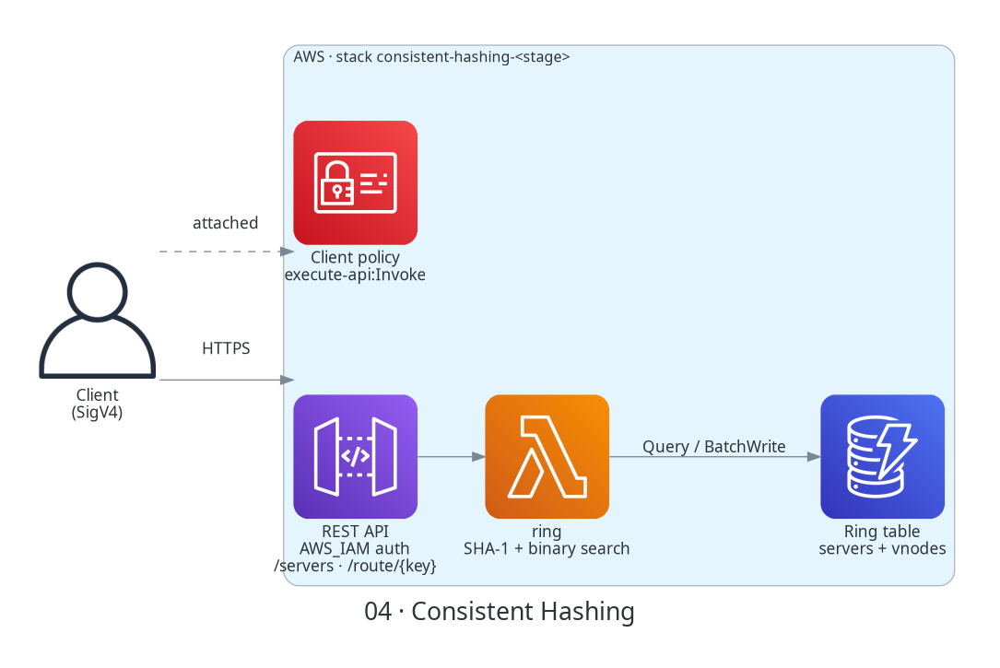
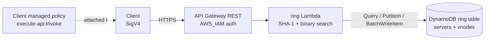

# 04 · Consistent Hashing


[← Portfolio](../README.md) · [Architecture](docs/architecture.md) · [Workflows](docs/workflow.md) · [Template](infrastructure/template.yaml) · [Code](src/ring/handler.py)



## Summary
A consistent hashing ring with virtual nodes, stored in DynamoDB and served by a Lambda behind an IAM-authorized API. You add and remove servers, and the API tells you which server owns any key, which key ranges changed owner, and how much of the ring each server holds. The design docs (concepts, then a Dynamo/Cassandra-style key-value store) explain the theory. Step 1 implements only the ring and routing; it stores no key data.

| Fact | Value |
|------|-------|
| Status | 🟡 Prototype: step 1, ring + routing (not deployed yet) |
| AWS services | API Gateway (REST) · Lambda (Python 3.12) · DynamoDB · IAM · CloudWatch Logs |
| Auth | IAM / SigV4 on every method, client managed policy output |
| Infra as code | [`infrastructure/template.yaml`](infrastructure/template.yaml) |
| Cost at idle | ~$0 (on-demand DynamoDB, pay-per-request Lambda and API Gateway) |

## Architecture
The image above is generated by [`docs/diagram.py`](docs/diagram.py). The same flow in Mermaid:



## How it works
1. Each server gets `vnodes` virtual nodes (default 100). Vnode `i` of server `s` sits at position `SHA-1("s#i")` on a ring of `0 .. 2^160 - 1`.
2. Vnodes are stored with the position as the sort key (40 hex digits, zero-padded), so one `Query` returns the ring in clockwise order.
3. To route a key, the Lambda hashes it with SHA-1 and binary-searches for the first vnode at or after that position, wrapping to the first vnode. That vnode's server owns the key.
4. With `?n=3` the Lambda keeps walking clockwise and returns the first 3 distinct physical servers (the preference list from [replication](docs/kv-2-replication-consistency.md#4-data-replication-for-high-availability)), skipping extra vnodes of servers already chosen. This is routing only; no data is replicated.
5. Adding or removing a server diffs the old and new ring and returns every key range `(start, end]` that changed owner, with `fromServer` and `toServer`. These are the [affected keys](docs/kv-1-partitioning.md#3-finding-affected-keys-on-addremove).

| Method | Path | Body | Result |
|--------|------|------|--------|
| `POST` | `/servers` | `{"serverId": "s0", "vnodes": 100}` | `201` vnodes added + changed ranges · `409` exists · `400` invalid |
| `GET` | `/servers` | | `200` servers, vnode counts, `sharePercent` of the ring |
| `DELETE` | `/servers/{serverId}` | | `200` vnodes removed + ranges and the server they move to · `404` |
| `GET` | `/route/{key}[?n=3]` | | `200` key position, owning vnode, `serverId`, optional `preferenceList` · `409` empty ring |

Validation: `serverId` is 1-64 chars of `A-Z a-z 0-9 _ . -`; `vnodes` is 1-500; `key` is 1-256 bytes; `n` is 1-10.

More detail and the data model: [docs/workflow.md](docs/workflow.md).

<details><summary>Example responses</summary>

```text
// GET /route/user-42?n=3
{"key": "user-42", "position": "3f1c…", "serverId": "s2",
 "vnode": {"position": "40a7…", "serverId": "s2", "vnodeIndex": 17},
 "preferenceList": ["s2", "s0", "s3"]}

// POST /servers {"serverId": "s4", "vnodes": 100}
{"serverId": "s4", "vnodesAdded": 100, "affectedRanges": 84,
 "ranges": [{"start": "02b1…", "end": "02f9…", "fromServer": "s1", "toServer": "s4"}, …]}
```
</details>

Local check of the ring code (4 servers x 100 vnodes, 10,000 keys): shares were 21-27% per server. Adding a 5th server moved 1,965 keys (19.6%), all to the new server. Removing a server moved only its own 2,173 keys.

## Design docs
<details><summary>Concepts and key-value store design (sections 1-17)</summary>

Phase 1, concepts, in [docs/architecture.md](docs/architecture.md):
1. [The rehashing problem](docs/architecture.md#1-the-rehashing-problem): why `hash(key) % n` moves most keys when `n` changes
2. [Hash space and hash ring](docs/architecture.md#2-hash-space-and-hash-ring)
3. [Hash servers onto the ring](docs/architecture.md#3-hash-servers-onto-the-ring)
4. [Hash keys onto the ring](docs/architecture.md#4-hash-keys-onto-the-ring)
5. [Server lookup](docs/architecture.md#5-server-lookup)
6. [Adding a server](docs/architecture.md#6-adding-a-server)
7. [Removing a server](docs/architecture.md#7-removing-a-server)
8. [Next: consistent hashing](docs/architecture.md#8-next-consistent-hashing)

Phase 2 designs a key-value store on top of the ring (Dynamo/Cassandra style):

[Part 1: partitioning](docs/kv-1-partitioning.md)

1. [Two issues with the basic approach](docs/kv-1-partitioning.md#1-two-issues-with-the-basic-approach)
2. [Virtual nodes](docs/kv-1-partitioning.md#2-virtual-nodes)
3. [Finding affected keys on add/remove](docs/kv-1-partitioning.md#3-finding-affected-keys-on-addremove)

[Part 2: replication and consistency](docs/kv-2-replication-consistency.md)

4. [Data replication for high availability](docs/kv-2-replication-consistency.md#4-data-replication-for-high-availability)
5. [Consistency and quorum (N, W, R)](docs/kv-2-replication-consistency.md#5-consistency-and-quorum-n-w-r)
6. [Consistency models](docs/kv-2-replication-consistency.md#6-consistency-models)
7. [Inconsistency resolution: versioning and vector clocks](docs/kv-2-replication-consistency.md#7-inconsistency-resolution-versioning-and-vector-clocks)

[Part 3: failure handling](docs/kv-3-failure-handling.md)

8. [Failure detection: gossip protocol](docs/kv-3-failure-handling.md#8-failure-detection-gossip-protocol)
9. [Handling temporary failures: sloppy quorum and hinted handoff](docs/kv-3-failure-handling.md#9-handling-temporary-failures-sloppy-quorum-and-hinted-handoff)
10. [Handling permanent failures: anti-entropy with Merkle trees](docs/kv-3-failure-handling.md#10-handling-permanent-failures-anti-entropy-with-merkle-trees)
11. [Handling data-centre outage](docs/kv-3-failure-handling.md#11-handling-data-centre-outage)

[Part 4: system architecture](docs/kv-4-system-architecture.md)

12. [The coordinator](docs/kv-4-system-architecture.md#12-the-coordinator)
13. [What a node contains](docs/kv-4-system-architecture.md#13-what-a-node-contains)
14. [Write path (Cassandra-style)](docs/kv-4-system-architecture.md#14-write-path-cassandra-style)
15. [Read path and Bloom filter](docs/kv-4-system-architecture.md#15-read-path-and-bloom-filter)
16. [Summary](docs/kv-4-system-architecture.md#16-summary)
17. [Next: implementation](docs/kv-4-system-architecture.md#17-next-implementation)

The concept images come from two matplotlib scripts (the second imports helpers from the first):
```bash
pip install matplotlib
python3 docs/diagram_ring.py   # phase 1: writes docs/images/*.png and prints the rehashing table
python3 docs/diagram_kv.py     # phase 2: writes docs/images/kv_*.png and prints example numbers
```
</details>

## Repo layout
```text
04-consistent-hashing/
├── README.md                          ← this file
├── docs/
│   ├── architecture.md                ← phase 1 concepts: hash ring, sections 1-8
│   ├── kv-1-partitioning.md           ← phase 2 design: sections 1-3
│   ├── kv-2-replication-consistency.md← phase 2 design: sections 4-7
│   ├── kv-3-failure-handling.md       ← phase 2 design: sections 8-11
│   ├── kv-4-system-architecture.md    ← phase 2 design: sections 12-17
│   ├── workflow.md                    ← data model, route/add-server sequences, test checks
│   ├── diagram.py                     ← hero image (AWS icons) → images/architecture.png
│   ├── diagram_ring.py                ← phase 1 concept images (matplotlib)
│   ├── diagram_kv.py                  ← phase 2 concept images (kv_*.png)
│   └── images/
├── infrastructure/
│   └── template.yaml                  ← DynamoDB, Lambda, REST API (AWS_IAM), client policy
├── src/
│   └── ring/handler.py                ← ring math + API routes
├── tests/
│   └── integration/
│       ├── sigv4.py                   ← stack outputs + SigV4-signed calls
│       └── test_api.py                ← end-to-end checks against the deployed stack
└── scripts/
    ├── deploy.sh                      ← lint, package src/, deploy, print outputs
    └── destroy.sh                     ← delete stack
```

## Deploy / Test / Teardown
```bash
cd 04-consistent-hashing
./scripts/deploy.sh dev us-east-1
# attach the ClientPolicyArn output to your IAM user/role, then:
python3 tests/integration/test_api.py dev
./scripts/destroy.sh dev us-east-1
```

## Cost & security notes
- **Cost:** on-demand DynamoDB, Lambda and API Gateway are pay-per-request, so idle cost is ~$0. Adding a 100-vnode server is 100 writes.
- **Auth:** every method uses `AWS_IAM`; callers need the `ClientPolicyArn` managed policy (`execute-api:Invoke` on this stage only). Unsigned requests get 403.
- **Least privilege:** the function role allows only `Query`, `GetItem`, `PutItem`, `DeleteItem` and `BatchWriteItem` on the ring table, plus writes to its own log group.
- **Data:** the table is encrypted at rest with point-in-time recovery on. Stage throttling is 10 rps, burst 20.
- **Limits:** a prototype with a single writer in mind. Two concurrent add/remove calls can each report ranges computed from a stale ring, though the stored vnodes stay correct.

## What I learned / next steps
- [x] Phase 1-2: concepts and key-value store design
- [x] Step 1: hash ring with virtual nodes, routing API, preference list, affected ranges
- [ ] Quorum reads and writes (N, W, R)
- [ ] Hinted handoff for temporary failures
- [ ] Merkle-tree anti-entropy repair
- [ ] Upgrade `01-key-value-store` with this design
