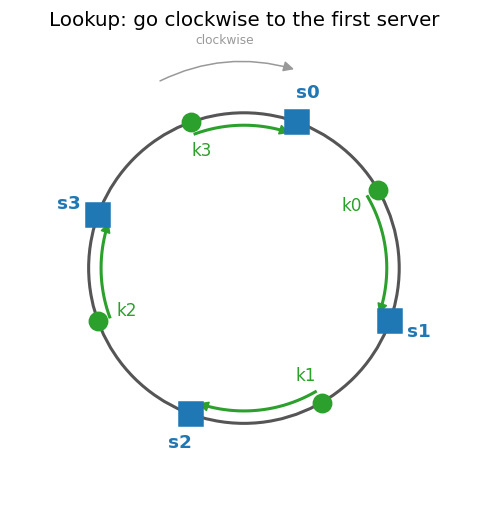

# 04 · Consistent Hashing


[← Portfolio](../README.md) · [Architecture](docs/architecture.md) · [Diagram script](docs/diagram.py)

## Summary
A consistent hashing system that spreads keys over servers so that adding or removing a server moves only a small share of the keys. Phase 1 covers the rehashing problem, the hash ring, lookups, and adding/removing servers. Phase 2 designs a Dynamo/Cassandra-style key-value store on top of it. Both are documentation only; CloudFormation, code and tests come in later phases.
| Fact | Value |
|------|-------|
| Status | ⚪ Planned: phases 1-2, concepts and diagrams |
| AWS services | To be decided in a later phase |
| Infra as code | Not yet |
| Cost | $0 (nothing deployed) |
## Architecture
The concept is explained step by step in [docs/architecture.md](docs/architecture.md):
1. [The rehashing problem](docs/architecture.md#1-the-rehashing-problem): why `hash(key) % n` moves most keys when `n` changes
2. [Hash space and hash ring](docs/architecture.md#2-hash-space-and-hash-ring)
3. [Hash servers onto the ring](docs/architecture.md#3-hash-servers-onto-the-ring)
4. [Hash keys onto the ring](docs/architecture.md#4-hash-keys-onto-the-ring)
5. [Server lookup](docs/architecture.md#5-server-lookup)
6. [Adding a server](docs/architecture.md#6-adding-a-server)
7. [Removing a server](docs/architecture.md#7-removing-a-server)
8. [Next: consistent hashing](docs/architecture.md#8-next-consistent-hashing)

Phase 2 designs a key-value store on top of the ring (Dynamo/Cassandra style), split into four docs:

[Part 1: partitioning](docs/kv-1-partitioning.md)

1. [Two issues with the basic approach](docs/kv-1-partitioning.md#1-two-issues-with-the-basic-approach)
2. [Virtual nodes](docs/kv-1-partitioning.md#2-virtual-nodes)
3. [Finding affected keys on add/remove](docs/kv-1-partitioning.md#3-finding-affected-keys-on-addremove)

[Part 2: replication and consistency](docs/kv-2-replication-consistency.md)

4. [Data replication for high availability](docs/kv-2-replication-consistency.md#4-data-replication-for-high-availability)
5. [Consistency and quorum (N, W, R)](docs/kv-2-replication-consistency.md#5-consistency-and-quorum-n-w-r)
6. [Consistency models](docs/kv-2-replication-consistency.md#6-consistency-models)
7. [Inconsistency resolution: versioning and vector clocks](docs/kv-2-replication-consistency.md#7-inconsistency-resolution-versioning-and-vector-clocks)

[Part 3: failure handling](docs/kv-3-failure-handling.md)

8. [Failure detection: gossip protocol](docs/kv-3-failure-handling.md#8-failure-detection-gossip-protocol)
9. [Handling temporary failures: sloppy quorum and hinted handoff](docs/kv-3-failure-handling.md#9-handling-temporary-failures-sloppy-quorum-and-hinted-handoff)
10. [Handling permanent failures: anti-entropy with Merkle trees](docs/kv-3-failure-handling.md#10-handling-permanent-failures-anti-entropy-with-merkle-trees)
11. [Handling data-centre outage](docs/kv-3-failure-handling.md#11-handling-data-centre-outage)

[Part 4: system architecture](docs/kv-4-system-architecture.md)

12. [The coordinator](docs/kv-4-system-architecture.md#12-the-coordinator)
13. [What a node contains](docs/kv-4-system-architecture.md#13-what-a-node-contains)
14. [Write path (Cassandra-style)](docs/kv-4-system-architecture.md#14-write-path-cassandra-style)
15. [Read path and Bloom filter](docs/kv-4-system-architecture.md#15-read-path-and-bloom-filter)
16. [Summary](docs/kv-4-system-architecture.md#16-summary)
17. [Next: implementation](docs/kv-4-system-architecture.md#17-next-implementation)

Images are generated by two scripts (the second imports helpers from the first):
```bash
pip install matplotlib
python3 docs/diagram.py      # phase 1: writes docs/images/*.png and prints the rehashing table
python3 docs/diagram_kv.py   # phase 2: writes docs/images/kv_*.png and prints example numbers
```
## Repo layout
```text
04-consistent-hashing/
├── README.md                          ← this file
└── docs/
    ├── architecture.md                ← phase 1: hash ring, sections 1-8
    ├── kv-1-partitioning.md           ← phase 2: sections 1-3
    ├── kv-2-replication-consistency.md← phase 2: sections 4-7
    ├── kv-3-failure-handling.md       ← phase 2: sections 8-11
    ├── kv-4-system-architecture.md    ← phase 2: sections 12-17
    ├── diagram.py                     ← phase 1 images
    ├── diagram_kv.py                  ← phase 2 images (kv_*.png)
    └── images/
```
## What I learned / next steps
- [x] Phase 2: key-value store design (virtual nodes, replication, quorum, vector clocks, gossip, hinted handoff, Merkle trees, write/read path)
- [ ] Implementation phase: infrastructure, code and tests
- [ ] Upgrade `01-key-value-store` with this design
