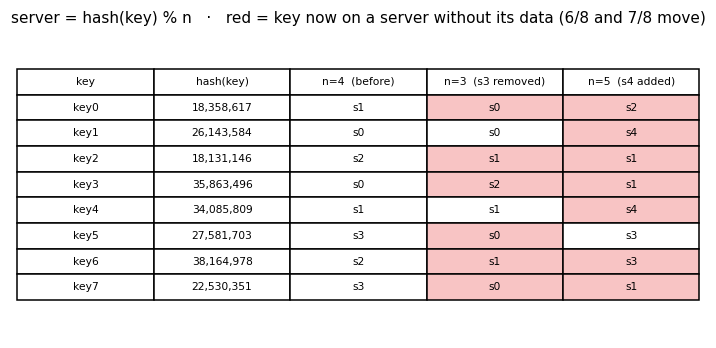
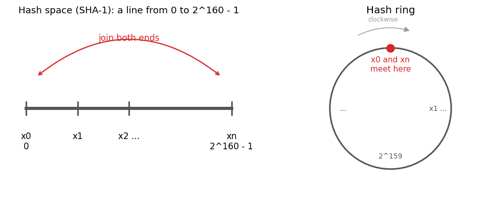
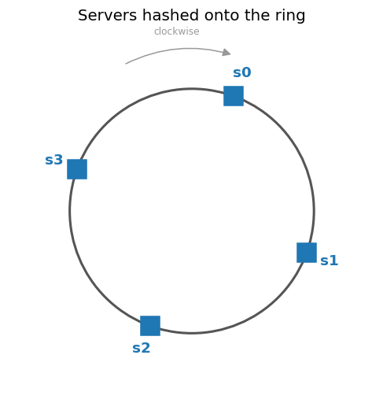
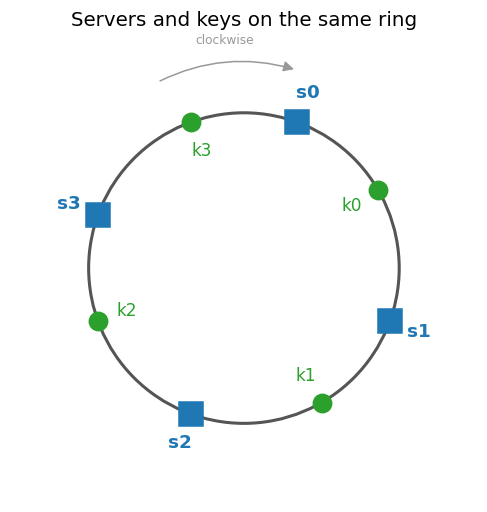
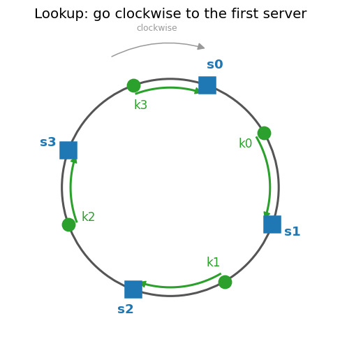
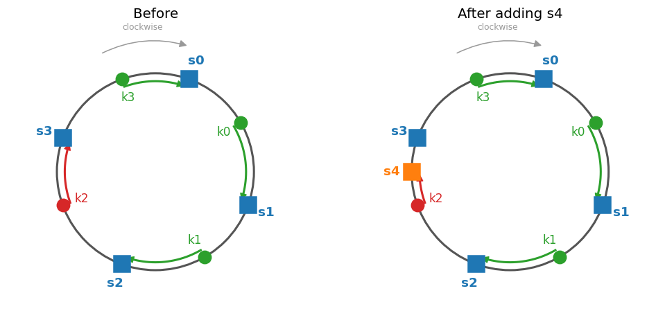
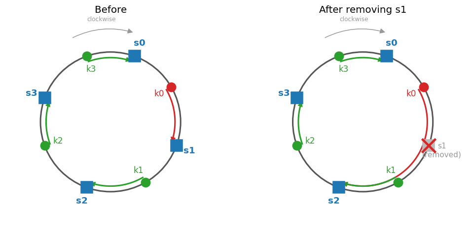

# Architecture · 04 Consistent Hashing
[← Project README](../README.md) · [Diagram script](diagram_ring.py)

This page builds the idea step by step: why `hash(key) % n` breaks when servers change, how a hash ring fixes it, and how lookups, adding and removing servers work on the ring. It is the design for the later phases. Nothing is deployed yet.

Images are generated by [`diagram_ring.py`](diagram_ring.py) (`python3 docs/diagram_ring.py`). Ring positions are illustrative, not real SHA-1 values. Every ring diagram uses the same positions for `s0..s3` and `k0..k3`, so they can be compared side by side.

## 1. The rehashing problem

With `n` cache servers, a common way to spread keys is:

```text
server = hash(key) % n
```

This works while `n` stays fixed. The table uses 8 keys with example hash values and 4 servers (`s0..s3`):

| Key | hash(key) | n = 4 (before) | n = 3 (s3 removed) | n = 5 (s4 added) |
|---|---|---|---|---|
| key0 | 18358617 | s1 | **s0** | **s2** |
| key1 | 26143584 | s0 | s0 | **s4** |
| key2 | 18131146 | s2 | **s1** | **s1** |
| key3 | 35863496 | s0 | **s2** | **s1** |
| key4 | 34085809 | s1 | s1 | **s4** |
| key5 | 27581703 | s3 | **s0** | s3 |
| key6 | 38164978 | s2 | **s1** | **s3** |
| key7 | 22530351 | s3 | **s0** | **s1** |

Bold = the key now maps to a different server. That server does not hold the key's data.



- **Server removed (n = 4 → 3):** 6 of 8 keys move, not only the 2 that lived on `s3`.
- **Server added (n = 4 → 5):** 7 of 8 keys move.

Because almost every key changes server, a cache sees a storm of misses, and a data store has to relocate most of its data. Ideally only the keys of the server that changed should move. That is what consistent hashing gives.

## 2. Hash space and hash ring

The **hash space** is the range of values a hash function can output. SHA-1 outputs 160 bits, so its hash space goes from `x0 = 0` to `xn = 2^160 - 1`.
Joining both ends of that range (so the value after `xn` is `x0` again) bends the line into a **hash ring**.



## 3. Hash servers onto the ring

Each server is placed on the ring by hashing its IP address or name with the same hash function (`hash("10.0.0.1")`, or `hash("s0")`). Its position is that hash value.



## 4. Hash keys onto the ring

Keys are hashed with the same function and placed on the same ring. There is **no modulo**: a key's position is its full hash value.



The problem this solves: the SHA-1 space has 2^160 values, far too many to map each one to a server in a lookup table. Hashing the key gives every key a deterministic position on the ring, so there is no per-key lookup table either. The ring itself only stores the sorted positions of the servers; a binary search on that list finds the next server clockwise from a key's position. The number of servers no longer appears in the formula, so changing it does not reshuffle everything.

## 5. Server lookup

To find the server for a key, start at the key's position and walk **clockwise** until the first server. That server stores the key.



| Key | Server |
|---|---|
| k0 | s1 |
| k1 | s2 |
| k2 | s3 |
| k3 | s0 (walks past the top of the ring, where `xn` wraps to `x0`) |

## 6. Adding a server

Add `s4` between `k2` and `s3`. Only the keys between `s4` and the previous server counter-clockwise (`s2`) move to `s4`. Here that is `k2`, which moves from `s3` to `s4`. `k0`, `k1` and `k3` stay where they are.



## 7. Removing a server

Remove `s1`. Only the keys that belonged to `s1` move, to the next server clockwise. Here `k0` moves from `s1` to `s2`. All other keys stay.



Compare with section 1: with `% n`, removing one server moved 6 of 8 keys. On the ring, adding or removing one server moves only the keys in one segment of the ring.

## 8. Next: consistent hashing

The basic approach so far:
1. Map servers and keys onto the ring with one uniform hash function.
2. A key belongs to the first server clockwise from it.

Phase 2 covers the problems with this basic approach, such as uneven partition sizes and uneven key spread when servers are added or removed, how virtual nodes fix them, and the key-value store built on top. Start with [part 1: partitioning](kv-1-partitioning.md).
