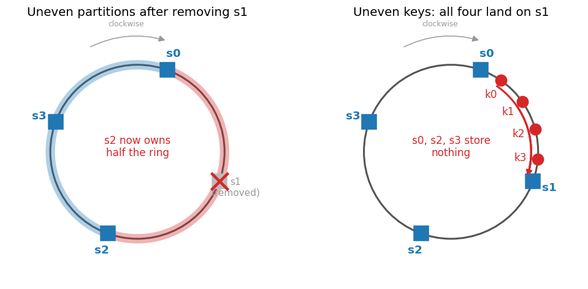
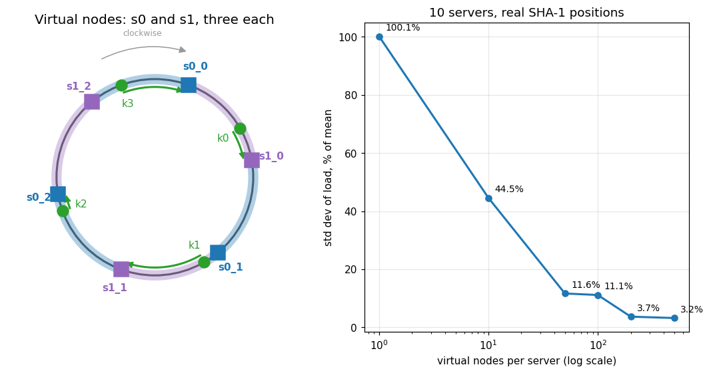
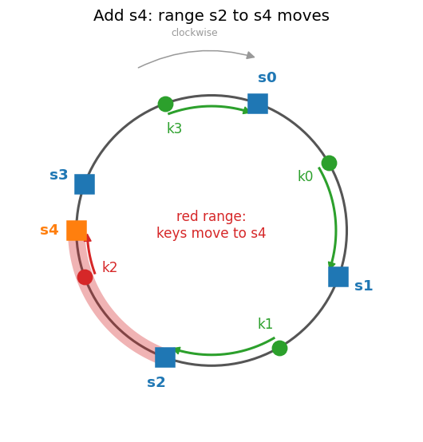
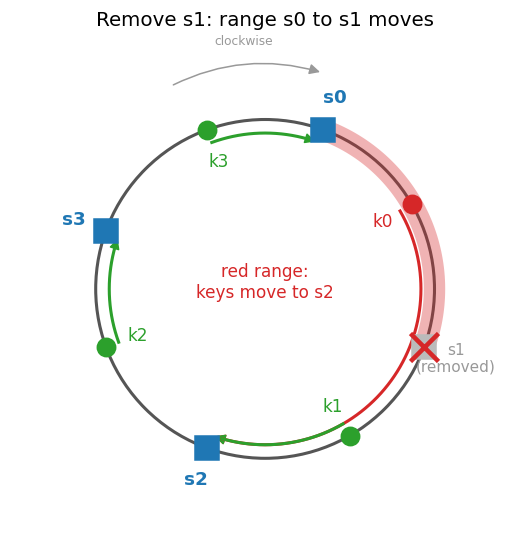

# Key-value store design, part 1 · Partitioning
[← Project README](../README.md) · [← Phase 1: the hash ring](architecture.md) · [Part 2: replication and consistency →](kv-2-replication-consistency.md)

Phase 2 designs a distributed key-value store on top of the hash ring from phase 1, in the style of Amazon Dynamo and Apache Cassandra. This part fixes the weak spots of the basic ring. Docs only; nothing is deployed.

Images are generated by [`diagram_kv.py`](diagram_kv.py) (`python3 docs/diagram_kv.py`). It reuses the ring positions of phase 1: `s0..s3` and `k0..k3` sit at the same places.

## 1. Two issues with the basic approach

The basic ring (phase 1, section 8) has two problems.

1. **Partitions become uneven.** A partition is the stretch of ring between a server and the previous server counter-clockwise. Servers land wherever their hash puts them, and adding or removing one changes the gaps. On the left, removing `s1` hands its whole range to `s2`, so `s2` now owns half the ring while `s0` and `s3` own a quarter each.
2. **Keys can be unevenly spread.** Even with equal partitions, keys may cluster. On the right, `k0..k3` all fall between `s0` and `s1`, so `s1` stores everything and the other three servers store nothing.

## 2. Virtual nodes

A **virtual node** (vnode) is one more position on the ring for the same physical server. Server `s0` is hashed several times (`hash("s0_0")`, `hash("s0_1")`, `hash("s0_2")`), and each result is a point on the ring that belongs to `s0`.

Nothing else changes:
- Keys are still hashed onto the ring. Vnodes do not replace key hashing; the key's hash is still what decides where the key sits.
- A lookup still walks clockwise from the key to the first node. If that node is `s0_1`, the key is stored on physical server `s0`.

What vnodes change is the size of the ranges. Each server now owns many small ranges spread around the ring instead of one big one, so the total load per server evens out.

Left: `s0` and `s1` with three vnodes each. `k0 → s1_0`, `k1 → s1_1`, `k2 → s0_2`, `k3 → s0_0`, so each physical server gets two keys.

Right: the share of the ring owned by each of 10 servers, using real SHA-1 positions. The y-axis is the standard deviation of that share as a percentage of the mean (lower = more even). With 1 position per server it is about 100%; with 200 vnodes it is about 4%. More vnodes give a more even load, at the cost of more metadata: every node must store and search a longer sorted list of positions. Real systems pick a middle value (Cassandra's `num_tokens` setting is the number of vnodes per node).

Vnodes also help with **heterogeneity**: a server with twice the capacity can be given twice as many vnodes, so it takes twice the load.

## 3. Finding affected keys on add/remove

When a node (a server or a single vnode) joins or leaves, only one range of the ring changes owner.

**Adding a node.** The affected range runs from the new node **counter-clockwise** to the previous node. Keys in that range move to the new node. Adding `s4` affects the range `(s2, s4]`, so `k2` moves from `s3` to `s4`.

**Removing a node.** The affected range runs from the removed node counter-clockwise to the previous node. Those keys move to the next node **clockwise**. Removing `s1` affects `(s0, s1]`, so `k0` moves to `s2`.

How keys are redistributed:
1. Find the new or removed node's position in the sorted list of positions.
2. Find the previous position counter-clockwise. The affected range is between the two.
3. Add: the server that used to own the range (the next node clockwise from the new one) copies the keys in that range to the new node, then deletes them once the new node is serving them.
   Remove: the next node clockwise takes over the range. In a planned removal the leaving node streams its keys there first. In a crash the data is rebuilt from replicas (part 2, section 4).

With vnodes, one physical server joining adds many small ranges, so it takes a little data from many existing servers instead of a lot from one.
