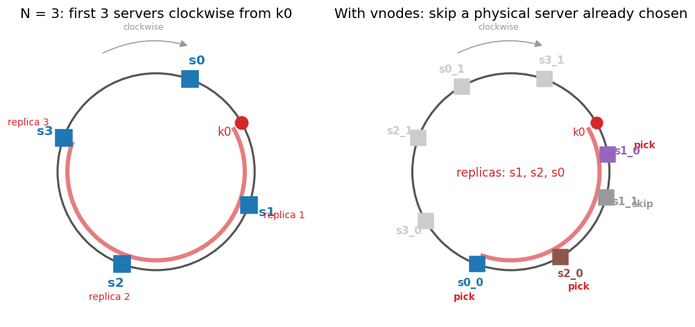
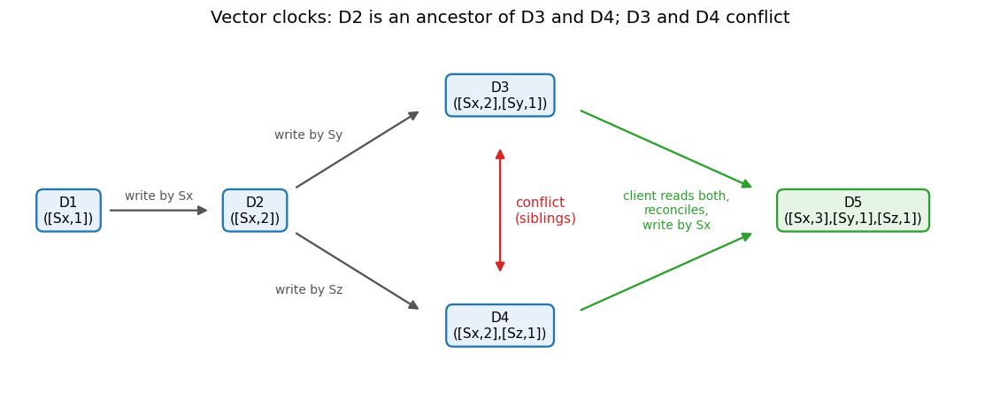

# Key-value store design, part 2 · Replication and consistency
[← Project README](../README.md) · [← Part 1: partitioning](kv-1-partitioning.md) · [Part 3: failure handling →](kv-3-failure-handling.md)

## 4. Data replication for high availability

To survive a server failure, each key is stored on `N` servers. After finding the key's position, walk clockwise and pick the first `N` **distinct** servers. With `N = 3`, `k0` is stored on `s1`, `s2` and `s3`.

With vnodes there is a trap. The next three vnodes clockwise may belong to only one or two physical machines. If they are all on `s1` and `s1` loses power, every "replica" is gone at once.

The fix:
- While walking clockwise, **skip any vnode whose physical server is already chosen**. On the right, the walk from `k0` meets `s1_0` (pick), `s1_1` (skip, also `s1`), `s2_0` (pick), `s0_0` (pick). The replicas are `s1`, `s2`, `s0`.
- Go one step further and place replicas in **different racks or data centres**, so one power supply, switch or building cannot take out all copies. Each node records its rack/data centre, and the walk also skips nodes in a rack already used.



The list of servers that hold a key is called its **preference list**.

## 5. Consistency and quorum (N, W, R)

Replicas must agree. Quorum settings control how much they must agree before a request counts as done.

| Symbol | Meaning |
|---|---|
| `N` | Number of replicas of each key |
| `W` | Write quorum: a write succeeds once `W` replicas have acknowledged it |
| `R` | Read quorum: a read succeeds once `R` replicas have answered |

The **coordinator** is the node that receives the client request (section 12). It sends the write or read to all `N` replicas and replies to the client as soon as `W` acks (write) or `R` responses (read) arrive. If the `R` responses differ, it returns the newest version (or all conflicting versions, section 7).

How each setting affects the system:
- **Lower `W`**: faster writes (wait for fewer acks), but fewer replicas are sure to have the new value.
- **Higher `W`**: slower writes and less tolerant of a down replica, but the value is on more servers.
- **Lower `R`**: faster reads, but a read may hit a replica that has not seen the latest write.
- **Higher `R`**: slower reads, but more replicas are compared, so the newest value is more likely found.

**The rule:** if `W + R > N`, any write set and any read set must share at least one replica, so every read sees the latest successful write (strong consistency). If `W + R <= N`, the sets may not overlap and a read can return stale data.

| N | W | R | W + R > N? | Behaviour | Fits |
|---|---|---|---|---|---|
| 3 | 1 | 3 | yes (4) | Fast writes, slow reads | Write-heavy |
| 3 | 3 | 1 | yes (4) | Fast reads, slow writes; a write fails if any replica is down | Read-heavy |
| 3 | 2 | 2 | yes (4) | Balanced; tolerates one replica down for both reads and writes | General use |
| 3 | 1 | 1 | no (2) | Fastest, may read stale data | Caches, metrics where staleness is fine |
| 3 | 2 | 1 | no (3) | Fast reads, may read stale data | Read-heavy where small staleness is fine |

Real systems:
- **Amazon Dynamo** (2007 paper): the common `(N, R, W)` configuration used by Dynamo instances is `(3, 2, 2)`, which gives `W + R = 4 > 3`.
- **Apache Cassandra**: the replication factor is set per keyspace (3 is common), and the client picks a consistency level per request. `ONE` waits for one replica, `QUORUM` for a majority (2 of 3), `ALL` for all 3, and `LOCAL_QUORUM` for a majority of replicas in the local data centre only. Writing and reading at `QUORUM` gives 2 + 2 > 3; reading and writing at `ONE` gives 1 + 1 <= 3, so reads may be stale.
- **Riak KV**: per-bucket `n_val` (default 3), with `r` and `w` that default to `quorum`. They can be changed per bucket or per request.

## 6. Consistency models

| Model | What a read sees | Downside | Fits |
|---|---|---|---|
| **Strong** | Always the latest successful write | Must wait for replicas to agree, so higher latency; when replicas are unreachable it rejects requests (lower availability) | Bank balances, inventory counts, seat booking |
| **Weak** | May never see the latest write; no guarantee | Confusing for users and hard to program against | Live video, voice calls, game state where old data is useless anyway |
| **Eventual** | May be stale for a while; if writes stop, all replicas converge to the same value | Short windows of stale reads; conflicting writes must be resolved | Social feeds, likes, shopping carts, DNS |

This design, like Dynamo and Cassandra, adopts **eventual consistency**. It keeps the store available during failures and partitions, and keeps latency low. The cost: concurrent writes can create conflicting versions on different replicas, so the system must detect and resolve them.

## 7. Inconsistency resolution: versioning and vector clocks

**Versioning** means every change to a value creates a new, immutable version instead of overwriting in place. When two replicas hold different versions, the system needs to tell whether one is simply newer, or whether they were written concurrently and conflict.

A **vector clock** is a list of `[server, version]` pairs attached to each version:

```text
D([s1, v1], [s2, v2], ..., [sn, vn])
```

When server `Si` writes data item `D`:
- if `[Si, vi]` already exists in the clock, increment `vi`;
- otherwise add `[Si, 1]`.

Worked example:

| Step | Event | Version | Vector clock |
|---|---|---|---|
| 1 | Client writes; handled by `Sx` | D1 | `([Sx,1])` |
| 2 | Client updates D1; handled by `Sx` | D2 | `([Sx,2])` |
| 3 | Client A updates D2; handled by `Sy` | D3 | `([Sx,2],[Sy,1])` |
| 4 | At the same time, client B updates D2; handled by `Sz` | D4 | `([Sx,2],[Sz,1])` |
| 5 | A client reads D3 and D4, sees the conflict, merges them; handled by `Sx` | D5 | `([Sx,3],[Sy,1],[Sz,1])` |



Rules (a server missing from a clock counts as 0):
- **X is an ancestor of Y** (no conflict, Y replaces X) if every counter in X is less than or equal to the matching counter in Y. Example: `D([s0,1],[s1,1])` is an ancestor of `D([s0,1],[s1,2])`. D2 is an ancestor of D3 and D4.
- **X and Y are siblings** (conflict) if X has some counter larger than Y and Y has some counter larger than X. Example: `D([s0,1],[s1,2])` and `D([s0,2],[s1,1])`. D3 (`Sy:1, Sz:0`) and D4 (`Sy:0, Sz:1`) are siblings.

Downsides:
- **The client must resolve conflicts.** The store can detect siblings but does not know which value is right, so it returns both and the application decides. Options:
  - *Merge*: for a shopping cart, take the union of items. Nothing added is lost, but a deleted item can come back.
  - *Last write wins* (by timestamp): simple, but silently drops one of the concurrent writes, and depends on clocks across servers being close.
  - *Ask the user* or apply a domain rule (for example, the highest bid wins).
- **The clock grows.** Every server that ever handles a write adds a pair. The fix is a threshold (for example 10 pairs): when the clock grows past it, drop the oldest pair (each pair keeps a timestamp of its last update). This can make reconciliation inaccurate, because a dropped pair can make an ancestor look like a sibling. The Dynamo paper reports this problem did not show up in production.
