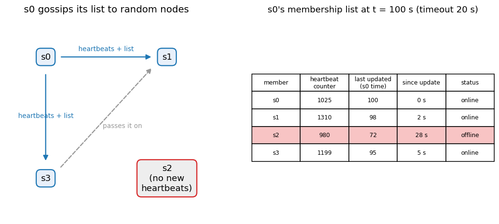
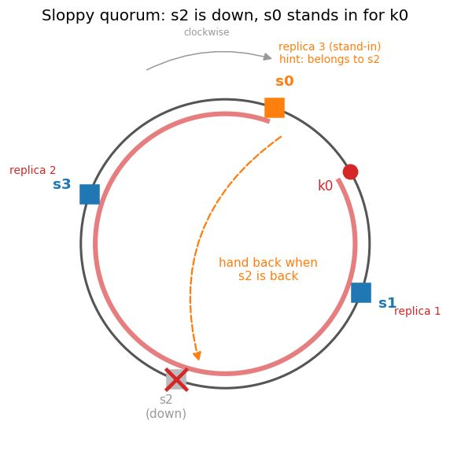
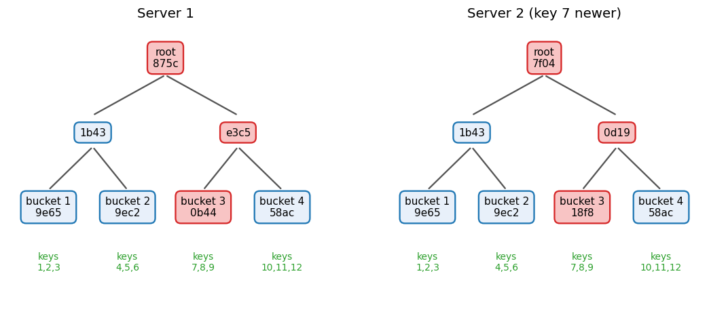

# Key-value store design, part 3 · Failure handling
[← Project README](../README.md) · [← Part 2: replication and consistency](kv-2-replication-consistency.md) · [Part 4: system architecture →](kv-4-system-architecture.md)

## 8. Failure detection: gossip protocol

One node saying "s2 is down" is not enough. The link between those two nodes may be broken while `s2` is fine for everyone else. A node should be marked down only when several nodes agree.

The simple way is all-to-all heartbeats: every node pings every other node. With `n` nodes that is about `n²` messages per round, which does not scale to hundreds of nodes.

**Gossip** spreads the same information with far fewer messages:
1. Each node keeps a **membership list**: every node ID, its heartbeat counter, and the local time that entry was last updated.
2. Each node periodically (say every second) increments its own heartbeat counter.
3. It sends its list to a few random nodes.
4. A receiver merges the list: for each member, if the received counter is higher than its own copy, it stores the new counter and sets "last updated" to its current time. It then gossips onward, so news spreads through the cluster in a few rounds.
5. If a member's counter has not increased for a set period (the timeout), it is marked offline. Because the counter arrives through many paths, one broken link does not cause a false "down".

Worked example. `s0`'s membership list at two moments, timeout 20 s. Each node increments its counter once per second.

| Member | Counter at t = 80 | Last updated | Counter at t = 100 | Last updated | Time since update at t = 100 | Status at t = 100 |
|---|---|---|---|---|---|---|
| s0 (self) | 1005 | 80 | 1025 | 100 | 0 s | online |
| s1 | 1290 | 78 | 1310 | 98 | 2 s | online |
| s2 | 980 | 72 | 980 | 72 | 28 s | **offline** |
| s3 | 1181 | 77 | 1199 | 95 | 5 s | online |

`s1` and `s3` keep rising. `s2` is stuck at 980 since t = 72. At t = 80 that is only 8 s, under the timeout. At t = 100 it is 28 s, so `s0` marks `s2` offline and gossips that to the others.

## 9. Handling temporary failures: sloppy quorum and hinted handoff

With a **strict quorum**, if one of a key's `N` replicas is down, a `W = 3` write fails and even `W = 2` loses some margin. That hurts availability.

A **sloppy quorum** keeps going: the coordinator sends writes (and reads) to the first `W` (or `R`) **healthy** servers clockwise on the ring, skipping servers that gossip reports as down. Those may not be the key's usual replicas.

Example, `N = 3`: `k0` normally lives on `s1`, `s2`, `s3`. `s2` is down, so the walk skips it and uses `s0` as the third replica.

**Hinted handoff:** `s0` stores the `k0` write together with a **hint** saying "this belongs to `s2`". `s0` keeps such hints in a separate local store and checks `s2`'s state through gossip. When `s2` comes back, `s0` sends it the hinted writes and then deletes its copy. `s2` is up to date again without a full repair.

Trade-off: with `W = 2`, a write might be acked only by `s3` and `s0`. If `s2` comes back before the hint is handed off, a read with `R = 2` from `s1` and `s2` misses that write, so `W + R > N` no longer guarantees overlap. This fits the eventual consistency choice in section 6.

## 10. Handling permanent failures: anti-entropy with Merkle trees

Hinted handoff covers short outages. If a replica is lost for good, or a hint is lost (for example the stand-in also fails), replicas drift apart. **Anti-entropy** fixes this: replicas compare their data and each updates any key it holds an older version of to the newest version.

Comparing every key would mean sending the entire data set over the network. A **Merkle tree** (hash tree) avoids that. Building one, for keys 1 to 12:

1. **Divide the key space into buckets.** Here 4 buckets of 3 keys: `1-3`, `4-6`, `7-9`, `10-12`.
2. **Hash each key** (with its value) in each bucket.
3. **One hash per bucket**: hash the bucket's key hashes together.
4. **Build parents up to the root**: hash pairs of child hashes together, level by level, until one root hash remains.

Comparing two replicas:

5. **Compare the root hashes.** Equal roots mean the replicas hold the same data, and nothing else is sent.
6. **If the roots differ, compare the children**, and walk down only the branches whose hashes differ, until you reach the buckets that differ.
7. **Sync only the keys in those buckets.**

In the diagram, server 2 has a newer value for key 7. The red path shows the hashes that differ: root, then the right child, then bucket 3. Buckets 1, 2 and 4 match and are never looked at. Hashes are real SHA-1 values, shown as the first 4 hex digits.

Why this suits large data sets: the data transferred is proportional to the **differences** between the replicas, not to the total amount of data. With a billion keys split into a million buckets of about 1,000 keys, one stale key means walking down about 20 levels of the tree (2^20 ≈ one million), comparing two hashes per level, and sending one bucket of about 1,000 keys. Each node keeps one tree per key range it holds, so trees can be compared range by range.

## 11. Handling data-centre outage

A whole data centre can fail (power, network, fire, flood). To stay available, each key is replicated **across several data centres** (section 4's rack/DC-aware placement). If one data centre goes offline, clients are routed to another that holds full copies of the data. Cassandra expresses this as a replication factor per data centre, and `LOCAL_QUORUM` lets requests wait only for replicas in the local DC so normal latency stays low.
