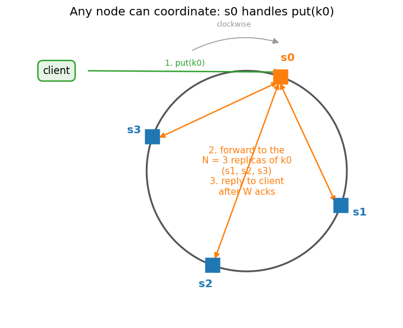
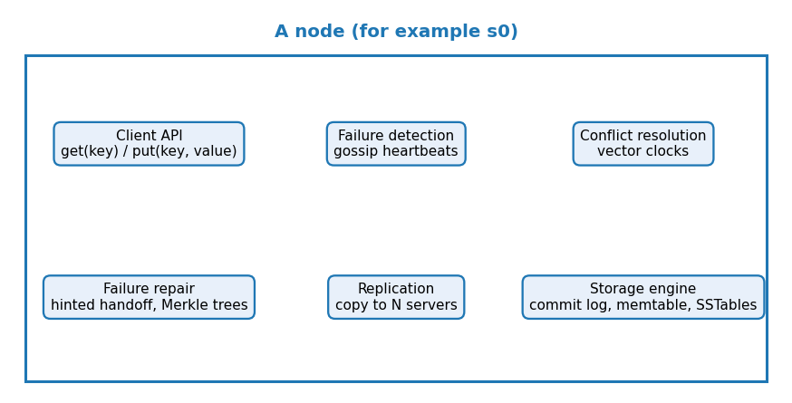
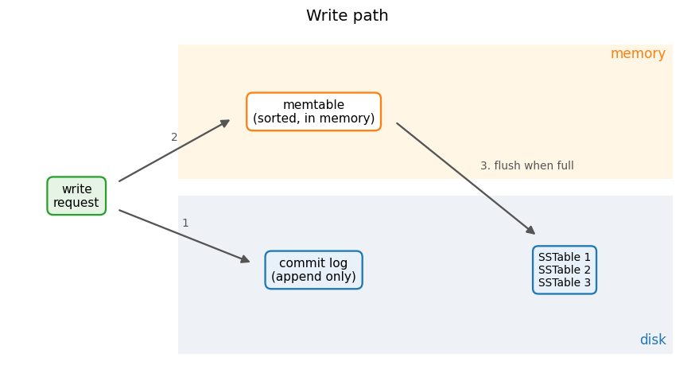
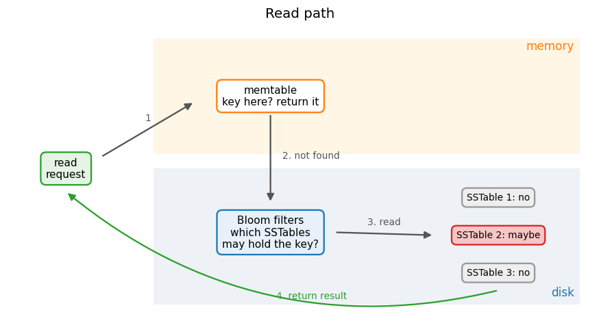

# Key-value store design, part 4 · System architecture
[← Project README](../README.md) · [← Part 3: failure handling](kv-3-failure-handling.md)

## 12. The coordinator

The **coordinator** is the node that acts as a proxy between the client and the replicas. It finds the key's preference list on the ring (section 4), forwards the request to the replicas, waits for `W` acks or `R` responses (section 5), resolves versions (section 7) and replies.

There is no single, special coordinator. **Any node can coordinate**: every node knows the ring, so whichever node receives the request routes it. Below, the client sends `put(k0)` to `s0`; `s0` is not a replica of `k0`, but it knows the replicas are `s1`, `s2`, `s3` and forwards to them.

Making the coordinator role multi-node avoids a single point of failure. Things to get right:

- **Membership agreement.** All nodes must agree on who is in the cluster and who is down. Gossip (section 8) spreads joins, leaves and failures.
- **A consistent view of the ring.** Each node needs the same sorted list of (v)node positions, or two coordinators could send the same key to different replicas. Ring changes travel by gossip with a version number, and nodes adopt the newer ring.
- **Request routing.** Either the client is *ring-aware* (it holds the ring and sends straight to a replica, saving one hop; Cassandra drivers can do this with token-aware routing) or a **load balancer** sends requests to any node, which then coordinates (simpler clients, one extra hop).
- **A coordinator dying mid-request.** The client uses a timeout and retries on another node. A retry can apply a write twice, so writes should be **idempotent** (same key and value give the same result) or carry a request ID that replicas use to drop duplicates. Some replicas may already have the write; vector clocks and anti-entropy reconcile them.
- **Leader-less vs leader-based.** Leader-less (Dynamo, Cassandra, Riak): any node accepts writes, so availability and write latency are good, but concurrent writes can conflict and need resolution. Leader-based (one leader per key range, with Raft or Paxos to elect it): ordered writes and simpler consistency, but writes wait for the leader, and there is a pause while a new one is elected.
- **Avoiding split-brain.** If the network splits, both halves may keep accepting writes. In a leader-less design that is allowed and the conflicts are reconciled later. If strong consistency is needed, require a majority (quorum) to accept writes or elect a leader, so at most one side can make progress.

## 13. What a node contains

Every node runs the same set of components, so there is no special node.

- **Client API**: accepts `get(key)` and `put(key, value)` and acts as coordinator.
- **Failure detection**: sends and merges gossip heartbeats, marks nodes online/offline.
- **Conflict resolution**: attaches and compares vector clocks, returns siblings to the client.
- **Failure repair**: hinted handoff for temporary failures, Merkle tree anti-entropy for permanent ones.
- **Replication**: copies each key to the `N` servers of its preference list.
- **Storage engine**: stores data on the local disk (commit log, memtable, SSTables).

## 14. Write path (Cassandra-style)

1. The write is appended to the **commit log** on disk. Appending is fast, and after a crash the log is replayed so nothing acknowledged is lost.
2. The write is added to the **memtable**, a sorted table in memory. The write is now acknowledged.
3. When the memtable is full (it reaches a size threshold), it is **flushed** in bulk to disk as an **SSTable** (sorted string table), which is never modified afterwards. The commit log entries it covers can then be discarded.

Writes never update data on disk in place. Many small writes become one large sequential write, which is why this path is fast. Over time, background **compaction** merges SSTables and drops overwritten values.

## 15. Read path and Bloom filter

1. Check the **memtable**. If the key is there, return it.
2. If not, ask each SSTable's **Bloom filter** whether that SSTable may contain the key.
3. Read only from the SSTables that answer "maybe"; if several have the key, keep the newest version.
4. Return the result to the client.

**Bloom filter:** a bit array plus `k` hash functions. To add a key, set the `k` bits its hashes point to. To check a key, look at those `k` bits: if any is 0 the key is **definitely not present**; if all are 1 it is **maybe present**. False positives are possible, false negatives are not.

Tiny example: 10 bits, `k = 2`. Add `k0` (bits 1, 4) and `k1` (bits 4, 7), so bits 1, 4, 7 are set. Checking `k2` (bits 2, 7): bit 2 is 0, so definitely not present. Checking `k3` (bits 1, 7): both are 1, so maybe present, though `k3` was never added (a false positive, which costs one wasted disk read).

## 16. Summary

| Goal / problem | Technique |
|---|---|
| Store big data | Consistent hashing to spread load across servers |
| High-availability reads | Replication, multi-data-centre setup |
| High-availability writes | Versioning and conflict resolution with vector clocks |
| Partition the data | Consistent hashing |
| Incremental scalability | Consistent hashing (adding a node moves only one range) |
| Heterogeneity | Virtual nodes (more vnodes for bigger servers) |
| Tunable consistency | Quorum consensus (`N`, `W`, `R`) |
| Handle temporary failures | Sloppy quorum and hinted handoff |
| Handle permanent failures | Anti-entropy with Merkle trees |
| Handle data-centre outage | Cross-data-centre replication |
| Detect failures | Gossip protocol |
| Fast writes and reads on one node | Commit log + memtable + SSTables, Bloom filters |

## 17. Next: implementation

This design will be built as a working example in a later phase (infrastructure, code and tests). After that, the same design will be used to upgrade [`01-key-value-store`](../../01-key-value-store/).
