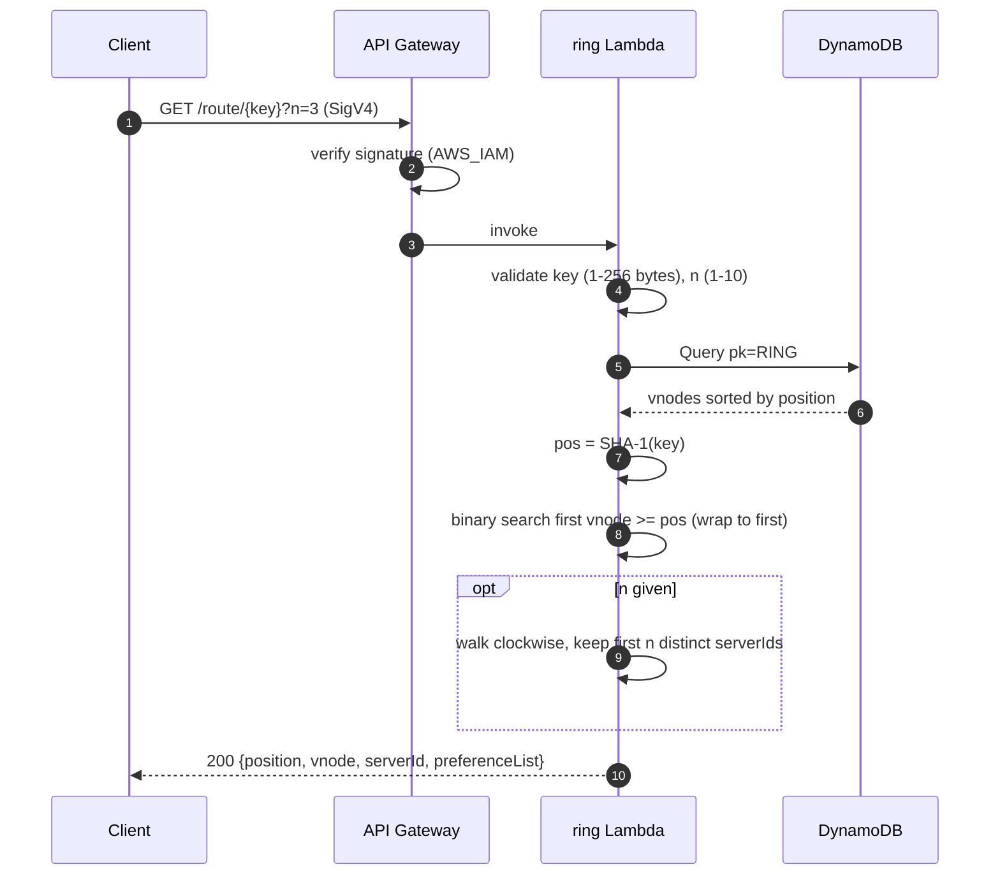
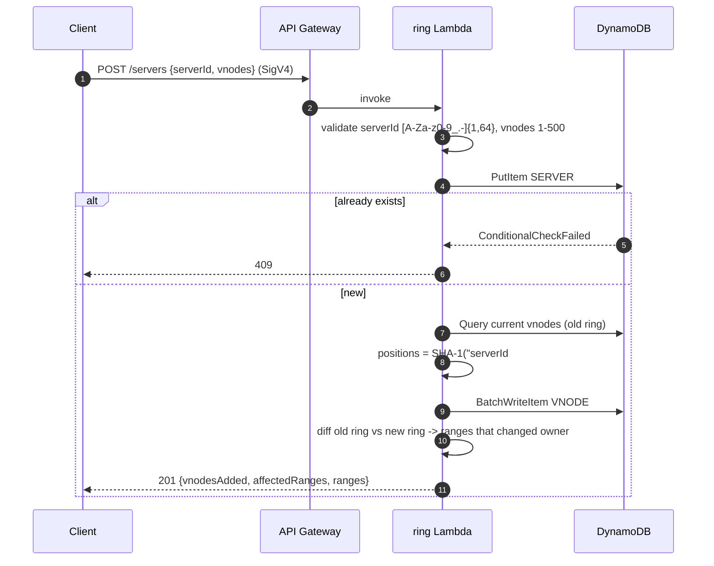
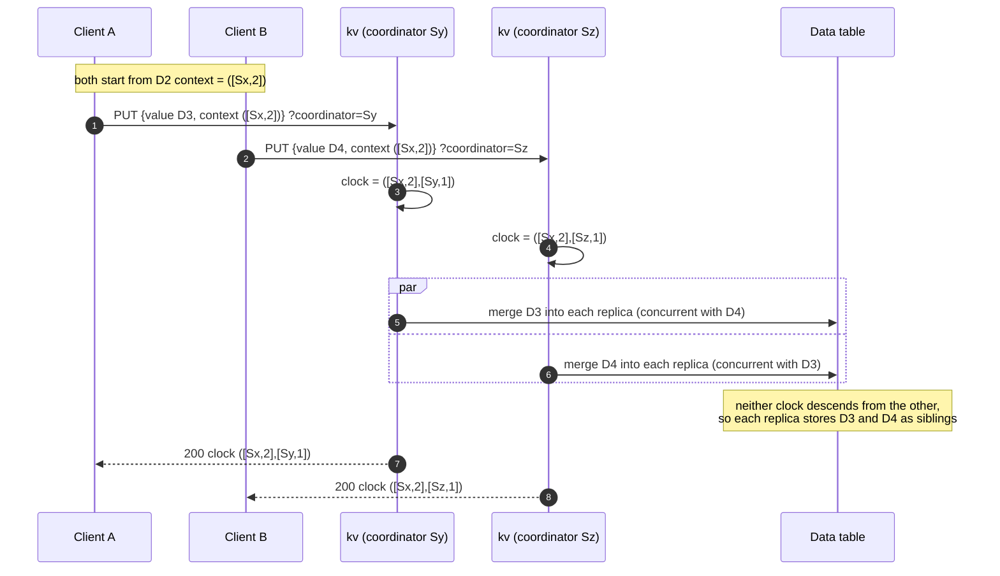
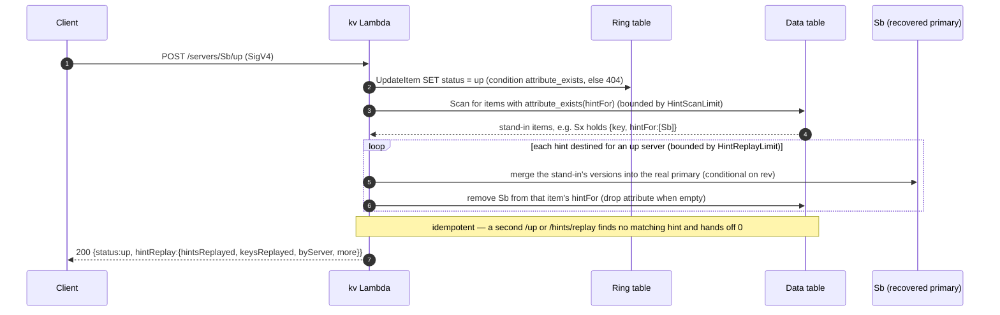
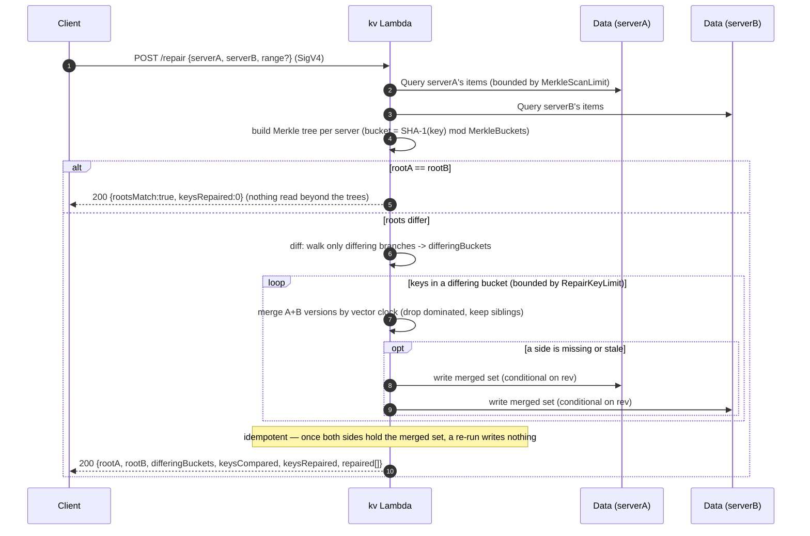
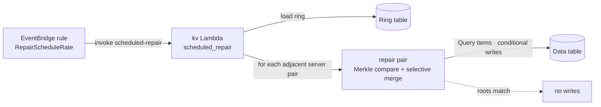
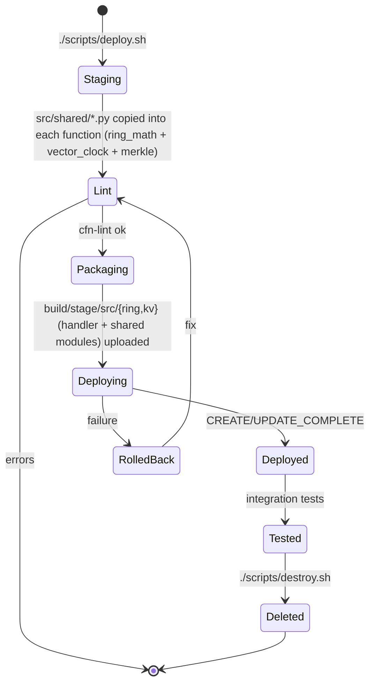

# Workflow · 04 Consistent Hashing
[← Project README](../README.md)

Step 1 built the hash ring with virtual nodes and a routing API. Step 2 added a kv coordinator Lambda that stores each key on N replicas with quorum writes (W) and reads (R), plus up/down switches that simulate server failure. Step 3 replaces the integer version with a **vector clock**: a coordinator stamps each write, replicas keep concurrent siblings, and a read detects conflicts and resolves them server-side with last-write-wins. Step 4 makes the quorum **sloppy**: when a primary replica is down the coordinator walks the ring to a healthy **stand-in** for both writes and reads, a stand-in write records a **hint** (`hintFor`) naming the down primary, and when the primary returns (`/up`, or `POST /hints/replay`) the hint is replayed to it and cleared (**hinted handoff**). Step 5 handles **permanent** failures with **Merkle-tree anti-entropy repair**: each server summarises its data as a Merkle tree (keys in `MerkleBuckets` leaf buckets, hashed pairwise to a root), and `POST /repair` compares two trees and reconciles only the keys in the buckets that differ. A scheduled EventBridge rule runs the same repair over adjacent replica pairs in the background. Data is not moved when the ring changes.

## Data model
Two DynamoDB tables. The ring table has one partition per ring (`pk = RING#default`). Vnode sort keys are the zero-padded 40-hex-digit SHA-1 position, so a `Query` on `begins_with(sk, "VNODE#")` returns the ring already sorted clockwise.

```mermaid
erDiagram
    SERVER ||--o{ VNODE : "owns vnodeCount of"
    SERVER {
        string pk "RING#default"
        string sk "SERVER#<serverId>"
        string serverId
        number vnodeCount "1-500, default 100"
        string status "up | down (simulated failure)"
    }
    VNODE {
        string pk "RING#default"
        string sk "VNODE#<sha1(serverId#vnodeIndex), 40 hex>"
        string serverId
        number vnodeIndex "0 .. vnodeCount-1"
    }
    SERVER ||--o{ REPLICA : "stores"
    REPLICA {
        string serverId "partition key (data table)"
        string itemKey "sort key: the user key"
        number rev "revision for the conditional write (optimistic lock)"
        string versions "JSON list of siblings {value, clock, timestamp, coordinator}, value up to 10 KB"
        string hintFor "stand-in only: JSON list of down primaries this copy is held for (absent on a normal replica)"
    }
```

The data table holds one item per replica: the same key on 3 servers is 3 items, `(s2, user-42)`, `(s0, user-42)`, `(s3, user-42)`. Each server gets its own partition, like one node's local storage. Each item stores a list of concurrent sibling versions, each with its own vector clock, plus a `rev` that backs an optimistic-concurrency conditional write so two coordinators writing the same replica item do not clobber each other. Ring math (`src/shared/ring_math.py`), vector-clock ops (`src/shared/vector_clock.py`) and Merkle-tree build/diff (`src/shared/merkle.py`) are copied into the functions at package time. Repair reads a server's items with a `Query` over its partition and builds a tree keyed by `SHA-1(key) mod MerkleBuckets`, so the bucket a key lands in is the same on every server.

## Route a key


## Add a server


Removing a server (`DELETE /servers/{serverId}`) is the reverse: load the ring, delete that server's vnodes and its `SERVER#` item, and return each range with `fromServer` (the removed one) and `toServer` (the next vnode clockwise).

## Quorum write (PUT) with a vector clock

Defaults N=3, W=2. The coordinator (first up server, or `?coordinator=`) increments its own clock entry. Each replica merges the new version into its sibling list under a conditional write on `rev`.

```mermaid
sequenceDiagram
    autonumber
    participant C as Client
    participant G as API Gateway
    participant K as kv Lambda
    participant RT as Ring table
    participant D as Data table
    C->>G: PUT /kv/{key}?w=2 {value, context} (SigV4)
    G->>K: invoke
    K->>K: validate key, value <= 10 KB, w in 1..N, decode context
    K->>RT: Query pk=RING#default (vnodes + server status)
    K->>K: preference list; pick coordinator (default first up, or ?coordinator=)
    alt coordinator not in preference list
        K-->>C: 400
    else coordinator down or up replicas < w
        K-->>C: 503 write not attempted
    else
        K->>K: new clock = context clock + increment(coordinator), truncate to MaxClockEntries
        par write every up replica (conditional on rev, bounded retry)
            K->>D: GetItem (s0, key); merge new version; PutItem if rev unchanged
        and
            K->>D: GetItem (s3, key); merge new version; PutItem if rev unchanged
        end
        Note over D: replica drops versions the new clock supersedes,<br/>keeps concurrent siblings, ignores a write it already descends from
        alt acks >= w
            K-->>C: 200 {coordinator, clock, context, acked, failed}
        else acks < w
            K-->>C: 503 {acked, failed}
        end
    end
```

## Conflicting write pair

Two clients update the same base version through different coordinators (`Sy` and `Sz`), with no ordering between them. Each replica keeps both as siblings.



## Quorum read (GET) with server-side LWW

Defaults R=2. The coordinator unions versions from the counted replicas, drops dominated ones, and if more than one concurrent version remains resolves it by last-write-wins (highest timestamp, tiebreak highest coordinator serverId). The resolution is not written back.

```mermaid
sequenceDiagram
    autonumber
    participant C as Client
    participant G as API Gateway
    participant K as kv Lambda
    participant RT as Ring table
    participant D as Data table
    C->>G: GET /kv/{key}?r=2 (SigV4)
    G->>K: invoke
    K->>RT: Query ring + server status
    K->>K: preference list, drop down servers
    par read every up replica
        K->>D: GetItem (Sx, key)
        D-->>K: [D3, D4] siblings
    and
        K->>D: GetItem (Sy, key)
        D-->>K: [D3, D4] siblings
    end
    K->>K: union versions from first r replicas, drop dominated
    alt fewer than r responses
        K-->>C: 503 {replicas}
    else no surviving version
        K-->>C: 404 {replicas}
    else one survivor
        K-->>C: 200 {value, context, conflict.detected=false}
    else more than one concurrent survivor
        K->>K: conflict detected; winner = max(timestamp, coordinator id)
        Note over K: LWW can silently drop the other write; not written back (no read repair)
        K-->>C: 200 {value=winner, context=merged clock, conflict {detected, versions, winner, discarded}}
    end
```

A later PUT carrying the merged `context` supersedes all of the siblings, so the next GET sees a single version. The trade-off of `W + R <= N` still holds: with `?r=1` only the first replica is counted and a sibling held elsewhere is missed.

## Sloppy write to a stand-in (step 4)

Primary `Sb` is down. The coordinator walks the ring to the next healthy distinct server, `Sx`, and uses it as a stand-in for `Sb`. `Sx` stores the value plus `hintFor = [Sb]`. W=2 is still met without the down primary.

```mermaid
sequenceDiagram
    autonumber
    participant C as Client
    participant K as kv Lambda
    participant RT as Ring table
    participant Sa as Sa (primary, up)
    participant Sx as Sx (stand-in for Sb)
    C->>K: PUT /kv/{key} {value} (SigV4)
    K->>RT: Query ring + server status
    K->>K: preference list [Sa, Sb, Sc]; Sb is down
    K->>K: walk ring: next healthy distinct server = Sx -> stand-in for Sb
    Note over K: targets = Sa (primary), Sx (stand-in for Sb), Sc (primary)
    par write the sloppy target set (conditional on rev)
        K->>Sa: merge version
    and
        K->>Sx: merge version + add Sb to hintFor
    end
    Note over Sx: stand-in item carries hintFor = [Sb]
    alt acks >= w
        K-->>C: 200 {acked:[{Sa}, {Sx, standIn, primary:Sb}, {Sc}]}
    else too few healthy targets
        K-->>C: 503 write not attempted
    end
```

## Sloppy read during an outage (step 4)

While `Sb` is still down, a GET walks to the same stand-in `Sx`, so it sees the value written there — the window a strict read (primaries only) would miss. Versions from primaries and stand-ins are unioned and reconciled exactly as step 3.

```mermaid
sequenceDiagram
    autonumber
    participant C as Client
    participant K as kv Lambda
    participant RT as Ring table
    participant Sa as Sa (primary, up)
    participant Sx as Sx (stand-in for Sb)
    C->>K: GET /kv/{key}?r=2 (SigV4)
    K->>RT: Query ring + server status (Sb still down)
    K->>K: targets = Sa (primary), Sx (stand-in for Sb), Sc (primary)
    par read the first r targets
        K->>Sa: GetItem
        Sa-->>K: version(s)
    and
        K->>Sx: GetItem
        Sx-->>K: version (written during the outage)
    end
    K->>K: union versions (primaries + stand-ins), drop dominated, LWW if >1
    Note over K: no read repair; each replica row carries role = primary | standIn (standInFor)
    K-->>C: 200 {value, replicas:[{Sa, role:primary}, {Sx, role:standIn, standInFor:Sb}, …]}
```

## Hint replay on recovery (step 4)

`Sb` comes back. `POST /servers/{id}/up` is served by the **kv** Lambda (it needs data-table access): it marks `Sb` up, scans for stand-in items whose `hintFor` lists `Sb`, writes each back to `Sb` with a vector-clock merge, and removes `Sb` from the hint. Replay is idempotent and bounded.



`POST /hints/replay` (optional body `{serverId}`) runs the same scan-and-hand-off on demand; without a `serverId` it replays every hint whose intended primary is up. It returns `409` if a named server is not up.

## Merkle compare and selective repair (step 5)

For permanent drift, `POST /repair` compares two servers with Merkle trees and reconciles **only** the keys in the buckets whose hashes differ. Equal roots mean no data is read beyond the two trees; otherwise the walk descends only differing branches to the differing bucket indices.



`GET /merkle/{serverId}[?start=&end=]` returns a server's root and per-bucket leaf hashes so two trees can be lined up side by side without running a repair.

## Scheduled background repair (step 5, Option B)

An EventBridge rule invokes the kv Lambda on a schedule (`RepairScheduleRate`, default `rate(1 hour)`; toggle with `RepairScheduleEnabled`) with a constant `{"source": "scheduled-repair"}` event. The handler repairs each **adjacent replica pair** on the ring — the servers whose preference lists overlap — reusing the same `repair()` path, bounded by `REPAIR_PAIR_LIMIT` pairs.



No new IAM: the scheduled path uses the kv role's existing ring-read and data read/write permissions; only EventBridge is granted `lambda:InvokeFunction` on the function, scoped to the rule ARN.

## Simulated failure

`POST /servers/{id}/down` runs `UpdateItem SET status = down` (condition `attribute_exists`, else 404) through the ring Lambda. `POST /servers/{id}/up` is served by the **kv** Lambda instead, because bringing a server up also replays hinted-handoff writes to it (above), which needs data-table access. The kv Lambda reads `status` on every request, so a down/up change applies at once.

## Deploy lifecycle


## Test checks
[`tests/integration/test_api.py`](../tests/integration/test_api.py)

| # | Check | Expected |
|---|-------|----------|
| 1 | Unsigned `GET /servers` | 403 |
| 2 | Add 4 servers x 100 vnodes | 201, `vnodesAdded` = 100 |
| 3 | Add a duplicate server | 409 |
| 4 | Invalid `serverId` (`bad#id`) | 400 |
| 5 | `GET /servers` shares of the 4 test servers | sum ≈ 100% |
| 6 | `GET /route/user-1?n=3` | 3 distinct servers, first = owner |
| 7 | Remove one server | 200, `vnodesRemoved` = 100 |
| 8 | Re-route 60 keys | only keys of the removed server moved |
| 9 | Unsigned `PUT /kv/{key}` | 403 |
| 10 | `PUT` then `GET` a fresh key | 200, 3 acks, value round-trips, no conflict |
| 11 | First replica down, `PUT` v2 with v1's context, W=2 | 200, down replica not in `acked` |
| 12 | Two replicas down, `PUT` with W=2 | 503 |
| 13 | Both back up, `GET ?r=1` | stale v1 from the replica that missed the write, no conflict |
| 14 | `GET ?r=3` | reconciles to v2 (descends from v1), no conflict |
| 15 | `GET ?r=9` | 400 |
| 16 | D1 at Sx, D2 at Sx with D1's context | 200, clock `Sx:2` |
| 17 | D3 at Sy, D4 at Sz, both with D2's context | concurrent clocks `([Sx,2],[Sy,1])` and `([Sx,2],[Sz,1])` |
| 18 | `GET` over D3 and D4 | `conflict.detected`, both versions, LWW `winner` |
| 19 | D5 at Sx with the GET context, then `GET` | no conflict, clock has Sx, Sy, Sz with `Sx:3` |
| 20 | Two context-less `PUT`s at different coordinators | conflict detected |
| 21 | `PUT ?coordinator=` not in the preference list | 400 |
| 22 | One primary down, `PUT` a fresh key, W=2 | 200, acked via a stand-in (`standIn` true) |
| 23 | `GET` during the outage | 200, returns the fresh value from the stand-in |
| 24 | Same `GET` | a replica row has `role` standIn with `standInFor` = the down primary |
| 25 | `POST /servers/{id}/up` on the recovered primary | 200, `hintReplay.hintsReplayed` ≥ 1 |
| 26 | `GET` after `/up` | value now on the original primary (its row `found`, `role` primary) |
| 27 | `POST /hints/replay` run twice | second pass hands off this key's hint 0 times (idempotent) |
| 28 | `GET` after repeated replay | value unchanged, no conflict |
| 29 | `POST /hints/replay` for a server that is down | 409 |
| 30 | Diverge two replicas of a key, `GET /merkle/{A}` and `/merkle/{B}` | both return a `root` |
| 31 | `POST /repair` on the diverged pair | 200, reports `rootA`/`rootB`, `differingBuckets`, repairs the key |
| 32 | `GET /merkle` of each server after repair | roots now match |
| 33 | `GET` the key after repair | reconciles to the latest value, no conflict |
| 34 | `POST /repair` run again | idempotent: `rootsMatch`, `keysRepaired` 0 |
| 35 | `POST /repair` with `serverA == serverB` | 400 |
| 36 | Unsigned `POST /repair` | 403 |
