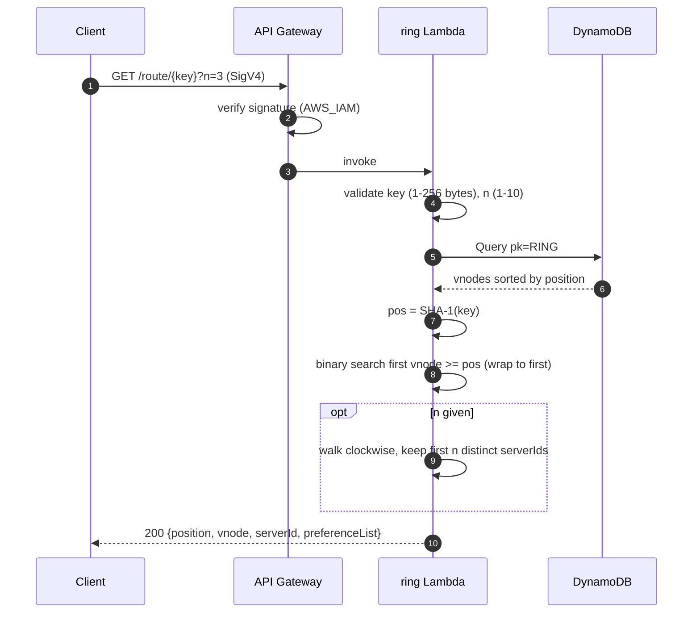
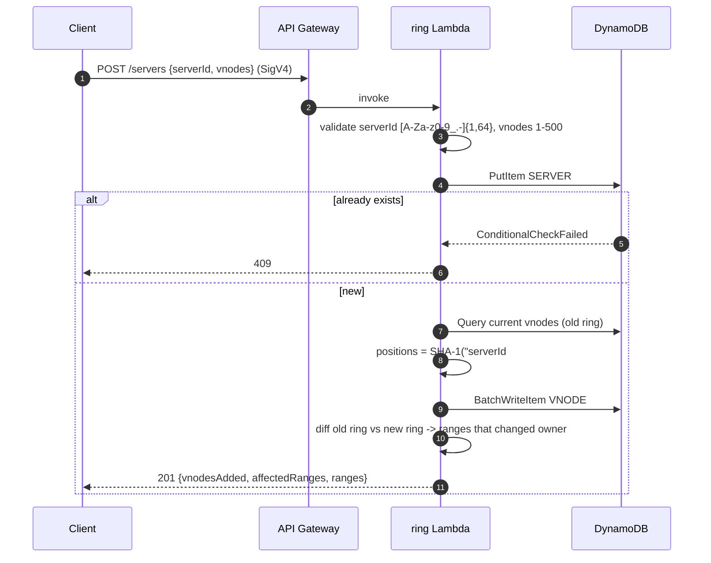
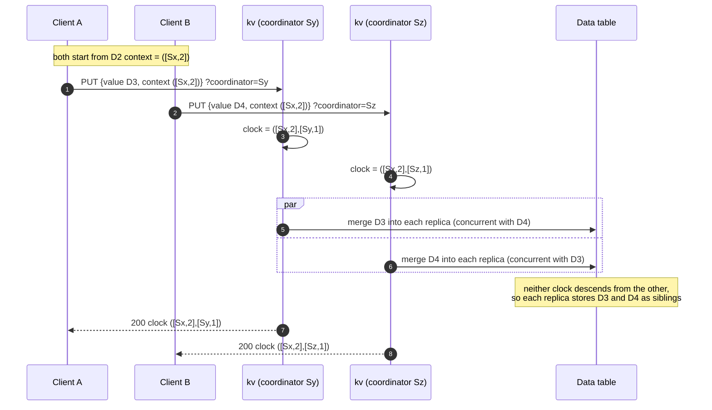
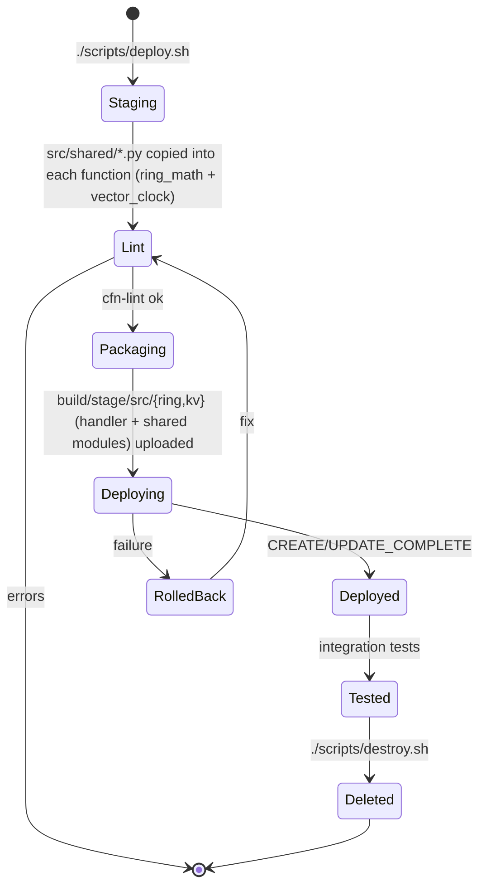

# Workflow · 04 Consistent Hashing
[← Project README](../README.md)

Step 1 built the hash ring with virtual nodes and a routing API. Step 2 added a kv coordinator Lambda that stores each key on N replicas with quorum writes (W) and reads (R), plus up/down switches that simulate server failure. Step 3 replaces the integer version with a **vector clock**: a coordinator stamps each write, replicas keep concurrent siblings, and a read detects conflicts and resolves them server-side with last-write-wins. Data is not moved when the ring changes.

## Data model
Two DynamoDB tables. The ring table has one partition per ring (`pk = RING#default`). Vnode sort keys are the zero-padded 40-hex-digit SHA-1 position, so a `Query` on `begins_with(sk, "VNODE#")` returns the ring already sorted clockwise.

```mermaid
erDiagram
    SERVER ||--o{ VNODE : "owns vnodeCount of"
    SERVER {
        string pk "RING#default"
        string sk "SERVER#<serverId>"
        string serverId
        number vnodeCount "1-500, default 100"
        string status "up | down (simulated failure)"
    }
    VNODE {
        string pk "RING#default"
        string sk "VNODE#<sha1(serverId#vnodeIndex), 40 hex>"
        string serverId
        number vnodeIndex "0 .. vnodeCount-1"
    }
    SERVER ||--o{ REPLICA : "stores"
    REPLICA {
        string serverId "partition key (data table)"
        string itemKey "sort key: the user key"
        number rev "revision for the conditional write (optimistic lock)"
        string versions "JSON list of siblings {value, clock, timestamp, coordinator}, value up to 10 KB"
    }
```

The data table holds one item per replica: the same key on 3 servers is 3 items, `(s2, user-42)`, `(s0, user-42)`, `(s3, user-42)`. Each server gets its own partition, like one node's local storage. Each item stores a list of concurrent sibling versions, each with its own vector clock, plus a `rev` that backs an optimistic-concurrency conditional write so two coordinators writing the same replica item do not clobber each other. Ring math (`src/shared/ring_math.py`) and vector-clock ops (`src/shared/vector_clock.py`) are copied into the functions at package time.

## Route a key


## Add a server


Removing a server (`DELETE /servers/{serverId}`) is the reverse: load the ring, delete that server's vnodes and its `SERVER#` item, and return each range with `fromServer` (the removed one) and `toServer` (the next vnode clockwise).

## Quorum write (PUT) with a vector clock

Defaults N=3, W=2. The coordinator (first up server, or `?coordinator=`) increments its own clock entry. Each replica merges the new version into its sibling list under a conditional write on `rev`.

```mermaid
sequenceDiagram
    autonumber
    participant C as Client
    participant G as API Gateway
    participant K as kv Lambda
    participant RT as Ring table
    participant D as Data table
    C->>G: PUT /kv/{key}?w=2 {value, context} (SigV4)
    G->>K: invoke
    K->>K: validate key, value <= 10 KB, w in 1..N, decode context
    K->>RT: Query pk=RING#default (vnodes + server status)
    K->>K: preference list; pick coordinator (default first up, or ?coordinator=)
    alt coordinator not in preference list
        K-->>C: 400
    else coordinator down or up replicas < w
        K-->>C: 503 write not attempted
    else
        K->>K: new clock = context clock + increment(coordinator), truncate to MaxClockEntries
        par write every up replica (conditional on rev, bounded retry)
            K->>D: GetItem (s0, key); merge new version; PutItem if rev unchanged
        and
            K->>D: GetItem (s3, key); merge new version; PutItem if rev unchanged
        end
        Note over D: replica drops versions the new clock supersedes,<br/>keeps concurrent siblings, ignores a write it already descends from
        alt acks >= w
            K-->>C: 200 {coordinator, clock, context, acked, failed}
        else acks < w
            K-->>C: 503 {acked, failed}
        end
    end
```

## Conflicting write pair

Two clients update the same base version through different coordinators (`Sy` and `Sz`), with no ordering between them. Each replica keeps both as siblings.



## Quorum read (GET) with server-side LWW

Defaults R=2. The coordinator unions versions from the counted replicas, drops dominated ones, and if more than one concurrent version remains resolves it by last-write-wins (highest timestamp, tiebreak highest coordinator serverId). The resolution is not written back.

```mermaid
sequenceDiagram
    autonumber
    participant C as Client
    participant G as API Gateway
    participant K as kv Lambda
    participant RT as Ring table
    participant D as Data table
    C->>G: GET /kv/{key}?r=2 (SigV4)
    G->>K: invoke
    K->>RT: Query ring + server status
    K->>K: preference list, drop down servers
    par read every up replica
        K->>D: GetItem (Sx, key)
        D-->>K: [D3, D4] siblings
    and
        K->>D: GetItem (Sy, key)
        D-->>K: [D3, D4] siblings
    end
    K->>K: union versions from first r replicas, drop dominated
    alt fewer than r responses
        K-->>C: 503 {replicas}
    else no surviving version
        K-->>C: 404 {replicas}
    else one survivor
        K-->>C: 200 {value, context, conflict.detected=false}
    else more than one concurrent survivor
        K->>K: conflict detected; winner = max(timestamp, coordinator id)
        Note over K: LWW can silently drop the other write; not written back (no read repair)
        K-->>C: 200 {value=winner, context=merged clock, conflict {detected, versions, winner, discarded}}
    end
```

A later PUT carrying the merged `context` supersedes all of the siblings, so the next GET sees a single version. The trade-off of `W + R <= N` still holds: with `?r=1` only the first replica is counted and a sibling held elsewhere is missed.

## Simulated failure

`POST /servers/{id}/down` runs `UpdateItem SET status = down` (condition `attribute_exists`, else 404) through the ring Lambda; `/up` sets it back. The kv Lambda reads `status` on every request, so the change applies at once.

## Deploy lifecycle


## Test checks
[`tests/integration/test_api.py`](../tests/integration/test_api.py)

| # | Check | Expected |
|---|-------|----------|
| 1 | Unsigned `GET /servers` | 403 |
| 2 | Add 4 servers x 100 vnodes | 201, `vnodesAdded` = 100 |
| 3 | Add a duplicate server | 409 |
| 4 | Invalid `serverId` (`bad#id`) | 400 |
| 5 | `GET /servers` shares of the 4 test servers | sum ≈ 100% |
| 6 | `GET /route/user-1?n=3` | 3 distinct servers, first = owner |
| 7 | Remove one server | 200, `vnodesRemoved` = 100 |
| 8 | Re-route 60 keys | only keys of the removed server moved |
| 9 | Unsigned `PUT /kv/{key}` | 403 |
| 10 | `PUT` then `GET` a fresh key | 200, 3 acks, value round-trips, no conflict |
| 11 | First replica down, `PUT` v2 with v1's context, W=2 | 200, down replica not in `acked` |
| 12 | Two replicas down, `PUT` with W=2 | 503 |
| 13 | Both back up, `GET ?r=1` | stale v1 from the replica that missed the write, no conflict |
| 14 | `GET ?r=3` | reconciles to v2 (descends from v1), no conflict |
| 15 | `GET ?r=9` | 400 |
| 16 | D1 at Sx, D2 at Sx with D1's context | 200, clock `Sx:2` |
| 17 | D3 at Sy, D4 at Sz, both with D2's context | concurrent clocks `([Sx,2],[Sy,1])` and `([Sx,2],[Sz,1])` |
| 18 | `GET` over D3 and D4 | `conflict.detected`, both versions, LWW `winner` |
| 19 | D5 at Sx with the GET context, then `GET` | no conflict, clock has Sx, Sy, Sz with `Sx:3` |
| 20 | Two context-less `PUT`s at different coordinators | conflict detected |
| 21 | `PUT ?coordinator=` not in the preference list | 400 |
