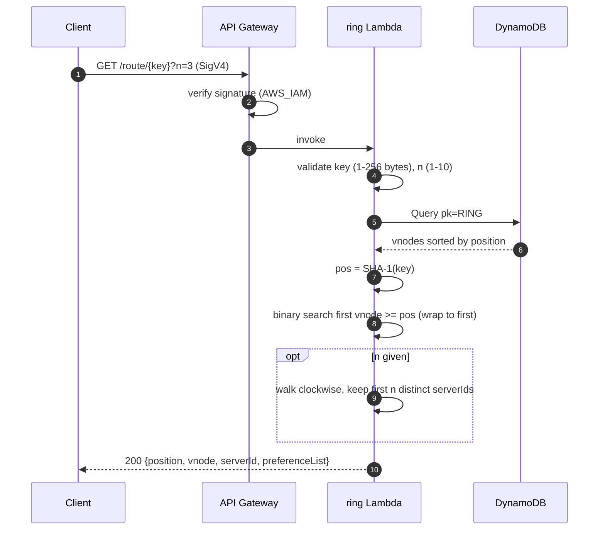
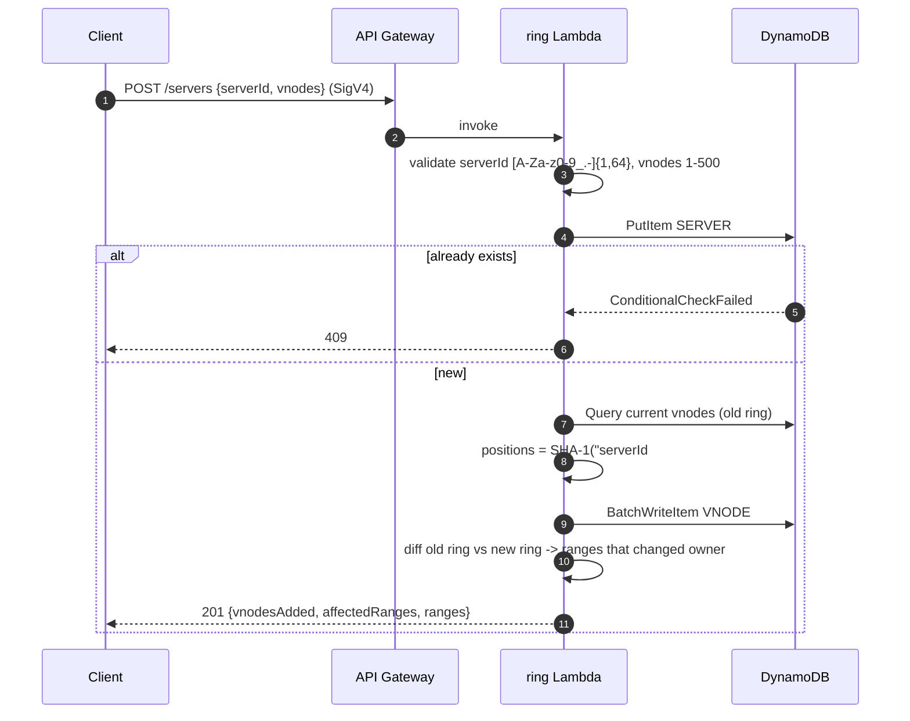
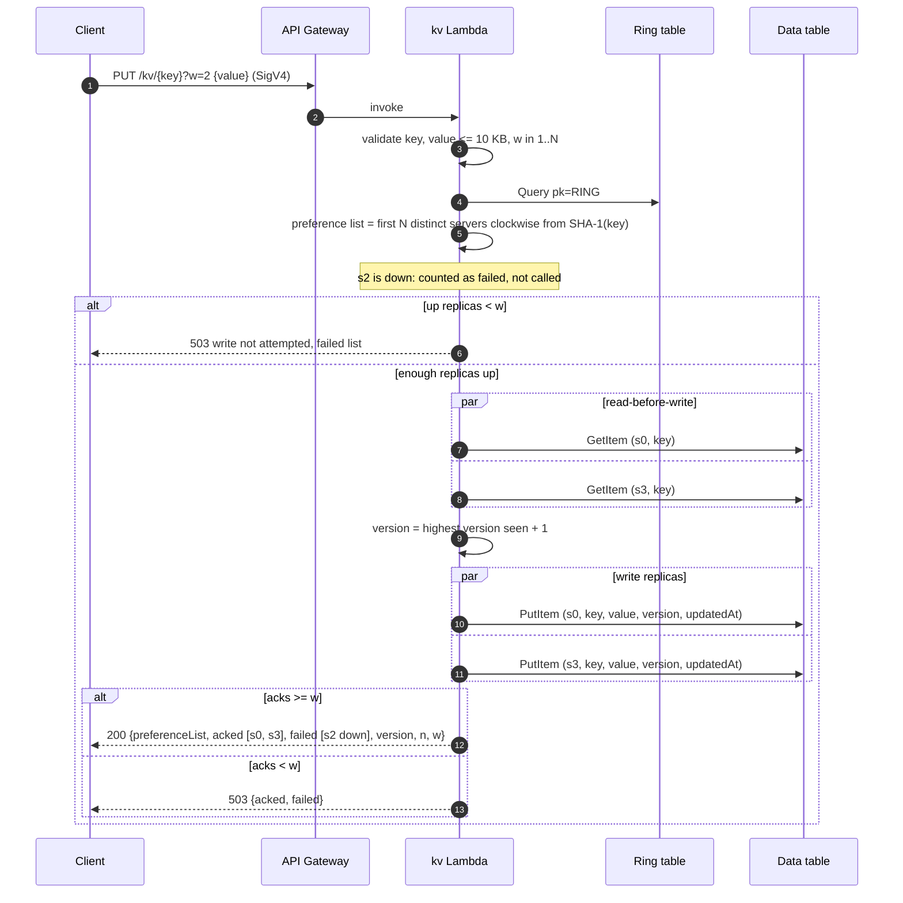
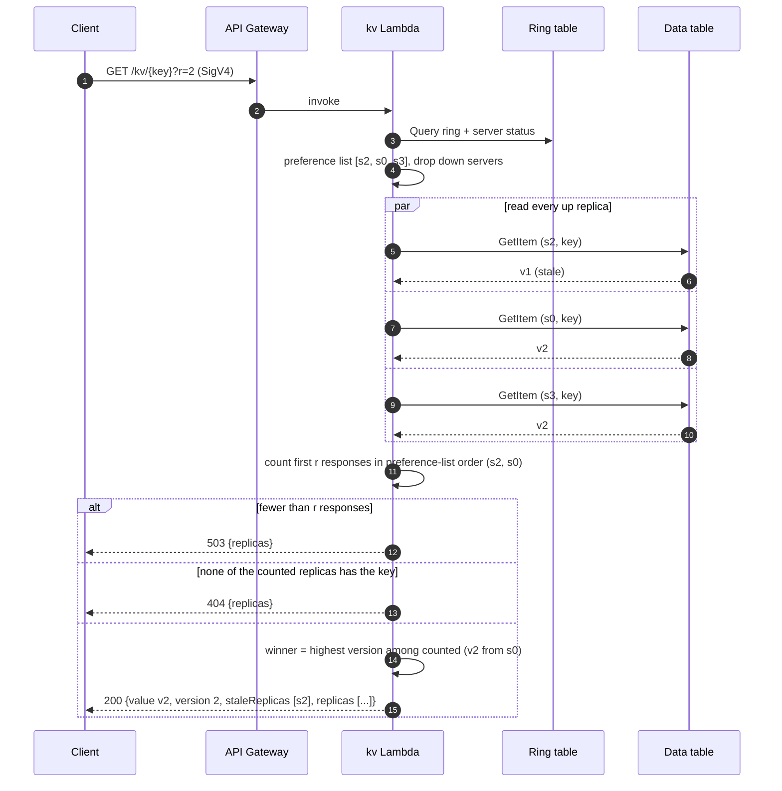
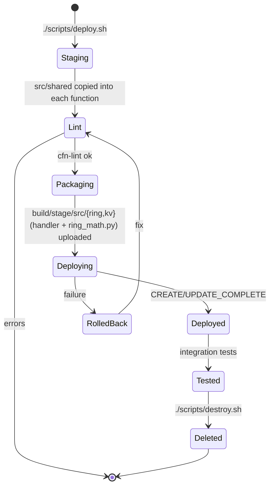

# Workflow · 04 Consistent Hashing
[← Project README](../README.md)

Step 1 built the hash ring with virtual nodes and a routing API. Step 2 adds a kv coordinator Lambda that stores each key on N replicas with quorum writes (W) and reads (R), plus up/down switches that simulate server failure. Data is not moved when the ring changes.

## Data model
Two DynamoDB tables. The ring table has one partition per ring (`pk = RING#default`). Vnode sort keys are the zero-padded 40-hex-digit SHA-1 position, so a `Query` on `begins_with(sk, "VNODE#")` returns the ring already sorted clockwise.

```mermaid
erDiagram
    SERVER ||--o{ VNODE : "owns vnodeCount of"
    SERVER {
        string pk "RING#default"
        string sk "SERVER#<serverId>"
        string serverId
        number vnodeCount "1-500, default 100"
        string status "up | down (simulated failure)"
    }
    VNODE {
        string pk "RING#default"
        string sk "VNODE#<sha1(serverId#vnodeIndex), 40 hex>"
        string serverId
        number vnodeIndex "0 .. vnodeCount-1"
    }
    SERVER ||--o{ REPLICA : "stores"
    REPLICA {
        string serverId "partition key (data table)"
        string itemKey "sort key: the user key"
        string value "up to 10 KB"
        number version "integer counter, highest wins"
        string updatedAt "ISO-8601 UTC"
    }
```

The data table holds one item per replica: the same key on 3 servers is 3 items, `(s2, user-42)`, `(s0, user-42)`, `(s3, user-42)`. Each server gets its own partition, like one node's local storage. Ring math (`src/shared/ring_math.py`) is copied into both functions at package time.

## Route a key


## Add a server


Removing a server (`DELETE /servers/{serverId}`) is the reverse: load the ring, delete that server's vnodes and its `SERVER#` item, and return each range with `fromServer` (the removed one) and `toServer` (the next vnode clockwise).

## Quorum write (PUT)

Defaults N=3, W=2. Here the first replica is marked down, so the write succeeds with 2 of 3 acks.



## Quorum read (GET)

Defaults R=2. s2 is back up but missed the last write, so it holds an older version.



With `?r=1` only s2 is counted, so the client gets the stale v1. That is the trade-off of `W + R <= N`: here W=2, R=1, N=3.

## Simulated failure

`POST /servers/{id}/down` runs `UpdateItem SET status = down` (condition `attribute_exists`, else 404) through the ring Lambda; `/up` sets it back. The kv Lambda reads `status` on every request, so the change applies at once.

## Deploy lifecycle


## Test checks
[`tests/integration/test_api.py`](../tests/integration/test_api.py)

| # | Check | Expected |
|---|-------|----------|
| 1 | Unsigned `GET /servers` | 403 |
| 2 | Add 4 servers x 100 vnodes | 201, `vnodesAdded` = 100 |
| 3 | Add a duplicate server | 409 |
| 4 | Invalid `serverId` (`bad#id`) | 400 |
| 5 | `GET /servers` shares of the 4 test servers | sum ≈ 100% |
| 6 | `GET /route/user-1?n=3` | 3 distinct servers, first = owner |
| 7 | Remove one server | 200, `vnodesRemoved` = 100 |
| 8 | Re-route 60 keys | only keys of the removed server moved |
| 9 | Unsigned `PUT /kv/{key}` | 403 |
| 10 | `PUT` then `GET` a fresh key | 200, 3 acks, value round-trips |
| 11 | First replica down, `PUT` with W=2 | 200, version 2, down replica not in `acked` |
| 12 | Two replicas down, `PUT` with W=2 | 503 |
| 13 | Both back up, `GET ?r=1` | stale v1 from the replica that missed the write |
| 14 | `GET ?r=3` | latest v2, `staleReplicas` = that replica |
| 15 | `GET ?r=9` | 400 |
