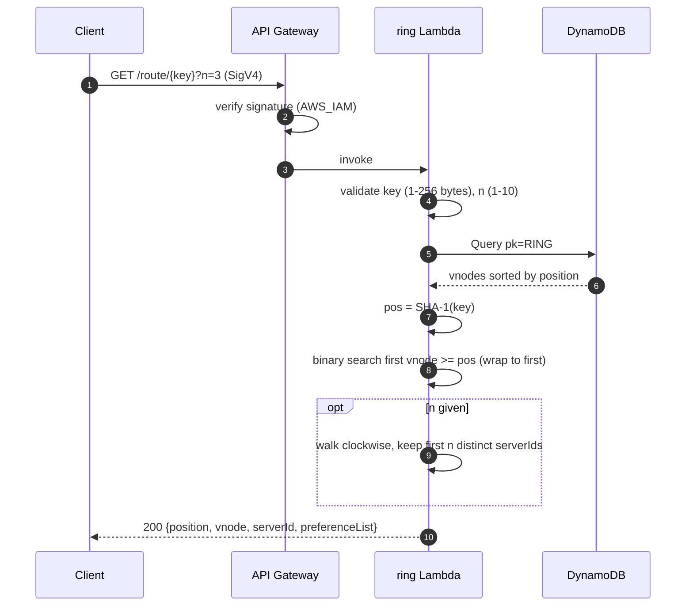
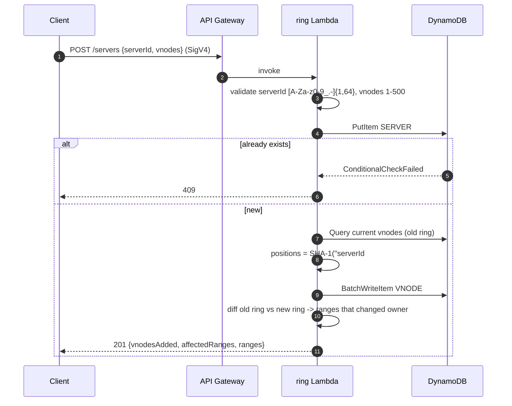
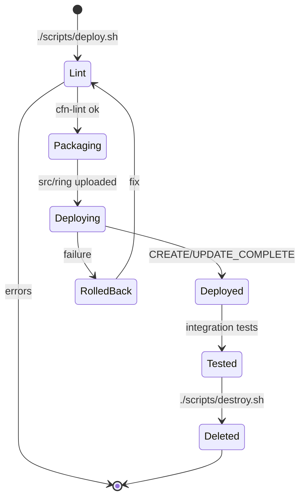

# Workflow · 04 Consistent Hashing
[← Project README](../README.md)

Step 1 builds the hash ring with virtual nodes and a routing API. It routes keys to servers but stores no key data, so nothing is replicated or copied when the ring changes.

## Data model
One DynamoDB table, one partition per ring (`pk = RING#default`). Vnode sort keys are the zero-padded 40-hex-digit SHA-1 position, so a `Query` on `begins_with(sk, "VNODE#")` returns the ring already sorted clockwise.

```mermaid
erDiagram
    SERVER ||--o{ VNODE : "owns vnodeCount of"
    SERVER {
        string pk "RING#default"
        string sk "SERVER#<serverId>"
        string serverId
        number vnodeCount "1-500, default 100"
    }
    VNODE {
        string pk "RING#default"
        string sk "VNODE#<sha1(serverId#vnodeIndex), 40 hex>"
        string serverId
        number vnodeIndex "0 .. vnodeCount-1"
    }
```

## Route a key


## Add a server


Removing a server (`DELETE /servers/{serverId}`) is the reverse: load the ring, delete that server's vnodes and its `SERVER#` item, and return each range with `fromServer` (the removed one) and `toServer` (the next vnode clockwise).

## Deploy lifecycle


## Test checks
[`tests/integration/test_api.py`](../tests/integration/test_api.py)

| # | Check | Expected |
|---|-------|----------|
| 1 | Unsigned `GET /servers` | 403 |
| 2 | Add 4 servers x 100 vnodes | 201, `vnodesAdded` = 100 |
| 3 | Add a duplicate server | 409 |
| 4 | Invalid `serverId` (`bad#id`) | 400 |
| 5 | `GET /servers` shares of the 4 test servers | sum ≈ 100% |
| 6 | `GET /route/user-1?n=3` | 3 distinct servers, first = owner |
| 7 | Remove one server | 200, `vnodesRemoved` = 100 |
| 8 | Re-route 60 keys | only keys of the removed server moved |
