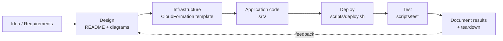
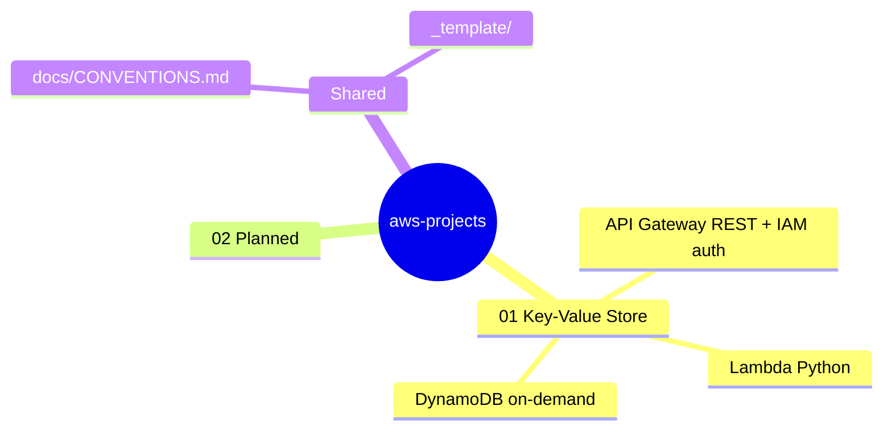
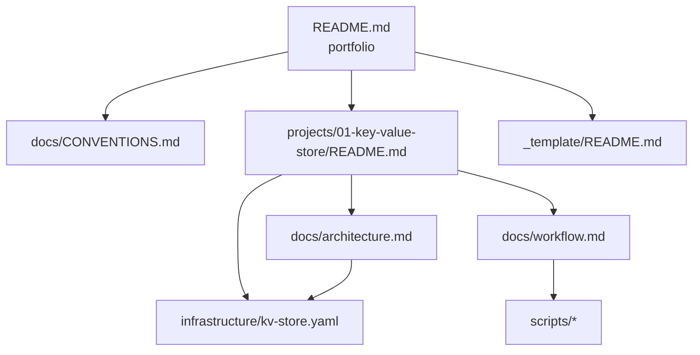

# AWS Projects Portfolio

Hands-on AWS prototypes, each built with Kiro + MCP and deployed with **CloudFormation**.
Every project lives in its own folder under [`projects/`](projects/) and is self-contained:
its own README, architecture diagrams, infrastructure template, source code, and scripts.

## Projects

| # | Project | What it shows | AWS services | Status |
|---|---------|---------------|--------------|--------|
| 01 | [Key-Value Store](projects/01-key-value-store/) | Serverless CRUD API over a NoSQL table, IAM-authenticated | API Gateway, Lambda, DynamoDB, IAM, CloudWatch | 🟡 Prototype |
| 02 | _next project_ | — | — | ⚪ Planned |

Status legend: ⚪ Planned · 🟡 Prototype · 🟢 Deployed & tested

## How each project is built



## Portfolio map



## Repository layout

```text
aws-projects/
├── README.md                  ← you are here: portfolio summary
├── docs/
│   └── CONVENTIONS.md         ← folder rules, naming, diagram standards
├── _template/                 ← copy this to start a new project
│   ├── README.md
│   ├── docs/architecture.md
│   ├── infrastructure/template.yaml
│   ├── src/
│   └── scripts/
├── projects/
│   └── 01-key-value-store/
│       ├── README.md          ← project summary, diagrams, how to run
│       ├── docs/
│       │   ├── architecture.md  ← components, data model, decisions
│       │   └── workflow.md      ← request flows + deploy lifecycle
│       ├── infrastructure/
│       │   └── kv-store.yaml    ← CloudFormation stack
│       ├── src/
│       │   └── README.md        ← where the Lambda code lives
│       └── scripts/
│           ├── deploy.sh
│           ├── destroy.sh
│           └── test_kv.py
└── .kiro/steering/            ← instructions so Kiro/MCP follow these conventions
```

## Documentation map

How the markdown files link together. Start at the top and go down.



## Reading guide (for reviewers)

1. Skim the **Projects** table above.
2. Open a project README: the first section answers *what / why / how* in under a minute.
3. Check `docs/architecture.md` for design decisions, `docs/workflow.md` for step-by-step flows.
4. The `infrastructure/` template is the source of truth for what gets deployed.

## Prerequisites (all projects)

- AWS account + AWS CLI v2 configured (`aws sts get-caller-identity` works)
- Python 3.11+ and `boto3` for test scripts
- Optional: `cfn-lint` (`pip install cfn-lint`) to validate templates

## Starting a new project

```bash
cp -r _template projects/02-<short-name>
```

Then fill in the README sections, add a row to the table above, and follow [docs/CONVENTIONS.md](docs/CONVENTIONS.md).
