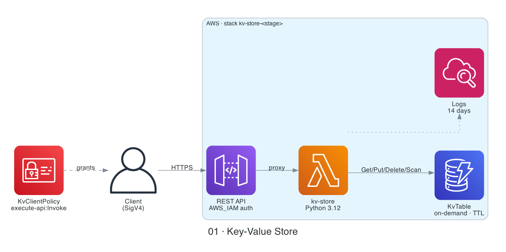
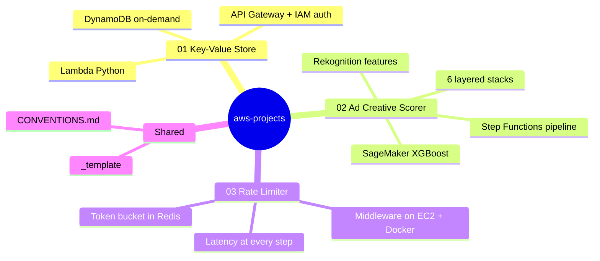
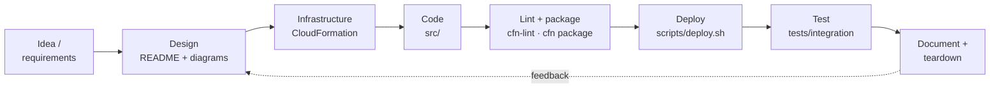
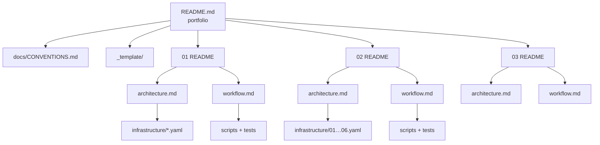

# AWS CloudFormation Projects


Hands-on AWS prototypes, each deployed with **CloudFormation** and documented so that a reviewer can tell what it does and how it works in a couple of minutes.
Every project lives in [`projects/`](projects/) and is self-contained: it has its own README, an architecture image, Mermaid flow diagrams, templates, code, tests, and scripts.

## Projects

| # | Project | What it shows | AWS services | Status |
|---|---------|---------------|--------------|--------|
| 01 | [**Key-Value Store**](projects/01-key-value-store/) | Serverless CRUD API over a NoSQL table, IAM-authenticated | API Gateway · Lambda · DynamoDB · IAM · CloudWatch | 🟡 Prototype |
| 02 | [**Ad Creative Scorer**](projects/02-ad-creative-scorer/) | ML pipeline: upload an ad image → computer-vision features → CTR score | API Gateway · Lambda · Step Functions · Rekognition · SageMaker · DynamoDB · S3 · KMS · CloudWatch | 🟡 Prototype |
| 03 | [**Rate Limiter**](projects/03-rate-limiter/) | Rate limiter middleware (token bucket in Redis) in front of a Lambda backend, latency measured at every step | EC2 · Docker · Redis · S3 · Lambda | ⚪ Planned |

Status legend: ⚪ Planned · 🟡 Prototype · 🟢 Deployed & tested

<table>
<tr>
<td width="50%" align="center"><a href="projects/01-key-value-store/"></a><br/><b><a href="projects/01-key-value-store/">01 · Key-Value Store</a></b></td>
<td width="50%" align="center"><a href="projects/02-ad-creative-scorer/"></a><br/><b><a href="projects/02-ad-creative-scorer/">02 · Ad Creative Scorer</a></b></td>
</tr>
</table>

## Portfolio map

Every entry below is a link, so you can jump straight to the file.

- 📁 **[aws-projects](./)**
  - 📘 [docs/CONVENTIONS.md](docs/CONVENTIONS.md): layout, README order, diagram and security rules
  - 🧩 [_template/](_template/): project skeleton · [scripts/new-project.sh](scripts/new-project.sh) scaffolds from it
  - 📦 **[01 · Key-Value Store](projects/01-key-value-store/)**
    - [Architecture](projects/01-key-value-store/docs/architecture.md) · [Workflows](projects/01-key-value-store/docs/workflow.md)
    - [Template: kv-store.yaml](projects/01-key-value-store/infrastructure/kv-store.yaml) · [Code: handler.py](projects/01-key-value-store/src/handler.py)
    - [Integration test](projects/01-key-value-store/tests/integration/test_api.py) · [Scripts](projects/01-key-value-store/scripts/)
  - 📦 **[02 · Ad Creative Scorer](projects/02-ad-creative-scorer/)**
    - [Architecture](projects/02-ad-creative-scorer/docs/architecture.md) · [Workflows](projects/02-ad-creative-scorer/docs/workflow.md)
    - [Templates: 01 to 06 stacks](projects/02-ad-creative-scorer/infrastructure/) · [Code: 5 Lambdas](projects/02-ad-creative-scorer/src/)
    - [Integration test](projects/02-ad-creative-scorer/tests/integration/test_api.py) · [Scripts](projects/02-ad-creative-scorer/scripts/)
  - 📦 **[03 · Rate Limiter](projects/03-rate-limiter/)**
    - [Architecture](projects/03-rate-limiter/docs/architecture.md) · [Workflows](projects/03-rate-limiter/docs/workflow.md)
    - [Template](projects/03-rate-limiter/infrastructure/template.yaml) · [Code](projects/03-rate-limiter/src/) · [Scripts](projects/03-rate-limiter/scripts/)



## How each project is built



## Repository layout

```text
aws-projects/
├── README.md                    ← you are here: portfolio summary
├── docs/
│   └── CONVENTIONS.md           ← folder rules, README order, diagram + security standards
├── _template/                   ← project skeleton with {{NN}} {{slug}} {{Title}} placeholders
├── scripts/
│   └── new-project.sh           ← scaffold: ./scripts/new-project.sh 03 slug "Title"
├── projects/
│   ├── 01-key-value-store/
│   │   ├── README.md            ← summary, diagrams, how to run
│   │   ├── docs/                ← architecture.md, workflow.md, diagram.py, images/
│   │   ├── infrastructure/      ← kv-store.yaml
│   │   ├── src/                 ← handler.py
│   │   ├── tests/integration/   ← test_api.py
│   │   └── scripts/             ← deploy.sh, destroy.sh
│   ├── 02-ad-creative-scorer/
│   │   ├── README.md
│   │   ├── docs/
│   │   ├── infrastructure/      ← 01-foundation … 06-monitoring (deploy in order)
│   │   ├── src/                 ← one folder per Lambda
│   │   ├── tests/integration/
│   │   └── scripts/             ← deploy.sh, train.sh, destroy.sh
│   └── 03-rate-limiter/
│       ├── README.md            ← goal, latency log
│       ├── docs/
│       ├── infrastructure/
│       ├── src/
│       ├── tests/integration/
│       └── scripts/
└── .kiro/steering/              ← keeps Kiro/MCP following these conventions
```

## Documentation map

How the markdown files link together. Start at the top.



## Reading guide (for reviewers)

1. Look at the architecture images above. Click one to open that project.
2. In a project README, the first screen covers what it is, why it exists, and how it works.
3. `docs/architecture.md` has the design decisions. `docs/workflow.md` has step-by-step flows.
4. `infrastructure/` is the source of truth for what gets deployed.

## Prerequisites (all projects)

- AWS account + AWS CLI v2 configured (`aws sts get-caller-identity` works)
- Python 3.12+ and `boto3` for tests
- `cfn-lint` (`pip install cfn-lint`) to validate templates
- Optional, for regenerating diagrams: `pip install diagrams` + `brew install graphviz`

## Starting a new project

```bash
./scripts/new-project.sh 03 url-shortener "URL Shortener"
```

This copies [`_template/`](_template/) to `projects/03-url-shortener/` and fills in the number, slug, and title everywhere. Then build the project, run `python3 docs/diagram.py`, add it to the table, gallery, map, and tree above, and follow [docs/CONVENTIONS.md](docs/CONVENTIONS.md).
