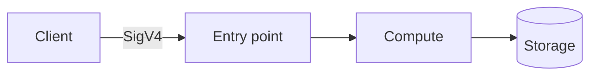

# NN · Project Name

## Summary

One paragraph: what it does, who calls it, why it exists.

| Fact | Value |
|------|-------|
| Status | ⚪ Planned |
| AWS services | |
| Auth | IAM / SigV4 |
| Infra as code | [`infrastructure/template.yaml`](infrastructure/template.yaml) |
| Cost at idle | |

## Architecture



## How it works

1. Step one
2. Step two

Details: [docs/workflow.md](docs/workflow.md) · Design: [docs/architecture.md](docs/architecture.md)

## Repo layout

```text
NN-project-name/
├── README.md
├── docs/
│   ├── architecture.md
│   └── workflow.md
├── infrastructure/
│   └── template.yaml
├── src/
└── scripts/
    ├── deploy.sh
    └── destroy.sh
```

## Deploy / Test / Teardown

```bash
./scripts/deploy.sh dev
# test command
./scripts/destroy.sh dev
```

## Cost & security notes

-

## What I learned / next steps

- [ ]
