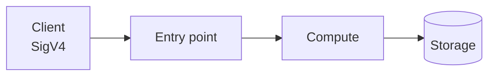

# {{NN}} · {{Title}}


[← Portfolio](../README.md) · [Architecture](docs/architecture.md) · [Workflows](docs/workflow.md) · [Template](infrastructure/template.yaml) · [Code](src/)


## Summary

<!-- One paragraph: what it does, who calls it, why it exists. -->

| Fact | Value |
|------|-------|
| Status | ⚪ Planned |
| AWS services | <!-- e.g. API Gateway · Lambda · DynamoDB --> |
| Auth | IAM / SigV4 |
| Infra as code | [`infrastructure/template.yaml`](infrastructure/template.yaml) |
| Cost at idle | <!-- e.g. ~$0, pay-per-request --> |

## Architecture

The image above is generated by [`docs/diagram.py`](docs/diagram.py). The same flow in Mermaid:



## How it works

1. <!-- step -->
2. <!-- step -->

| Method | Path | Body | Result |
|--------|------|------|--------|
| | | | |

More detail: [docs/workflow.md](docs/workflow.md). Design decisions: [docs/architecture.md](docs/architecture.md).

## Repo layout

```text
{{NN}}-{{slug}}/
├── README.md                 ← this file
├── docs/
│   ├── architecture.md       ← components, data model, decisions
│   ├── workflow.md           ← sequence + state diagrams, deploy lifecycle
│   ├── diagram.py            ← diagram-as-code (AWS icons)
│   └── images/architecture.png
├── infrastructure/
│   └── template.yaml         ← CloudFormation stack
├── src/                      ← Lambda code
├── tests/
│   └── integration/          ← tests against the deployed stack
└── scripts/
    ├── deploy.sh             ← lint, package src/, deploy, print outputs
    └── destroy.sh            ← delete stack
```

## Deploy / Test / Teardown

```bash
cd {{NN}}-{{slug}}
./scripts/deploy.sh dev us-east-1
# python3 tests/integration/<test>.py dev us-east-1
./scripts/destroy.sh dev us-east-1
```

## Cost & security notes

- **Cost:** <!-- -->
- **Auth:** <!-- -->
- **Least privilege:** <!-- -->
- **Data:** <!-- -->

## What I learned / next steps

- [ ] <!-- -->
