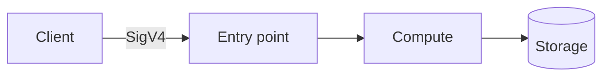

# NN · Project Name


[← Portfolio](../../README.md) · [Architecture](docs/architecture.md) · [Workflows](docs/workflow.md) · [Template](infrastructure/template.yaml) · [Code](src/)


## Summary

One paragraph: what it does, who calls it, why it exists.

| Fact | Value |
|------|-------|
| Status | ⚪ Planned |
| AWS services | |
| Auth | IAM / SigV4 |
| Infra as code | [`infrastructure/template.yaml`](infrastructure/template.yaml) |
| Cost at idle | |

## Architecture

Image above generated by [`docs/diagram.py`](docs/diagram.py). Same flow in Mermaid:



## How it works

1. Step one
2. Step two

| Method | Path | Body | Result |
|--------|------|------|--------|

## Repo layout

```text
NN-project-name/
├── README.md
├── docs/
│   ├── architecture.md
│   ├── workflow.md
│   ├── diagram.py
│   └── images/architecture.png
├── infrastructure/
│   └── template.yaml
├── src/
├── tests/integration/
└── scripts/
    ├── deploy.sh
    └── destroy.sh
```

## Deploy / Test / Teardown

```bash
./scripts/deploy.sh dev
python3 tests/integration/test_api.py dev
./scripts/destroy.sh dev
```

## Cost & security notes

-

## What I learned / next steps

- [ ]
