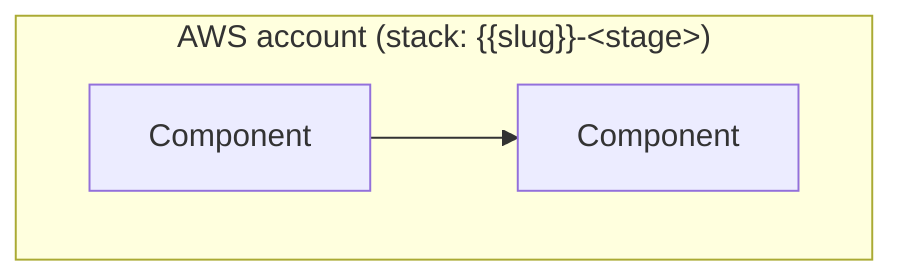

# Architecture · {{NN}} {{Title}}

[← Project README](../README.md) · [Architecture image](images/architecture.png)

## Components



| Logical ID | Type | Purpose |
|------------|------|---------|
| | | |

## Data model

```mermaid
erDiagram
    ITEM {
        string pk PK "describe"
    }
```

## Design decisions

| Decision | Chosen | Alternatives | Why |
|----------|--------|--------------|-----|
| | | | |

## Limits

-
