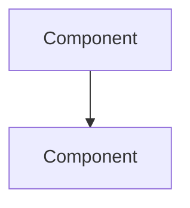

# Architecture · NN Project Name

[← Project README](../README.md)

## Components

| Logical ID | Type | Purpose |
|------------|------|---------|

## Data model

## Design decisions

| Decision | Chosen | Alternatives | Why |
|----------|--------|--------------|-----|

## Limits
