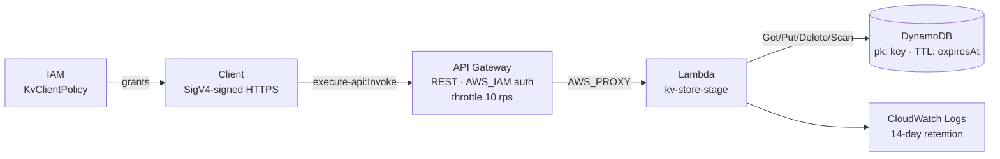

# 01 · Key-Value Store

## Summary

A serverless key-value store with a REST API. Clients `PUT`, `GET`, `DELETE`, and list keys over HTTPS. Every request is authenticated with AWS IAM (SigV4). Values are any JSON, with an optional per-key TTL. The whole stack is one CloudFormation template.

| Fact | Value |
|------|-------|
| Status | 🟡 Prototype |
| AWS services | API Gateway (REST), Lambda (Python 3.12), DynamoDB, IAM, CloudWatch Logs |
| Auth | IAM / SigV4 (`AWS_IAM` on every method) |
| Infra as code | [`infrastructure/kv-store.yaml`](infrastructure/kv-store.yaml) |
| Cost at idle | ~$0 (all pay-per-request) |

## Architecture



## How it works

1. Client signs the request with its IAM credentials.
2. API Gateway checks the signature and that the caller has `execute-api:Invoke` (granted by the `KvClientPolicy` output). Unsigned or unauthorized calls get `403`.
3. Lambda validates input and calls DynamoDB.
4. Response is JSON.

| Method | Path | Body | Result |
|--------|------|------|--------|
| `PUT` | `/kv/{key}` | `{"value": <json>, "ttlSeconds": 3600}` | `200` stored |
| `GET` | `/kv/{key}` | — | `200 {key, value, updatedAt}` or `404` |
| `DELETE` | `/kv/{key}` | — | `200` or `404` |
| `GET` | `/kv` | — | `200 {keys: [...]}` (first 100) |

Detailed flows: [docs/workflow.md](docs/workflow.md). Design decisions: [docs/architecture.md](docs/architecture.md).

## Repo layout

```text
01-key-value-store/
├── README.md                 ← this file
├── docs/
│   ├── architecture.md       ← components, data model, decisions
│   └── workflow.md           ← sequence diagrams, deploy lifecycle
├── infrastructure/
│   └── kv-store.yaml         ← CloudFormation (includes inline Lambda code)
├── src/
│   └── README.md             ← where the code lives and why
└── scripts/
    ├── deploy.sh             ← validate + deploy stack, print outputs
    ├── test_kv.py            ← signed end-to-end smoke test
    └── destroy.sh            ← delete stack
```

## Deploy / Test / Teardown

```bash
cd projects/01-key-value-store

# 1. Deploy (stage defaults to dev, region to $AWS_REGION or us-east-1)
./scripts/deploy.sh dev us-east-1

# 2. Grant your IAM user/role access (ARN from the ClientPolicyArn output)
aws iam attach-user-policy --user-name <you> --policy-arn <ClientPolicyArn>
#   or: aws iam attach-role-policy --role-name <role> --policy-arn <ClientPolicyArn>

# 3. Test
pip install boto3
python3 scripts/test_kv.py dev us-east-1

# 4. Tear down (deletes all stored data)
./scripts/destroy.sh dev us-east-1
```

## Cost & security notes

- **Cost:** DynamoDB on-demand, Lambda and API Gateway per-request. Idle cost is near zero; PITR adds a small per-GB charge.
- **Auth:** every method uses `AWS_IAM`. Nothing is anonymously reachable. The smoke test checks that an unsigned request gets `403`.
- **Least privilege:** the Lambda role can only touch this table and its own log group. The client policy only allows invoking this API's stage.
- **Data:** encrypted at rest (DynamoDB SSE), PITR on. `DeletionPolicy: Delete` because it's a prototype; set `Retain` before holding real data.
- **Abuse limits:** stage throttling 10 rps / burst 20; key ≤ 256 chars; value ≤ 350 KB.

## What I learned / next steps

- [ ] Add a conditional write (`If-Match` / version number) for optimistic concurrency
- [ ] Paginate `GET /kv` with `LastEvaluatedKey`
- [ ] Add CloudWatch alarms on Lambda errors and API 5xx
- [ ] Move Lambda code to `src/` + `aws cloudformation package` once it grows past inline size
