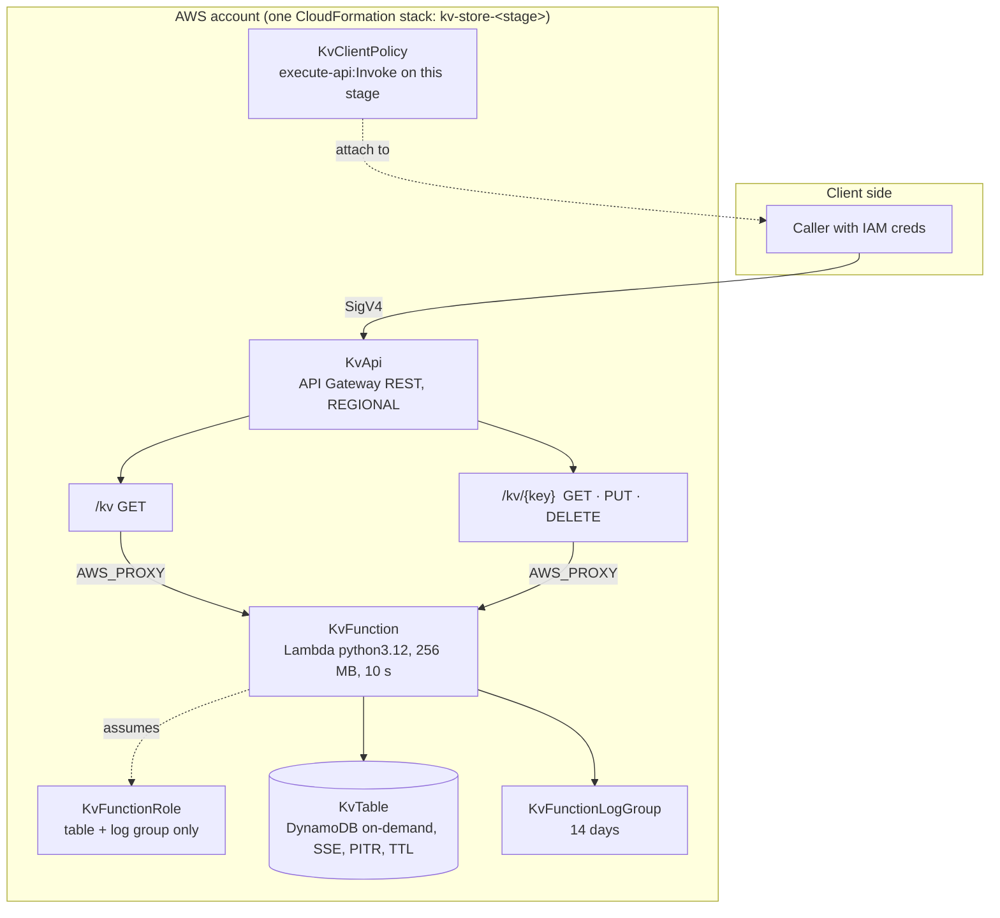

# Architecture · 01 Key-Value Store

[← Project README](../README.md)

## Components



| Logical ID | Type | Purpose |
|------------|------|---------|
| `KvTable` | `AWS::DynamoDB::Table` | Stores items |
| `KvFunction` | `AWS::Lambda::Function` | Request handling + validation |
| `KvFunctionRole` | `AWS::IAM::Role` | Least-privilege execution role |
| `KvFunctionLogGroup` | `AWS::Logs::LogGroup` | Lambda logs with retention |
| `KvApi`, `KvResource`, `KvKeyResource`, `*Method` | API Gateway | REST routes, `AWS_IAM` auth |
| `KvApiDeployment`, `KvApiStage` | API Gateway | Stage + throttling |
| `KvFunctionInvokePermission` | `AWS::Lambda::Permission` | Lets only this API invoke the function |
| `KvClientPolicy` | `AWS::IAM::ManagedPolicy` | Attach to callers |

## Data model

```mermaid
erDiagram
    KV_ITEM {
        string pk PK "the key (1-256 chars)"
        string value "JSON-encoded value (<= 350 KB)"
        number updatedAt "epoch seconds"
        number expiresAt "optional TTL, epoch seconds"
    }
```

DynamoDB TTL deletes expired items lazily (can take up to ~48 h), so the handler also hides items whose `expiresAt` has passed.

## Design decisions

| Decision | Chosen | Alternatives | Why |
|----------|--------|--------------|-----|
| Storage | DynamoDB | ElastiCache Redis, S3 | Serverless, no VPC, single-digit-ms reads, pay-per-request |
| API | API Gateway REST | HTTP API, Lambda URL | REST API supports `AWS_IAM` per method + stage throttling |
| Auth | IAM / SigV4 | Cognito, API keys | Callers are AWS principals; API keys are not authentication |
| Code packaging | Inline `ZipFile` | S3 artifact / SAM | One-file deploy, no bucket needed; move to `src/` when it grows |
| List keys | `Scan` limit 100 | GSI, pagination | Fine for a prototype; documented as next step |
| Billing | `PAY_PER_REQUEST` | Provisioned | Unpredictable/low traffic, zero idle cost |

## Limits

- Key: 1–256 chars. Value: ≤ 350 KB JSON (DynamoDB item max is 400 KB).
- Throttle: 10 rps steady, 20 burst per stage.
- Consistency: reads are eventually consistent (DynamoDB default).
