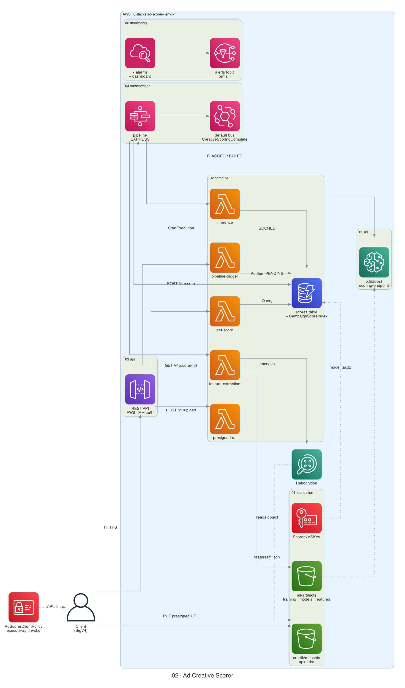
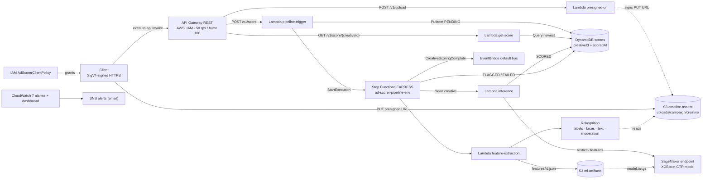

# 02 · Ad Creative Scorer


-FF4F8B?logo=amazonaws&logoColor=white)


[← Portfolio](../../README.md) · [Architecture](docs/architecture.md) · [Workflows](docs/workflow.md) · [Templates](infrastructure/) · [Code](src/)



## Summary

A predictive ad creative performance scorer. A client asks for a presigned S3 URL, uploads an ad image, and submits it for scoring. A Step Functions Express workflow runs Rekognition to extract visual features (labels, faces, emotion, text, moderation labels). Creatives with moderation labels are marked `FLAGGED`; clean ones are sent to a SageMaker XGBoost endpoint that predicts a click-through rate (CTR). The client polls for the result. Every API method requires IAM (SigV4). The system is six CloudFormation stacks deployed in order, plus a `train.sh` step that trains the model between them.

| Fact | Value |
|------|-------|
| Status | 🟡 Prototype |
| AWS services | API Gateway (REST), Lambda (Python 3.12, 5 functions), Step Functions (Express), Rekognition, SageMaker (XGBoost 1.7-1), DynamoDB, S3, KMS, EventBridge, SSM Parameter Store, CloudWatch, SNS, X-Ray |
| Auth | IAM / SigV4 (`AWS_IAM` on every method); attach the `ClientPolicyArn` output to callers |
| Infra as code | [`infrastructure/01-foundation.yaml` … `06-monitoring.yaml`](infrastructure/) |
| Supported regions | us-east-1, us-east-2, us-west-2, eu-west-1 (the XGBoost image mapping in stack 01) |
| Cost at idle | ~$1/month (KMS key) plus S3/PITR storage and 7 alarms without stack 05. With stack 05 the endpoint runs 24/7: ~$65/month (see [cost](#cost--security-notes)) |

## Architecture

The image above uses official AWS icons and is generated from [`docs/diagram.py`](docs/diagram.py). The same system as a Mermaid diagram:



All storage (both buckets, the table, every log group, the SNS topic, the endpoint volume and data capture) is encrypted with one KMS key from stack 01. Components per stack and the stack import graph are in [docs/architecture.md](docs/architecture.md).

## How it works

1. **Upload URL.** `POST /v1/upload` returns a new `creative_id` (UUID) and a presigned S3 PUT URL for `uploads/<campaign_id>/<creative_id>`, valid for 3600 s.
2. **Upload.** The client `PUT`s the image to that URL. The URL is signed with the presigned-url Lambda's role, which may only write under `uploads/`.
3. **Submit.** `POST /v1/score` checks that the bucket is the project's creative bucket and that the key, `creative_id` and `campaign_id` agree. It writes a `PENDING` item to DynamoDB, starts the state machine, and returns `202`.
4. **Pipeline.** The state machine validates the input, runs Rekognition, then either marks the item `FLAGGED` (moderation labels found) or calls the SageMaker endpoint and marks it `SCORED`. Any error marks it `FAILED`. Both success paths publish a `CreativeScoringComplete` event to EventBridge.
5. **Poll.** `GET /v1/score/{creativeId}` returns the newest record for that creative.

| Method | Path | Body | Result |
|--------|------|------|--------|
| `POST` | `/v1/upload` | `{"content_type": "image/png", "campaign_id": "summer-2026"}` | `200 {creative_id, upload_url, s3_key, expires_in, content_type}`, `400` bad input |
| `POST` | `/v1/score` | `{"s3_bucket", "s3_key", "creative_id", "campaign_id"?}` | `202 {creative_id, status: PENDING, execution_arn, scored_at}`, `400` bad input |
| `GET` | `/v1/score/{creativeId}` | — | `200 {creative_id, campaign_id, status, scored_at, ctr_score?, engagement_score?, moderation_flags?}`, `404`, `400` |

Unsigned or unauthorized calls get `403` from API Gateway before any Lambda runs. `content_type` must be one of `image/jpeg`, `image/png`, `image/webp`, `image/gif`, `video/mp4`, `video/quicktime`, and IDs must match `^[A-Za-z0-9_-]{1,64}$`. Rekognition image APIs accept only JPEG and PNG, so other uploads end as `FAILED`.

Detailed flows and the state machine: [docs/workflow.md](docs/workflow.md). Data model, design decisions and the training CSV schema: [docs/architecture.md](docs/architecture.md).

<details>
<summary>API usage examples (SigV4 with <code>awscurl</code>)</summary>

`awscurl` signs requests with your AWS credentials (`pip install awscurl`). Your principal needs the `ClientPolicyArn` policy attached.

```bash
API=$(aws cloudformation describe-stacks --stack-name ad-scorer-dev-api \
  --query "Stacks[0].Outputs[?OutputKey=='APIEndpoint'].OutputValue" --output text)
BUCKET=$(aws cloudformation describe-stacks --stack-name ad-scorer-dev-foundation \
  --query "Stacks[0].Outputs[?OutputKey=='CreativeAssetsBucketName'].OutputValue" --output text)
```

**Step 1: get a presigned upload URL**

```bash
awscurl --service execute-api --region us-east-1 -X POST \
  -H "Content-Type: application/json" \
  -d '{"content_type": "image/jpeg", "campaign_id": "summer-2026"}' \
  "$API/v1/upload"

# Response 200
{
  "creative_id": "a1b2c3d4-...",
  "upload_url": "https://ad-scorer-creative-assets-<account>-dev.s3.amazonaws.com/uploads/summer-2026/a1b2c3d4-...?X-Amz-...",
  "s3_key": "uploads/summer-2026/a1b2c3d4-...",
  "expires_in": 3600,
  "content_type": "image/jpeg"
}
```

**Step 2: upload the creative** (plain `curl`; the URL carries its own signature, and `Content-Type` must match the one requested)

```bash
curl -X PUT "<upload_url>" \
  -H "Content-Type: image/jpeg" \
  --upload-file ./ad_creative.jpg
```

**Step 3: submit for scoring**

```bash
awscurl --service execute-api --region us-east-1 -X POST \
  -H "Content-Type: application/json" \
  -d "{\"s3_bucket\": \"$BUCKET\", \"s3_key\": \"uploads/summer-2026/a1b2c3d4-...\", \"creative_id\": \"a1b2c3d4-...\", \"campaign_id\": \"summer-2026\"}" \
  "$API/v1/score"

# Response 202 Accepted (async)
{
  "creative_id": "a1b2c3d4-...",
  "status": "PENDING",
  "execution_arn": "arn:aws:states:us-east-1:...:express:ad-scorer-pipeline-dev:...",
  "scored_at": "2026-05-11T10:30:00.123456+00:00"
}
```

**Step 4: poll for the result**

```bash
awscurl --service execute-api --region us-east-1 "$API/v1/score/a1b2c3d4-..."

# Response 200 when scored
{
  "creative_id": "a1b2c3d4-...",
  "campaign_id": "summer-2026",
  "status": "SCORED",
  "scored_at": "2026-05-11T10:30:00.123456+00:00",
  "ctr_score": 0.0842,
  "engagement_score": 0.0968
}
```

`status` moves `PENDING` → `FEATURES_EXTRACTED` → `SCORED`, `FLAGGED` (with `moderation_flags`) or `FAILED`. `engagement_score` is `ctr_score × 1.15`, a placeholder metric.

</details>

## Repo layout

```text
02-ad-creative-scorer/
├── README.md                          ← this file
├── docs/
│   ├── architecture.md                ← components per stack, imports, data model, decisions, CSV schema
│   ├── workflow.md                    ← sequence + state diagrams, deploy lifecycle
│   ├── diagram.py                     ← diagram-as-code (AWS icons)
│   └── images/architecture.png        ← generated by diagram.py
├── infrastructure/
│   ├── 01-foundation.yaml             ← KMS key, 2 S3 buckets, 7 IAM roles, SSM params, XGBoost image map
│   ├── 02-compute-and-storage.yaml    ← DynamoDB table + GSI, 5 Lambdas, their log groups
│   ├── 03-api-gateway.yaml            ← REST API (AWS_IAM), request models, client policy, optional API key
│   ├── 04-step-functions.yaml         ← Express state machine, its log group, SSM ARN param
│   ├── 05-sagemaker.yaml              ← model, endpoint config, endpoint, auto scaling
│   └── 06-monitoring.yaml             ← SNS topic, 7 alarms, dashboard
├── src/
│   ├── presigned_url/handler.py       ← POST /v1/upload
│   ├── pipeline_trigger/handler.py    ← POST /v1/score
│   ├── get_score/handler.py           ← GET /v1/score/{creativeId}
│   ├── feature_extraction/handler.py  ← Rekognition features (ExtractFeatures state)
│   └── inference/handler.py           ← SageMaker call + SCORED write (RunInference state)
├── tests/
│   └── integration/
│       └── test_api.py                ← SigV4-signed end-to-end test (9 checks)
└── scripts/
    ├── deploy.sh                      ← package src/ + deploy stacks 01→06 in order
    ├── train.sh                       ← run the SageMaker training job, print ModelS3Key
    └── destroy.sh                     ← delete stacks 06→01, then optionally the retained buckets
```

## Deploy / Train / Test / Teardown

Template dependency order (each stack imports exports from earlier ones):

| Order | Template | Stack name | Purpose |
|-------|----------|------------|---------|
| 1 | `01-foundation.yaml` | `ad-scorer-<env>-foundation` | KMS, S3, IAM roles, SSM params |
| 2 | `02-compute-and-storage.yaml` | `ad-scorer-<env>-compute` | DynamoDB, Lambda functions |
| 3 | `03-api-gateway.yaml` | `ad-scorer-<env>-api` | REST API, client policy, optional usage plan |
| 4 | `04-step-functions.yaml` | `ad-scorer-<env>-orchestration` | State machine |
| 5 | `05-sagemaker.yaml` | `ad-scorer-<env>-ml` | Model + endpoint (needs a trained model) |
| 6 | `06-monitoring.yaml` | `ad-scorer-<env>-monitoring` | Alarms, dashboard, SNS |

```bash
cd projects/02-ad-creative-scorer

# 1. First deploy: stacks 01-04 and 06. Stack 05 is skipped until a model exists.
#    Usage: deploy.sh <env> <region> <alert-email> [model-s3-key]
#    Creates a private artifact bucket cfn-artifacts-<account>-<region> on first run,
#    packages src/ with `aws cloudformation package`, runs cfn-lint if installed.
./scripts/deploy.sh dev us-east-1 you@example.com
#    Then confirm the SNS subscription email.

# 2. Upload labelled training data (CSV, no header; schema in docs/architecture.md)
ML_BUCKET=ad-scorer-ml-artifacts-$(aws sts get-caller-identity --query Account --output text)-dev
aws s3 cp train.csv      "s3://$ML_BUCKET/training-data/train/creative_features.csv"
aws s3 cp validation.csv "s3://$ML_BUCKET/training-data/validation/creative_features.csv"

# 3. Train (managed spot, ml.m5.xlarge, up to 1 h run / 2 h wait). Prints ModelS3Key.
./scripts/train.sh dev us-east-1

# 4. Redeploy with the model key; this creates stack 05 (endpoint takes several minutes)
./scripts/deploy.sh dev us-east-1 you@example.com models/xgboost-ctr/<job-name>/output/model.tar.gz

# 5. Grant your IAM user/role access (ARN printed by deploy.sh as ClientPolicyArn)
aws iam attach-user-policy --user-name <you> --policy-arn <ClientPolicyArn>
#   or: aws iam attach-role-policy --role-name <role> --policy-arn <ClientPolicyArn>

# 6. Test (needs all 6 stacks for the creative to reach SCORED or FLAGGED)
pip install boto3
python3 tests/integration/test_api.py dev us-east-1

# 7. Tear down: asks for confirmation, deletes stacks 06 -> 01, then offers to
#    empty and delete the two retained buckets. The KMS key is kept; the script
#    prints the schedule-key-deletion command.
./scripts/destroy.sh dev us-east-1
```

`train.sh` hyperparameters can be overridden with `HP_MAX_DEPTH`, `HP_ETA`, `HP_NUM_ROUND`, `HP_SUBSAMPLE`, `HP_OBJECTIVE`, plus `TRAINING_INSTANCE_TYPE` and `XGBOOST_VERSION` (must match `SageMakerXGBoostVersion` in stack 05).

<details>
<summary>Post-deployment checklist</summary>

- [ ] Confirm the SNS email subscription for alarms
- [ ] Upload training CSVs to `training-data/train/` and `training-data/validation/`
- [ ] Run `scripts/train.sh` and wait for `Completed`
- [ ] Rerun `scripts/deploy.sh` with the printed `ModelS3Key` to create stack 05
- [ ] Attach `ClientPolicyArn` to the callers
- [ ] Run `tests/integration/test_api.py` against a sample image
- [ ] Check the CloudWatch dashboard (URL printed by `deploy.sh`) shows metrics
- [ ] Add a Pillow Lambda layer and compute `color_saturation` (today the inference Lambda sends a fixed 0.5)

</details>

## Cost & security notes

Cost estimate carried over from the original project (dev environment, 1,000 scorings/day):

| Service         | Usage                       | Estimated Monthly Cost |
|----------------|------------------------------|------------------------|
| Rekognition     | 30,000 image API calls       | ~$3.00                |
| Lambda          | 90,000 invocations, 512MB    | ~$0.50                |
| SageMaker EP    | ml.t3.medium, 1 instance     | ~$65.00               |
| DynamoDB        | PAY_PER_REQUEST, 1K writes   | ~$1.00                |
| Step Functions  | 30,000 EXPRESS transitions   | ~$0.75                |
| API Gateway     | 30,000 API calls             | ~$0.10                |
| S3              | 50GB storage + requests      | ~$1.20                |
| **Total**       |                              | **~$72/month**        |

- **Cost notes:** the endpoint is the main cost and runs whether or not anything is scored. The template's default instance is `ml.t2.medium` (the original table assumed `ml.t3.medium`, which is not in the `InferenceInstanceType` AllowedValues), and auto scaling can add up to 10 instances above 70 invocations/instance/minute. Delete stack 05 (or the whole project) when idle. Not in the table: the KMS key (~$1/month, kept after teardown), 7 CloudWatch alarms, the dashboard, training jobs (managed spot), and SageMaker data capture (20 % of requests to S3). Serverless Inference would cut cost for unpredictable volume.
- **Auth:** every API method uses `AWS_IAM`. `AdScorerClientPolicy` grants only `execute-api:Invoke` on this stage's `/v1/*`. The API key and usage plan are off by default (`EnableAPIKey=false`) and only set quotas. The integration test checks that unsigned requests get `403`.
- **Least privilege:** one IAM role per Lambda, scoped to its own log group, the exact table actions it uses, and the S3 prefixes it touches. The Step Functions and SageMaker roles have no managed full-access policies. `Resource: "*"` is used only where the API has no resource-level permissions (Rekognition `Detect*`, X-Ray, `ecr:GetAuthorizationToken`, namespace-conditioned `cloudwatch:PutMetricData`, Step Functions log delivery), each with a comment.
- **Input checks:** API Gateway JSON models plus the same checks in each Lambda. `campaign_id` and `creative_id` are restricted to safe characters, and only keys under `uploads/` in the project's own bucket are accepted, so callers cannot point the pipeline at other objects.
- **Encryption:** one customer-managed KMS key (rotation on) for both buckets, the table, all 7 log groups, the SNS topic, and the endpoint. Both buckets have Block Public Access on and deny non-TLS requests. The SageMaker model runs with network isolation.
- **Data retention:** both buckets and the KMS key have `DeletionPolicy: Retain`; the table and log groups are deleted with their stacks (scores are derived data). Point-in-time recovery is on for the table.
- **Artifacts:** Lambda zips go to a private bucket (Block Public Access on, SSE, 30-day expiry).
- **Limits to know:** Express executions are capped at 5 minutes. The feature-extraction Lambda reserves 50 concurrent executions, which can fail to deploy in new accounts with a low concurrency quota. The presigned URL is signed with Lambda session credentials, so it can expire before `expires_in`. `AWS::ApiGateway::Account` (stack 03) is a per-region account setting and overwrites any existing API Gateway CloudWatch role.

## What I learned / next steps

- [ ] Compute `color_saturation` with Pillow in a Lambda layer (the model currently gets a constant 0.5)
- [ ] Add a Catch on `PublishScoringEvent` so an EventBridge failure is visible on the item
- [ ] Video support: async `rekognition:StartLabelDetection` and a `.waitForTaskToken` branch in Step Functions
- [ ] A/B model comparison: a second production variant at 10 % weight, compare `ctr_score` distributions
- [ ] Batch scoring: EventBridge Scheduler + Map state over `PENDING` items, SageMaker Batch Transform instead of a real-time endpoint
- [ ] Serverless Inference to remove the 24/7 endpoint cost
- [ ] Add an API to query `CampaignScoreIndex` (top creatives per campaign)
- [ ] Unit tests for the five handlers with stubbed AWS clients

### Changes from original

The original project (six templates with inline Lambda code, a `deploy.sh` and a `teardown.sh`) was reviewed and these problems were fixed while moving it into this repo's format.

| # | Problem in the original | What was done |
|---|-------------------------|---------------|
| 1 | All 3 methods used `AuthorizationType: NONE` with an API key (on by default), and API keys are not authentication | All 3 methods use `AuthorizationType: AWS_IAM`. New `AdScorerClientPolicy` managed policy (`execute-api:Invoke` on `/v1/*` of the stage) with output `ClientPolicyArn`. The API key and usage plan are optional quotas, off by default (`EnableAPIKey=false`). |
| 2 | `GET /v1/score/{creativeId}` called the inference Lambda, which expects a Step Functions event and would fail on an API event; no Lambda permission for GET | New `get_score` Lambda queries the newest item by `creativeId` and returns `200`/`400`/`404`. It has a read-only role (`dynamodb:Query`, `kms:Decrypt`) and its own `GetScoreLambdaPermission`. |
| 3 | Presigned-URL and trigger Lambdas used the feature-extraction role, which lacked the S3 upload, `states:StartExecution` and `ssm:GetParameter` rights they need. `campaign_id` went unvalidated into the S3 key, and the trigger accepted any bucket/key | Separate `LambdaPresignedURLRole` (`s3:PutObject` on `uploads/*` only) and `LambdaPipelineTriggerRole` (`PutItem`, `StartExecution` on the one state machine, `ssm:GetParameter` on the one parameter). `campaign_id` is required and must match `^[A-Za-z0-9_-]{1,64}$`. The trigger requires the project's bucket and a key of `uploads/<campaign_id>/<creative_id>` that matches the body. |
| 4 | `ValidateInput` invoked the feature Lambda with `action: VALIDATE`, which the handler ignored, so extraction ran twice | `ValidateInput` is a `Choice` state (5 string fields, key under `uploads/`). Bad input goes to `InvalidInput` → `UpdateStatusFailed`, or to `PipelineFailed` if the item cannot be identified. |
| 5 | Step Functions role lacked `dynamodb:UpdateItem`, `events:PutEvents` and X-Ray, had unused SageMaker training and PassRole statements, and could invoke any `ad-scorer-*` function | Scoped to `lambda:InvokeFunction` on the 2 pipeline functions, `dynamodb:UpdateItem` on the table, KMS on the key, `events:PutEvents` on the default bus, X-Ray, and log delivery. SageMaker statements removed. |
| 6 | `PublishScoringEvent` read `$.inference.score.*`, which does not exist on the FLAGGED branch (`ResultPath: null`), so flagged runs failed | `FlaggedForModeration` and `RunInference` both write `$.result.status`; `PublishScoringEvent` reads `$.result` on both paths. `FlaggedForModeration` gained a Catch. |
| 7 | Stack 05 used `AWS::SageMaker::TrainingJob`, which is not a CloudFormation resource type, set a script-mode `SAGEMAKER_PROGRAM` on the built-in container, and hard-coded the us-east-1 XGBoost image account | Training job removed from stack 05 and replaced by `scripts/train.sh` (same job settings, waits, prints `ModelS3Key`). `SAGEMAKER_PROGRAM` removed. The XGBoost image comes from a per-region mapping in stack 01 (4 regions). `ModelS3Key` is now a required parameter. |
| 8 | SageMaker role used `AmazonSageMakerFullAccess` | Inline least-privilege policy: ML bucket, KMS (plus `CreateGrant` for AWS resources only), ECR pull on `sagemaker-xgboost`, `/aws/sagemaker/*` logs, namespace-conditioned metrics. |
| 9 | KMS key policy had no CloudWatch Logs principal (the encrypted log groups would fail to create) and no CloudWatch principal (alarms could not publish to the encrypted SNS topic). The service statement allowed s3, lambda, sagemaker and states with no conditions | Added `AllowCloudWatchLogs` (conditioned on this account's log-group ARNs) and `AllowCloudWatchAlarmsToSNS` (`aws:SourceAccount`). Remaining service statement limited to SageMaker and Step Functions with `aws:SourceAccount`. |
| 10 | Feature-extraction role had the invalid `s3:HeadObject` action and unused Rekognition actions, and it was not clear that its KMS grant is what lets Rekognition read SSE-KMS objects | KMS Decrypt kept and documented for Rekognition reads. `RecognizeCelebrities`, `DetectProtectiveEquipment` and the invalid `s3:HeadObject` removed. `GetObject` narrowed to `uploads/*`, DynamoDB to `UpdateItem`. |
| 11 | Lambda code was inline `ZipFile` in the template | Code moved to `src/<function>/handler.py` (`Handler: handler.handler`, `Code: ../src/<function>/`), packaged by `deploy.sh` to the private `cfn-artifacts-<account>-<region>` bucket. |
| 12 | Buckets had `DeletionPolicy: Retain` without `UpdateReplacePolicy`, other stateful resources had none, and many resources lacked the `Environment` tag | `DeletionPolicy`/`UpdateReplacePolicy` pairs on stateful resources: Retain on both buckets and the KMS key, Delete on the table and log groups. `Project` and `Environment` tags on every taggable resource and on the stacks. |
| 13 | `InferenceInstanceType` defaulted to `ml.t3.medium` and allowed `ml.t3.*` types that cfn-lint flags as unsupported for endpoints (W1030) | AllowedValues tightened to `ml.t2.medium`, `ml.t2.large`, `ml.m5.large`, `ml.m5.xlarge`, `ml.c5.large` (default `ml.t2.medium`). |
| 14 | `deploy.sh` defaulted the alert email to `alerts@example.com`, did not package code, and prompted interactively for stack 05; `teardown.sh` deleted without confirmation and ignored errors | Rewritten as `scripts/deploy.sh` and `scripts/destroy.sh`. `deploy.sh` requires and validates the alert email, deploys the 6 stacks in order with `package`, `--no-fail-on-empty-changeset`, `CAPABILITY_NAMED_IAM` and stack tags, and skips stack 05 until a model key is given. `destroy.sh` asks for confirmation, deletes in reverse order waiting for each (missing stacks skipped, failures stop the script), then offers to empty and delete the retained buckets. |

<details>
<summary>Smaller fixes made at the same time</summary>

- KMS alias renamed to `alias/ad-scorer-<env>-key`; SNS topic uses the imported key ARN.
- X-Ray tracing on all 5 Lambdas, the API stage and the state machine.
- `AWSLambdaBasicExecutionRole` replaced by grants on each function's own KMS-encrypted log group.
- Inference parses JSON, number or CSV predictions and clamps the score to [0, 1].
- `UpdateStatusFailed` ends in a `Fail` state so the `ExecutionsFailed` alarm fires.
- SageMaker latency alarm parameter renamed `SageMakerLatencyThresholdMicros` (the metric is in microseconds).
- Model and endpoint-config names are generated so a new model can replace the old one; the endpoint keeps its fixed name.
- API access logs and the state machine log group are KMS-encrypted; access logs include `userArn`.

</details>
