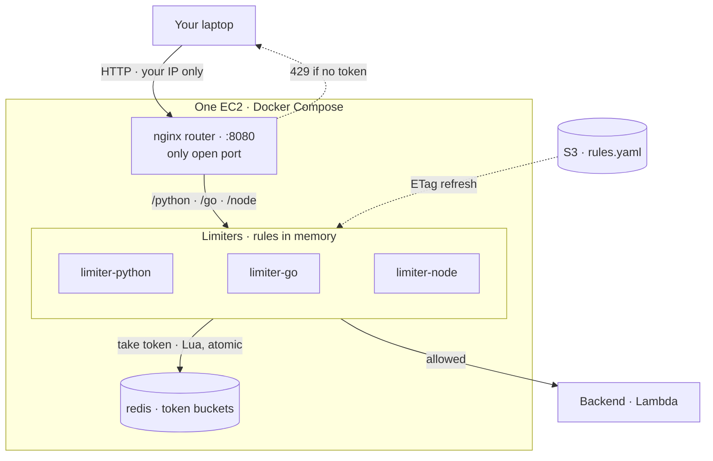

# 03 · Rate Limiter


[← Portfolio](../../README.md) · [Architecture](docs/architecture.md) · [Workflows](docs/workflow.md) · [Template](infrastructure/template.yaml) · [Code](src/)

<!-- Architecture image (docs/images/architecture.png) added once the design is decided. -->

## Summary

We are building a rate limiter. It runs as middleware on one EC2 instance with Docker Compose, keeps token buckets in Redis, and forwards allowed requests to a Lambda backend (a cheap stand-in for a real server). The rate limiter is middleware that sits between the client and the servers ([why](docs/architecture.md#where-the-rate-limiter-sits)). One requirement holds from the start: **latency is measured at every step**. Every time we call the setup on AWS, we record what latency the system adds, so each step of the build comes with numbers.

The project is built in defined steps. Each step is designed and agreed before it is implemented.

| Fact | Value |
|------|-------|
| Status | ⚪ Planned |
| What it is | A rate limiter |
| Middleware | One EC2 + Docker Compose: router, one limiter container per language, Redis |
| Backend | AWS Lambda (stand-in for a real server, keeps testing cheap) |
| Algorithm | Token bucket (bucket size, refill rate) |
| Rate limiter placement | Middleware between client and servers |
| Token buckets | Redis container (Docker network only) |
| Rules | S3 `rules.yaml`, held in limiter memory, refreshed by ETag |
| Latency | Measured at every step, for every call to the AWS setup |
| Access | Public IP, security group allows the owner's IP only (added by hand after deploy). No auth; short-lived test only ([details](docs/architecture.md#security)) |
| Infra as code | [`infrastructure/template.yaml`](infrastructure/template.yaml) |
| Cost at idle | $0 once the stack is deleted; small hourly EC2 cost while running |

## Architecture



## Latency

Latency is tracked at every step of the build. Each step adds a row here.

| Step | What changed | Latency | Notes |
|------|--------------|---------|-------|
| | | | |

## How it works

Defined step by step as the project is built.

More detail: [docs/workflow.md](docs/workflow.md). Design decisions: [docs/architecture.md](docs/architecture.md).

## Repo layout

```text
03-rate-limiter/
├── README.md                 ← this file
├── docs/
│   ├── architecture.md       ← components, data model, decisions
│   ├── workflow.md           ← sequence + state diagrams, deploy lifecycle
│   ├── diagram.py            ← diagram-as-code (AWS icons)
│   └── images/architecture.png
├── infrastructure/
│   └── template.yaml         ← CloudFormation stack
├── src/
│   └── token_bucket/         ← docker-compose.yml, token_bucket.lua, router/, one folder per language
├── tests/
│   └── integration/          ← tests against the deployed stack
└── scripts/
    ├── deploy.sh             ← lint, package src/, deploy, print outputs
    └── destroy.sh            ← delete stack
```

## Deploy / Test / Teardown

```bash
cd projects/03-rate-limiter
./scripts/deploy.sh dev us-east-1
# python3 tests/integration/<test>.py dev us-east-1
./scripts/destroy.sh dev us-east-1
```

## Cost & security notes

- **Cost:** EC2 billed hourly while up; delete the stack after each test.
- **Access:** deliberate exception to the repo's IAM-auth default. Only the router port is open, to the owner's IP, added by hand (never stored in this repo). No SSH; SSM for shell. See [Security](docs/architecture.md#security).
- **Least privilege:** instance role can only invoke the backend Lambda and read `rules.yaml`.
- **Data:** test data only (plain HTTP). Redis is never published.

## What I learned / next steps

- [ ] Steps to be added as we go
