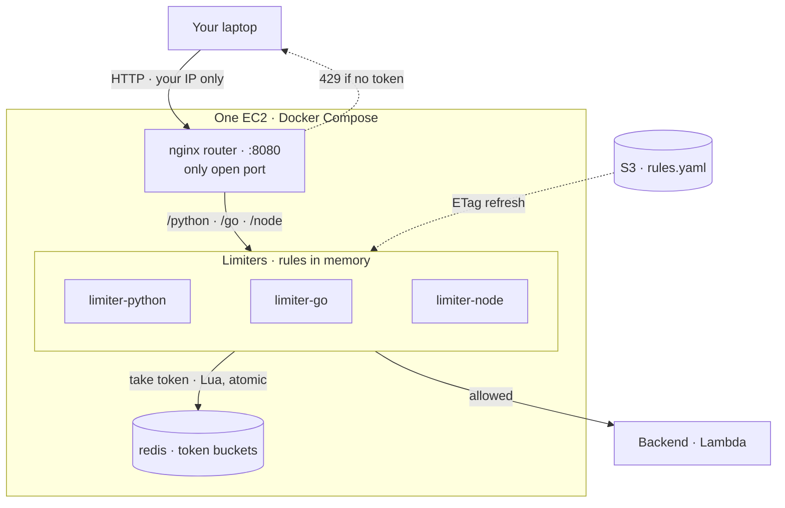

# 03 · Rate Limiter


[← Portfolio](../../README.md) · [Architecture](docs/architecture.md) · [Workflows](docs/workflow.md) · [Template](infrastructure/template.yaml) · [Code](src/)

<!-- Architecture image (docs/images/architecture.png) added once the design is decided. -->

## Summary

We are building a rate limiter. It runs as middleware on one EC2 instance with Docker Compose, keeps token buckets in Redis, and forwards allowed requests to a Lambda backend (a cheap stand-in for a real server). The rate limiter is middleware that sits between the client and the servers ([why](docs/architecture.md#where-the-rate-limiter-sits)). One requirement holds from the start: **latency is measured at every step**. Every time we call the setup on AWS, we record what latency the system adds, so each step of the build comes with numbers.

The project is built in defined steps. Each step is designed and agreed before it is implemented.

| Fact | Value |
|------|-------|
| Status | ⚪ Planned |
| What it is | A rate limiter |
| Middleware | One EC2 + Docker Compose: router, one limiter container per language, Redis |
| Backend | AWS Lambda (stand-in for a real server, keeps testing cheap) |
| Algorithm | Token bucket (bucket size, refill rate) |
| Caller identity | User id + cookie + IP, layered: a request needs a token in every bucket ([details](docs/architecture.md#identifying-the-caller)) |
| Rate limiter placement | Middleware between client and servers |
| Token buckets | Redis container (Docker network only) |
| Rules | S3 `rules.yaml`, held in limiter memory, refreshed by ETag |
| Latency | Measured at every step, for every call to the AWS setup |
| Access | Public IP, security group allows the owner's IP only (added by hand after deploy). No auth; short-lived test only ([details](docs/architecture.md#security)) |
| Infra as code | [`infrastructure/template.yaml`](infrastructure/template.yaml) |
| Cost at idle | $0 once the stack is deleted; small hourly EC2 cost while running |

## Architecture



## Latency

Latency is tracked at every step of the build. Each step adds a row here.

| Step | What changed | Latency | Notes |
|------|--------------|---------|-------|
| 1 | Token bucket, phase 1: t3.small, nginx → limiter → Redis (same box) → Lambda backend, us-east-1 | Limiter overhead **~0.3–0.7 ms** p50; Redis call **0.31–0.53 ms** p50 | Lambda invoke (~20 ms) is most of the server time; client round trip ~122–125 ms is mostly the laptop → us-east-1 link |

<details><summary>Step 1 · full results per language (100 requests each, ~6 req/s, all allowed)</summary>

| Language | client p50 | client p99 | server total p50 | redis p50 | redis p99 | backend p50 | limiter overhead p50 (total − backend) |
|---|---|---|---|---|---|---|---|
| Python | 125.22 | 144.55 | 22.30 | 0.53 | 1.01 | 21.63 | ~0.67 |
| Go | 122.19 | 134.96 | 19.89 | 0.31 | 2.29 | 19.55 | ~0.34 |
| Node | 123.18 | 134.85 | 20.57 | 0.47 | 0.79 | 19.99 | ~0.58 |

All values in ms. Not yet measured: the nginx router hop (from the router's `request_time − upstream_time` log). At this light load the three languages are within ~0.3 ms of each other; Go has the fastest Redis p50 but a higher p99 outlier.

</details>

## How it works

Defined step by step as the project is built.

More detail: [docs/workflow.md](docs/workflow.md). Design decisions: [docs/architecture.md](docs/architecture.md).

## Repo layout

```text
03-rate-limiter/
├── README.md                 ← this file
├── docs/
│   ├── architecture.md       ← placement, routing, identity, security, decisions
│   ├── workflow.md           ← sequence + state diagrams, deploy lifecycle
│   ├── diagram.py            ← diagram-as-code (AWS icons)
│   └── images/architecture.png
├── infrastructure/
│   └── template.yaml         ← CloudFormation stack
├── src/
│   └── token_bucket/
│       ├── README.md         ← how the token bucket works, Redis data model, memory sizing
│       ├── token_bucket.lua  ← the algorithm (runs in Redis)
│       ├── rules.yaml        ← rate limit rules
│       ├── docker-compose.yml, router/nginx.conf
│       └── python/ go/ node/ ← one limiter server per language
├── tests/
│   └── integration/          ← tests against the deployed stack
└── scripts/
    ├── deploy.sh             ← lint, package src/, deploy, print outputs
    └── destroy.sh            ← delete stack
```

## Deploy / Test / Teardown

```bash
cd projects/03-rate-limiter
./scripts/deploy.sh dev us-east-1          # uploads code + rules, deploys, waits until all limiters are healthy (~5-15 min)
# Console: add ONE inbound rule to the SecurityGroupId output: TCP 8080, <your-ip>/32
python3 tests/integration/latency.py http://<PublicIp>:8080 100
./scripts/destroy.sh dev us-east-1         # deletes the stack and this stage's uploaded artifacts
```

Change only `rules.yaml` and re-run `deploy.sh`: the limiters pick it up within ~30 s without replacing the instance. Changing code replaces the instance (new public IP; your security group rule stays).

## Cost & security notes

- **Cost:** EC2 billed hourly while up; delete the stack after each test.
- **Access:** deliberate exception to the repo's IAM-auth default. Only the router port is open, to the owner's IP, added by hand (never stored in this repo). No SSH; SSM for shell. See [Security](docs/architecture.md#security).
- **Least privilege:** instance role can only invoke the backend Lambda and read `rules.yaml`.
- **Data:** test data only (plain HTTP). Redis is never published.

## What I learned / next steps

Done:

- [x] Token bucket algorithm (Lua, multi-bucket, all-or-nothing) — [details](src/token_bucket/README.md)
- [x] Limiter servers: Python (tested locally), Node (logic tested), Go (first build on EC2)
- [x] nginx router + Docker Compose (Redis with password, one published port)
- [x] CloudFormation: VPC, EC2 t3.small, security group (no inbound), instance role, backend Lambda (cfn-lint clean)
- [x] `deploy.sh` / `destroy.sh` and the live test `tests/integration/latency.py`

Left to build:

- [x] Deployed, ran live tests, recorded step 1 latency
- [ ] Update `docs/diagram.py` + render `architecture.png`, `docs/workflow.md`
- [ ] Phase 2: scale out (more instances, ElastiCache), more algorithms
