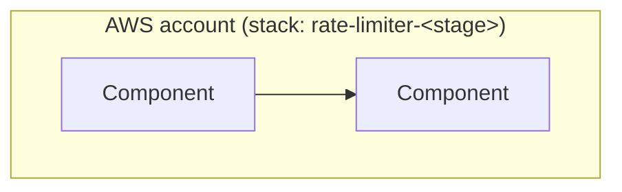
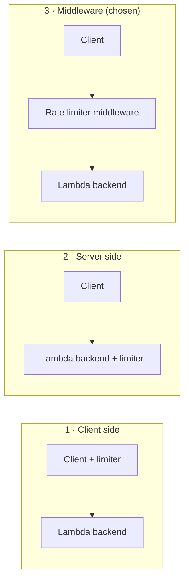
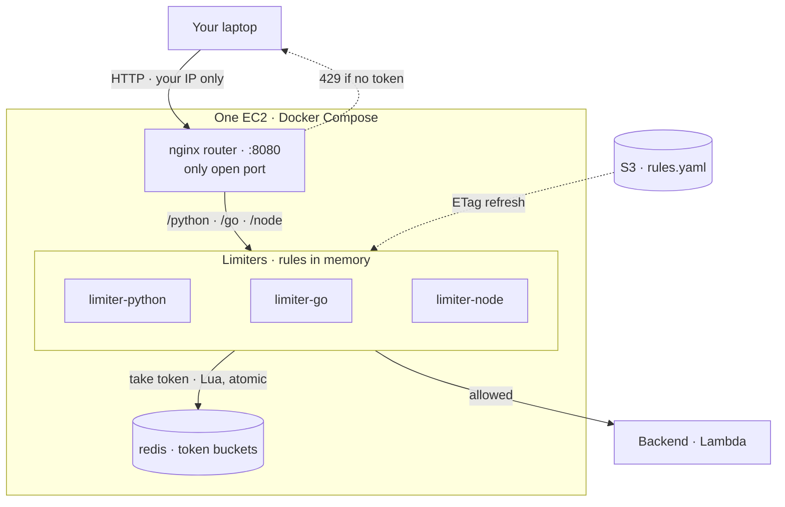
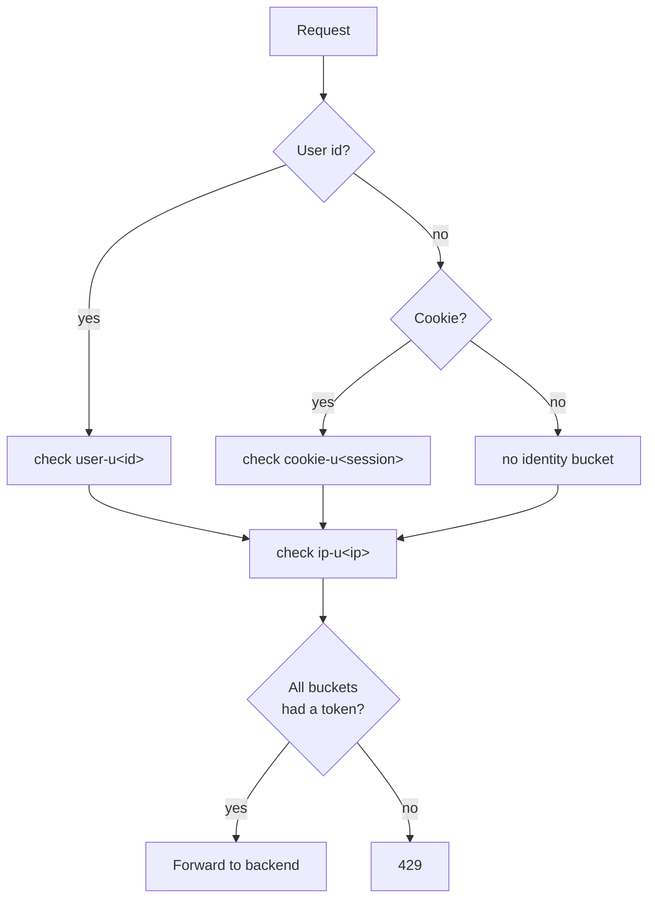

# Architecture · 03 Rate Limiter

[← Project README](../README.md) · [Architecture image](images/architecture.png)

## Components



| Logical ID | Type | Purpose |
|------------|------|---------|
| | | |

## Where the rate limiter sits

We considered three places for the rate limiter.



### 1. Client side

The client limits its own requests.

- Unreliable. The client controls the code, so it can change or skip the limiter.
- Any caller that doesn't use our client (scripts, curl, other SDKs) ignores it completely.
- Good only for being polite to the server. It can't enforce anything.

### 2. Server side (inside the backend)

The backend checks the limit before doing the work.

- **Extra server load.** Every request runs the backend, including the ones we end up rejecting. With Lambda, that means rejected requests still cost an invocation and use up concurrency.
- **No protection against floods.** Abusive traffic still reaches the backend before it's rejected, so a spike can still exhaust Lambda concurrency or downstream resources.
- **Shared state is needed.** Lambda is stateless and runs many instances at once, so in-memory counters are per instance and wrong. The counts must live in an external store (for example DynamoDB or ElastiCache), which adds a network hop to every request.
- **Race conditions.** Concurrent instances update the same counter, so increments must be atomic or the limit is exceeded.
- **Coupling.** Limiter logic is mixed with business logic. Every service has to reimplement it, and changing a limit means redeploying the backend.

### 3. Middleware (chosen)

A separate rate limiter sits between the client and the servers. Requests over the limit are rejected before they reach the backend.

- The client can't bypass it.
- The backend only sees allowed traffic.
- Limits live in one place, separate from business logic.

Trade-offs we accept and will measure:

- An extra hop on every request. This is the latency we track at every step.
- The middleware becomes a critical dependency. It must scale with traffic, and we must decide what happens if it fails (fail open or fail closed).
- It still needs shared state for counters if it runs on more than one instance.


## High-level architecture



| Piece | Job | Hot path? |
|-------|-----|-----------|
| EC2 | One small ARM instance running Docker Compose. Deleted after each test | Yes |
| Router | nginx container. Single published port (8080). Routes `/python/...`, `/go/...`, `/node/...` to the matching limiter container | Yes, small fixed hop |
| Rate limiter (per language) | Matches the request to a rule (in memory), takes a token from Redis, forwards or rejects | Yes |
| Redis | Holds the live token count per bucket ([data model](../src/token_bucket/README.md#data-model-redis)). Docker network only, never published, password required | Yes, one round trip |
| S3 | Source of truth for the rules (`rules.yaml`) | No |
| Backend | Lambda stand-in for a real server. Called with the EC2 instance role (SigV4). Only sees allowed requests | Only when allowed |

Rule format and the example rules: [token bucket README](../src/token_bucket/README.md#rules).

Why not Lambda for the middleware: the real middleware is a long-running server. Lambda adds cold starts, has no shared memory between copies, and needs a VPC to reach Redis, so its numbers would mostly measure Lambda.

## Identifying the caller

### Possible identifiers

| Identifier | Where it comes from | Can the caller fake it? | Good for |
|------------|---------------------|-------------------------|----------|
| User id (authenticated) | Verified token (e.g. JWT `sub`) | No | Per-user fairness; most accurate |
| API key / client id | Header, checked against issued keys | No, once checked | Public APIs, partners, paid tiers |
| Account / tenant / org | Looked up from the user | No | One shared limit per company |
| IP address | Network connection | Hard to fake, but shared and changing | Anonymous traffic, login/sign-up |
| IP range (IPv4 /24, IPv6 /64) | Derived from the IP | Hard to fake | Attackers rotating nearby IPs |
| Session / cookie id | Cookie | Yes: clear it, get a new one | Logged-out website visitors |
| Device id | Mobile app install id | Yes: reinstall | Mobile apps |
| Global (no caller) | Nothing | n/a | Capping total backend load |

Watch-outs:

- Raw headers (`X-User-Id`, `X-Forwarded-For`) can be set to anything by the client. Trust only verified ids, or the IP our own nginx records.
- One IP can hide thousands of users (office, school, mobile carrier), so IP limits should be looser.
- Device fingerprinting (identifying users from browser/device traits without consent) is avoided: it is a privacy problem.

### Chosen: user id + cookie + IP, layered

Every request is checked against **several buckets at once**, and is allowed only if **all** of them have a token.

| Layer | Applies when | Key | Stops |
|-------|--------------|-----|-------|
| User id | Request has a user id | `user-u42` | One user overusing the API |
| Cookie | No user id, but has a session cookie | `cookie-u9f2c1a` | Logged-out visitors overusing it |
| IP | Always | `ip-u3405803783` | Anyone dodging the other layers (no id, clearing cookies), and floods from one address |



Why layered and not one combined key (e.g. user + cookie + IP in one key): a combined key changes whenever any part changes, so clearing a cookie or switching networks would give the caller a fresh, full bucket. Separate layers mean the IP bucket still holds even when the cookie is reset.

Test-only shortcuts (fine here, not for real use):

- The user id comes from an `X-User-Id` header, which a caller can fake. In real use it would come from a verified login token.
- The cookie is a random session id the client sends; we don't issue or sign it.

Checking several buckets is all-or-nothing: if the IP bucket denies, the user bucket doesn't lose a token. The Lua script checks every bucket in one Redis call ([details](../src/token_bucket/README.md#the-lua-script)).

### Where the rules are stored

Decided: S3 is the source of truth. Each limiter loads `rules.yaml` at startup and keeps it in memory. Every N seconds it asks S3 for the file only if the ETag changed; an unchanged file returns a tiny "not modified" response. Rule reads on the request path are a memory lookup.

Options considered:

| Option | Cost | Read speed | Fits when |
|--------|------|-----------|-----------|
| **S3 (YAML file)** (chosen) | ~$0 at this scale | Tens of ms, but only when loading | Rules change rarely, edited as a file, versioned |
| DynamoDB | Pay-per-request, ~$0 at idle | Single-digit ms | Many rules, per-customer rules, changed often by an API |
| AWS AppConfig | Small per-request fee | Fast, built-in caching | Need validation and staged rollout of rule changes |
| EFS / EBS (literal disk) | Paid while it exists, EFS needs a VPC | Fast | Not a good fit: more cost and setup for no gain here |

## Code and container layout

One folder per algorithm. Each has a Compose file that starts the router, one limiter per language, and Redis. The algorithm itself is a Lua script that runs inside Redis, shared by every language.

```text
src/
└── token_bucket/
    ├── README.md            ← how the token bucket works, data model, memory sizing
    ├── docker-compose.yml   ← router + one limiter per language + Redis
    ├── token_bucket.lua     ← the algorithm (runs atomically in Redis, multi-bucket)
    ├── rules.yaml           ← default rules (uploaded to S3 on deploy)
    ├── router/nginx.conf    ← nginx: routes /python, /go, /node
    ├── python/              ← app.py, requirements.txt, Dockerfile
    ├── go/                  ← main.go, go.mod, Dockerfile (go.sum made at build)
    └── node/                ← server.js, package.json, package-lock.json, Dockerfile
```

Only source files and Dockerfiles go to GitHub (each Dockerfile is ~10-20 lines). Images are built on the EC2 instance and never committed.

## Algorithms

Each algorithm lives in its own folder under `src/` with its own README (how it works, Redis data model, memory sizing). The rest of this page (placement, routing, identity, rules storage, security) is shared by all algorithms.

| Algorithm | In short | Details |
|-----------|----------|---------|
| Token bucket | A bucket per caller holds up to `bucket_size` tokens and refills at `refill_rate`/s. Each request takes a token; empty bucket → 429. Runs as one atomic Lua script in Redis. | [src/token_bucket/README.md](../src/token_bucket/README.md) |

## Latency measurement

| What | Where it is measured |
|------|----------------------|
| Rate limiter's own latency (request in → decision out, Redis time) | Timings logged inside each limiter container |
| End-to-end latency from a real client | From your laptop, direct to the EC2 public IP |

Languages are tested one at a time on the same instance so they don't compete for CPU.

## Security

This project deliberately deviates from the repo default of IAM (SigV4) auth on every API. It is an explicit, short-lived test choice:

- The EC2 has a public IP. The security group ships with **no inbound rules**. After deploy, the owner adds their own IP by hand in the console, so no IP is ever stored in this public repo.
- Only the router port is opened to that IP. No SSH; shell access uses SSM Session Manager.
- There is no auth check on the endpoint. Anyone behind the allowed IP can reach it while it is up.
- Plain HTTP over the internet. Test data only.
- Redis is never published; it is reachable only on the Docker network.
- The backend Lambda is invoked with the instance role (least privilege: `lambda:InvokeFunction` on that one function).
- The stack is deleted after each test session.

Do not copy this pattern for anything long-lived.

## Build phases

1. **Phase 1 · Single server.** One EC2 with Docker Compose: router, limiter per language, Redis container, Lambda backend.
2. **Phase 2 · Scale out.** More instances (e.g. ECS), shared Redis (e.g. ElastiCache), load tuning.

Parked: fail open vs fail closed.

## Design decisions

| Decision | Chosen | Alternatives | Why |
|----------|--------|--------------|-----|
| Rate limiter placement | Middleware between client and servers | Client side, server side | Can't be bypassed, keeps rejected traffic off the backend, separates limits from business logic |
| Backend | AWS Lambda (test stand-in for a real server) | | Cheap for testing |
| Algorithm | Token bucket (bucket size, refill rate) | | First algorithm to build |
| Middleware compute (phase 1) | One EC2 + Docker Compose | Lambda | Behaves like the real long-running server; no cold starts or VPC complexity |
| Lambda middleware | Rejected | Concurrency 1, normal concurrency | Cold starts, no shared memory, throttling at concurrency 1; measures Lambda, not the limiter |
| Counter store | Redis container on the same EC2 | ElastiCache | Cheapest for phase 1; ElastiCache in phase 2 |
| Redis key | `<rule>-u<caller>`, e.g. `user-u42`; IPv4 stored as a number | `tb:default-per-user:user42` | Shorter key = less memory per user; same lookup speed |
| Token storage | Whole milli-tokens (1 token = 1000), fields `t` and `ts` | Fractional tokens as text | Compact integer storage, no floating-point drift |
| Caller identity | User id + cookie + IP, layered: allow only if every bucket has a token | One combined key; IP only; API keys | Resetting one id (e.g. clearing cookies) still hits the IP bucket |
| Rule match | Caller + endpoint | Caller only, endpoint only | Different limits per endpoint for each caller |
| Rules store | S3 YAML, in limiter memory, refreshed by ETag | DynamoDB, AppConfig, EFS/EBS, Redis | Cheapest, versioned, memory-speed reads |
| Rule loading | Poll S3 with ETag | Loader Lambda push, pull on miss | No extra Lambda; a long-running server can poll cheaply |
| Container layout | One Compose per algorithm, one Dockerfile per language | One Dockerfile with all languages | Small, separate builds; one process per container |
| Network access | Public IP, security group allows owner's IP only (added manually) | SSM tunnel | Owner wants direct laptop → AWS latency; tunnel adds a noisy hop |

## Limits

- Phase 1 is a single instance: no high availability.
- No auth on the endpoint (see Security).
