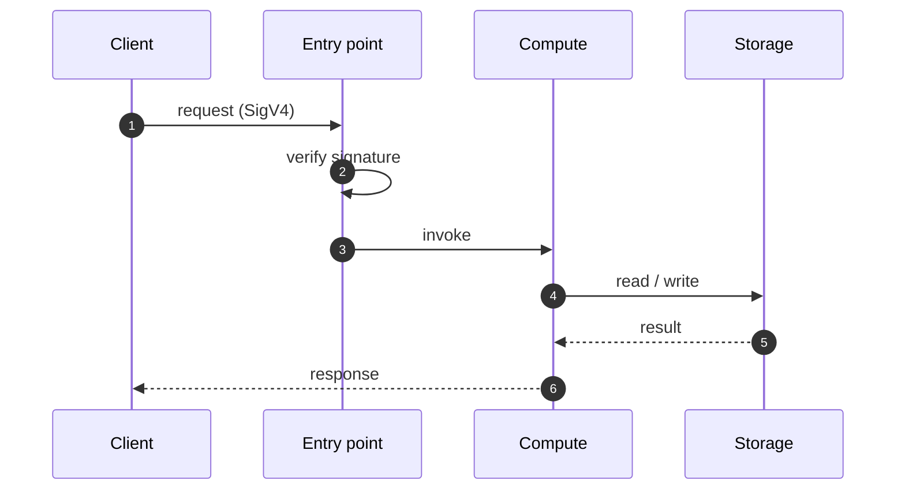
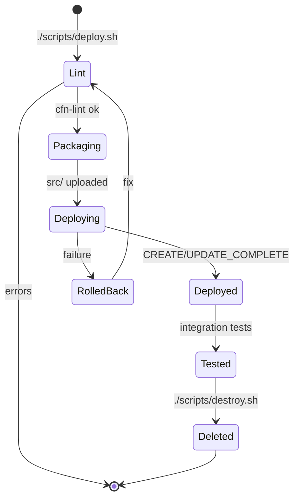

# Workflow · 03 Rate Limiter

[← Project README](../README.md)

## Main request flow

## Deploy lifecycle

## Test checks

| # | Check | Expected |
|---|-------|----------|
| 1 | Unsigned request | 403 |
| 2 | | |
