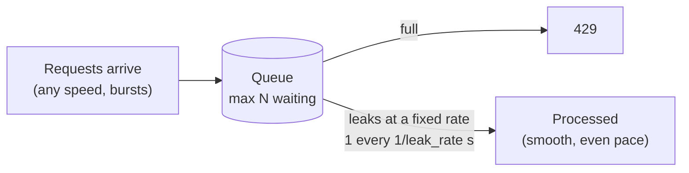
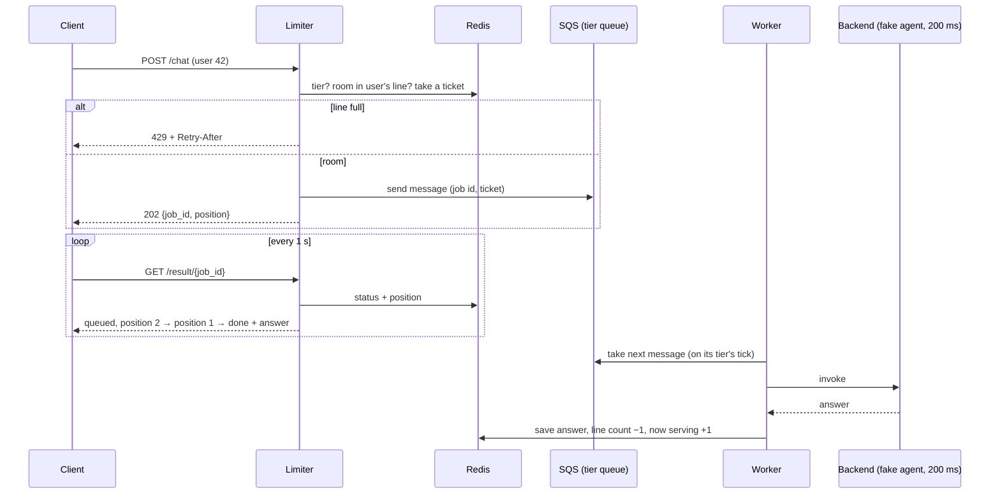

# Leaky bucket (queue)

[← Architecture](../../docs/architecture.md) · [Project README](../../README.md) · [Token bucket](../token_bucket/README.md)

**Status: design, not built yet.**

The second rate limiting algorithm. Requests wait in a line and are processed at a **fixed speed**. Example used throughout: a **chat agent**, where every message waits its turn for the busy model, and business users get a faster lane.

## How it works

- **Empty queue:** the first request is processed right away.
- **Busy queue:** each new request waits its turn, first in, first out.
- **Full queue:** new requests get 429 straight away.
- Token bucket vs leaky bucket: the token bucket **cuts off** extra traffic but lets allowed bursts through at once. The leaky bucket **smooths** traffic: the backend always sees an even pace.

Like a coffee shop: SQS is the **line**, the worker is the **barista** (their speed is the leak rate), and Redis is the **door guard** (counts how many each customer has in line).

## Tiers

| Tier | Name | Leak rate | Max waiting per user |
|------|------|-----------|----------------------|
| 0 | regular | 1 per second | 3 |
| 1 | business | 5 per second | 10 |
| 2–255 | future | set in `rules.yaml` | set in `rules.yaml` |

- A user's tier is a small number in one Redis hash (`tiers`: user id → tier). Users not in it are tier 0.
- Up to 255 tiers costs no extra memory. Adding one = a `rules.yaml` entry + one queue per language.
- Each tier has **its own queue**, so business never waits behind regular.
- Test setup: tiers are set by a seed script. In real use, the tier would come from the user's verified account.

## The flow

## Pieces

| Piece | Job | Controls the rate? |
|-------|-----|--------------------|
| Limiter (Python / Go / Node) | Checks Redis, sends to SQS, answers polls | No |
| **SQS FIFO queue** (per language × tier) | Holds waiting requests in exact order, outside the EC2 | No |
| **Worker** (Python / Go / Node) | Starts one request every `1 / leak_rate` s | **Yes**: this is the leak |
| Redis | Tier lookup, per-user line count, position counters, results | No |
| Backend Lambda | Fake chat agent: sleeps 200 ms, replies | No |

- **FIFO queue:** a standard SQS queue doesn't guarantee order; a leaky bucket must be first in, first out.
- **Worker starts on every tick and doesn't wait for the reply,** so a 200 ms agent can keep up with business's 5/s (one start every 200 ms).
- **One set of queues per language** (3 languages × 2 tiers = 6 queues): `/python` uses Python's queues and worker, etc., so each language is measured on its own, like the token bucket.

## Redis data

| Key | Holds | Example |
|-----|-------|---------|
| `tiers` (hash) | user id → tier number | `42 → 1` |
| `lq-u<user>` | requests this user has waiting (line count) | `lq-u42 = 2` |
| `tk-<lang>-<tier>` | last ticket handed out | `tk-python-1 = 118` |
| `sv-<lang>-<tier>` | last ticket finished ("now serving") | `sv-python-1 = 116` |
| `job-<id>` (hash) | status, ticket, answer; expires after 5 min | `status=done` |
| `poll-u<id>` / `pollu-u<user>` | token buckets for the polling limit | reuses `token_bucket.lua` |

**Position in line** = your ticket − now serving. Redis keeps this because the limiter (hands out tickets) and the worker (finishes them) are different programs, and later there will be several of each; a counter inside one server would only see its own requests.

Accepting a request (tier check, line count, ticket) is one atomic Lua call, like the token bucket.

## Polling limit

The client polls `GET /result/{job_id}` once per second.

| Limit | Allowance | Over it |
|-------|-----------|---------|
| Per job | 1 per second, burst of 3 | 429 + Retry-After |
| Per user (all their jobs) | 10 per second, burst of 20 | 429 + Retry-After |

- Job ids are random and long (UUID), and a poll must come from the same user, so nobody can read someone else's answer.

## What we measure

| Timing | Meaning |
|--------|---------|
| `accept` | Limiter: Redis checks + SQS send (expect ~10–30 ms) |
| `queue wait` | Time in line, by design. Should differ by tier |
| `processing` | Worker start → agent answer (~200 ms + Lambda overhead) |
| `poll delay` | Up to 1 s extra, because the client checks once a second |

## Test plan

Burst of **5 requests at once**, then poll every second:

| User | Expected |
|------|----------|
| Regular (tier 0: 1/s, max 3) | 3 accepted, 2 × 429. Done at about 0 s, 1 s, 2 s |
| Business (tier 1: 5/s, max 10) | All 5 accepted. All done within about 1 s |

Plus: polling faster than allowed gets 429; each language tested one at a time.

## What changes in the project

- **New:** this folder (Lua scripts, 3 limiters, 3 workers, Compose file), 6 SQS FIFO queues in CloudFormation, instance role allowed to use only those queues, backend sleeps 200 ms in this mode.
- **Unchanged:** nginx routing, Redis, EC2, deploy and destroy flow, IP-only access.

## Open questions

- When a request fails in the agent: retry up to 3 times, then move it to a dead-letter queue and mark the job `failed`?
- Message retention: keep waiting messages at most 10 minutes (a client won't wait longer)?
