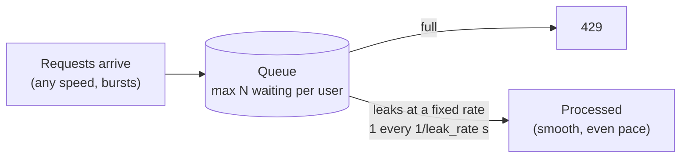
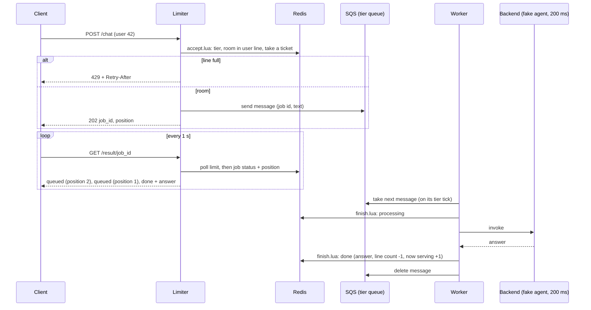

# Leaky bucket (queue)

[← Architecture](../../docs/architecture.md) · [Project README](../../README.md) · [Token bucket](../token_bucket/README.md) · [Code structure](CODE_STRUCTURE.md)

**Status: built and tested locally, not deployed yet.** Latency results: to be measured after deploy.

The second rate limiting algorithm. Requests wait in a line and are processed at a **fixed speed**. Example used throughout: a **chat agent**, where every message waits its turn for the busy model, and business users get a faster lane.

## How it works



- **Empty queue:** the first request is processed right away.
- **Busy queue:** each new request waits its turn, first in, first out.
- **Full line (for that user):** new requests get 429 straight away.
- Token bucket vs leaky bucket: the token bucket **cuts off** extra traffic but lets allowed bursts through at once. The leaky bucket **smooths** traffic: the backend always sees an even pace.

Like a coffee shop: SQS is the **line**, the worker is the **barista** (their speed is the leak rate), and Redis is the **door guard** (counts how many each customer has in line).

## Tiers

| Tier | Name | Leak rate | Max waiting per user |
|------|------|-----------|----------------------|
| 0 | regular | 1 per second | 3 |
| 1 | business | 5 per second | 10 |
| 2–255 | future | set in `rules.yaml` | set in `rules.yaml` |

- A user's tier is a small number in one Redis hash (`tiers`: user id → tier). Users not in it, or with a tier that is not configured, are tier 0.
- Each tier has **its own queue**, so business never waits behind regular.
- Test setup only: `seed_tiers` in `rules.yaml` writes users `biz1` to `biz5` into tier 1 when a limiter starts. In real use the tier would come from the user's verified account, never from a file.

### How to add a tier

1. Add an entry under `tiers` in [`rules.yaml`](rules.yaml): `id`, `name`, `leak_rate`, `max_waiting`.
2. Add the tier number to the tier list of the queue loop in [`infrastructure/template.yaml`](../../infrastructure/template.yaml) (and to the matching list in `Outputs`). That creates one queue plus one dead-letter queue per language.
3. Deploy. Limiters pick up `rules.yaml` by ETag within ~30 s. **Workers read the rules once at start**, so restart them (a code change replaces the instance, which does the same).
4. Put users in the new tier by writing `HSET tiers <user> <tier>` (or add test users to `seed_tiers`).

No code change is needed: the Lua scripts, limiters and workers loop over whatever tiers `rules.yaml` lists.

## API

Same prefixes as the token bucket: nginx sends `/python/…`, `/go/…`, `/node/…` to the limiter of that language. Every response (except `/healthz`) has a `Server-Timing` header (`redis`, `sqs`, `total`, in ms).

| Method and path | Headers | Body | Answer |
|-----------------|---------|------|--------|
| `POST /<lang>/chat` | `X-User-Id` (required: letters, digits, `_ . :`, max 128) | optional JSON `{"message": "…"}`, text up to 500 characters | `202 {job_id, position, tier}`, or `429` + `Retry-After` when the user's line is full |
| `GET /<lang>/result/<job_id>` | same `X-User-Id` as the POST (else 404) | none | `200 {status, tier, position, …}`; `429` + `Retry-After` when polling too fast |
| `GET /<lang>/healthz` | none | none | `200 {"ok":true}`, no checks |

Result fields: `status` is `queued`, `processing`, `done`, `failed` or `expired`. While waiting, `position` is the place in line (1 = next up); once ended it is 0 and the answer carries `queue_wait_ms`, `processing_ms` and `answer` (done) or `error` (failed or expired).

Other answers: `400` bad or missing `X-User-Id` / bad body, `404` unknown path or job (also someone else's job), `405` wrong method, `413` body over 4 KB, `502` the job could not be queued (the user's place is given back).

Test-only hook: a POST body `{"message": "…", "fail": true}` makes the backend raise an error for that job, so retries and the failed state can be tested. It travels in the SQS message body to the worker, which passes it to the backend Lambda. Remove it before any real use.

## The flow



## Pieces

| Piece | Job | Controls the rate? |
|-------|-----|--------------------|
| Limiter (Python / Go / Node) | Checks Redis, sends to SQS, answers polls | No |
| **SQS FIFO queue** (per language × tier) | Holds waiting requests in exact order, outside the EC2 | No |
| **Worker** (Python / Go / Node) | Starts one request every `1 / leak_rate` s | **Yes**: this is the leak |
| Redis | Tier lookup, per-user line count, ticket counters, results | No |
| Backend Lambda | Fake chat agent: sleeps 200 ms (`sleep_ms`), replies | No |

- **FIFO queue:** a standard SQS queue doesn't guarantee order; a leaky bucket must be first in, first out. All jobs of a queue share one message group, so the order is strict.
- **Worker starts on every tick and doesn't wait for the reply,** so a 200 ms agent can keep up with business's 5/s (one start every 200 ms). If the worker was idle, missed ticks are not made up: there is no burst after a quiet period.
- **One set of queues per language** (3 languages × 2 tiers = 6 queues): `/python` uses Python's queues and worker, etc., so each language is measured on its own, like the token bucket.
- **Queue names:** `rate-limiter-<stage>-<lang>-t<tier>.fifo`, dead-letter queue `rate-limiter-<stage>-<lang>-t<tier>-dlq.fifo`. Encrypted at rest (SQS-managed keys).

## Retention, retries and failure

| Decision | Value | What happens |
|----------|-------|--------------|
| Longest wait | **2 minutes** (`MessageRetentionPeriod` 120) | A message still unprocessed after 2 minutes is dropped by SQS. The next poll sees the job is older than that and reports `expired`, giving the user's place back. |
| Attempts | **5** | After 5 failed attempts the job is `failed`. The worker marks it `failed` on the 5th (using `ApproximateReceiveCount`), deletes the message, releases the user's place and moves "now serving" on. The queue's redrive policy (`maxReceiveCount` 5) moves the message to the dead-letter queue as a safety net if the worker dies first. |
| Retry speed | visibility 10 s, **1 s** after a backend error | A received job is hidden for 10 s. After a backend error the worker shortens that to 1 s, so a retry is quick and a FIFO queue is not stuck behind a bad job for long. |
| Receive batch | at most `max(1, 2 × leak_rate)` and 10 | Small batches keep buffered jobs from sitting hidden for long. |
| Dead-letter queues | kept 1 day | Moved messages keep their original age, so a 120 s retention there would purge them at once. |

All of these (except the queue properties in CloudFormation) are in [`rules.yaml`](rules.yaml) under `queue:`.

## Redis data

| Key | Holds | Example |
|-----|-------|---------|
| `tiers` (hash) | user id → tier number | `42 → 1` |
| `lq-<lang>-u<user>` | requests this user has waiting (line count). Expires after retention + 60 s, so a crashed worker cannot lock a user out | `lq-python-u42 = 2` |
| `tk-<lang>-<tier>` | last ticket handed out | `tk-python-1 = 118` |
| `sv-<lang>-<tier>` | last ticket finished ("now serving") | `sv-python-1 = 116` |
| `job-<uuid>` (hash) | status, tier, ticket, user, times, answer; expires 5 min after it ends | `st=done` |
| `poll-u<job_id>` / `pollu-u<user>` | token buckets for the polling limit | reuses `token_bucket.lua` |

**Position in line** = your ticket − now serving. Redis keeps this because the limiter (hands out tickets) and the worker (finishes them) are different programs, and later there will be several of each; a counter inside one server would only see its own requests.

Two atomic Lua scripts do all the bookkeeping:

- [`accept.lua`](accept.lua): reads the tier, compares the user's line count with the tier's `max_waiting`, and either refuses (nothing written) or adds one to the line count, takes a ticket and creates the job. Returns accepted, tier, ticket, position and `retry_after_ms`.
- [`finish.lua`](finish.lua): moves a job to `processing`, `done`, `failed` or `expired`. Ending a job saves the answer or error, takes one off the line count (never below 0) and moves "now serving" on. Calling it twice for the same job changes nothing the second time, because SQS can deliver a message again.

Both build some key names from their arguments. That is fine on the single Redis node used here; Redis Cluster would need hash tags (phase 2).

## Polling limit

The client polls `GET /result/<job_id>` once per second. The limit reuses `../token_bucket/token_bucket.lua` (not copied; the Docker build context is `src/`).

| Limit | Allowance | Over it |
|-------|-----------|---------|
| Per job | 1 per second, burst of 3 | 429 + Retry-After |
| Per user (all their jobs) | 10 per second, burst of 20 | 429 + Retry-After |

Job ids are random UUIDs, and a poll must come from the user who sent the job, so nobody can read someone else's answer.

## Files

[CODE_STRUCTURE.md](CODE_STRUCTURE.md) has the full map with fingerprints. In short:

| Path | What |
|------|------|
| `accept.lua`, `finish.lua` | The two Redis scripts |
| `rules.yaml` | Tiers, queue settings, polling limits, agent delay, test users |
| `docker-compose.yml` | Router + Redis + 3 limiters + 3 workers (reuses the token bucket `nginx.conf`) |
| `python/` | `app.py` limiter, `worker.py`, `common.py`, two Dockerfiles |
| `node/` | `server.js` limiter, `worker.js`, `common.js`, two Dockerfiles |
| `go/` | One binary with two modes (`limiter`, `worker`): `main.go`, `limiter.go`, `worker.go`, `common.go`, two Dockerfiles |

## Deploy, test, teardown

```bash
cd projects/03-rate-limiter
./scripts/deploy.sh dev us-east-1 leaky_bucket     # creates the 12 SQS queues, uploads code + rules, waits until healthy
# Console: add ONE inbound rule to the SecurityGroupId output: TCP 8080, <your-ip>/32
python3 tests/integration/leaky_latency.py http://<PublicIp>:8080 3    # 3 rounds per language
./scripts/destroy.sh dev us-east-1                 # deletes the stack, queues and this stage's artifacts
```

- The template uses `Fn::ForEach` (the `AWS::LanguageExtensions` transform), so deploying needs `CAPABILITY_AUTO_EXPAND`; `deploy.sh` passes it.
- Switching a stack between `token_bucket` and `leaky_bucket` changes the boot script, so the instance is replaced (new public IP; your security group rule stays).
- SQS refuses to create a queue with a name used in the last ~60 seconds, so wait a minute before deploying again after a delete.
- Moving `rules.yaml` only: re-run `deploy.sh`; limiters pick it up in ~30 s, workers need a restart.

## What the test checks

[`tests/integration/leaky_latency.py`](../../tests/integration/leaky_latency.py) (standard library only) runs each language one at a time and exits non-zero on anything unexpected:

| Scenario | Expected |
|----------|----------|
| (a) Regular user, burst of 5 at once | 3 accepted (positions 1, 2, 3), 2 × 429. Jobs start about 0 s, 1 s, 2 s after the burst and end `done` |
| (b) Business user (`biz1` to `biz5`), burst of 5 | All 5 accepted as tier 1, all done within about 1.5 s |
| (c) 8 polls of one job at the same moment | Some 429 with `Retry-After` |
| (d) Job sent with `"fail": true` | Ends `failed` after 5 attempts (about 6 s); the user's next request is accepted |

It polls every second and prints p50 and p90 for accept, queue wait, processing and end-to-end, plus a markdown table.

## What we measure

| Timing | Meaning |
|--------|---------|
| `accept` | Limiter: Redis checks + SQS send. Client view (includes your internet link) and server view (`Server-Timing`) |
| `queue wait` | Time in line, by design. Differs by tier |
| `processing` | Worker start → agent answer (~200 ms + Lambda overhead) |
| `end-to-end` | POST sent → first poll that shows `done`; includes up to 1 s of poll delay |

### Latency results

To be measured after deploy.

## Checked so far, and what is not

Checked locally (Python, Node and Go limiter + worker against a Redis stand-in with real Lua and an SQS FIFO stand-in): both Lua scripts, the API errors, regular and business bursts, the fixed pace, the poll limit, the fail hook (`failed` after 5 attempts), `expired`, and that line counts return to 0. `cfn-lint` passes for the template.

Not checked yet: real SQS FIFO behaviour, the real Lambda call from the Go and Node workers, Docker image builds, S3 rules loading, and the stack behind nginx. These get exercised by the first deploy.

## What changed in the project

- **New:** this folder (Lua scripts, 3 limiters, 3 workers, Compose file), 6 SQS FIFO queues + 6 dead-letter queues in CloudFormation (only when `Algorithm=leaky_bucket`), instance role allowed to use only those queues, backend can sleep and fail on request, `leaky_latency.py`.
- **Unchanged:** nginx routing, Redis, EC2 size, destroy flow, IP-only access.
