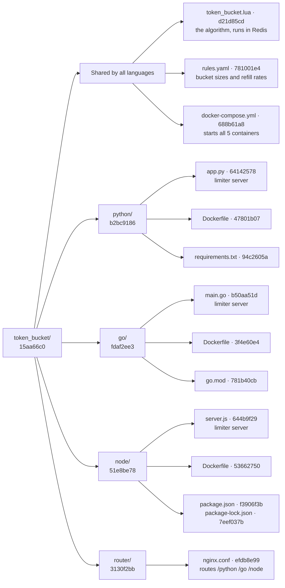
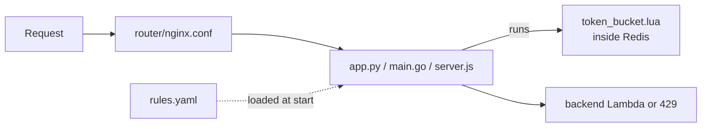

# Code structure · token bucket

[← Token bucket README](README.md) · [Architecture](../../docs/architecture.md)

A map of every file in this folder, drawn as a Merkle tree: each file has a fingerprint (short SHA-256 hash), and each folder's fingerprint is made from its children's. Change one character anywhere and that file's hash, its folder's hash, and the root hash all change, so the tree shows exactly where code changed.

## The tree



"Shared by all languages" is a grouping for reading only; those files sit directly in `token_bucket/`. `README.md` (542ab97f) is also part of the root hash.

## What each file does

| File | Job | Used by |
|------|-----|---------|
| `token_bucket.lua` | The algorithm: refill, check every bucket, take tokens all-or-nothing, save | Every limiter sends it to Redis |
| `rules.yaml` | Which buckets exist (`user`, `cookie`, `ip`, `login`), their size and refill rate | Every limiter, loaded into memory from S3 |
| `docker-compose.yml` | Starts router + 3 limiters + Redis; only the router publishes a port | Docker on the EC2 |
| `router/nginx.conf` | Sends `/python/…`, `/go/…`, `/node/…` to the right limiter; sets the real client IP | nginx container |
| `python/app.py` · `go/main.go` · `node/server.js` | Same job in 3 languages: read caller ids, pick matching rules, one Redis call, then call the backend or return 429 | Their own container |
| `*/Dockerfile` | How to build each container image (no logic) | `docker compose build` |
| `requirements.txt` · `go.mod` · `package*.json` | Pinned libraries for each language | The Docker build |
| `README.md` | How the token bucket works, Redis data model, memory sizing | People |

## How the files work together on one request



## How the hashes are made

- **File:** SHA-256 of the file's bytes.
- **Folder:** SHA-256 of its children's `name:hash` lines, sorted by name.
- **Shown:** first 8 characters. Skipped: `node_modules/`, `__pycache__/`, `.venv/`, hidden files, and this file.

These hashes are a snapshot of the phase 1 code. To recompute them after a change, from `src/`:

```bash
python3 -c "
import hashlib,os
S={'node_modules','__pycache__','.venv'}
def t(p,d=0):
    if os.path.isfile(p):
        x=hashlib.sha256(open(p,'rb').read()).hexdigest();print('  '*d+os.path.basename(p),x[:8]);return x
    k=sorted(i for i in os.listdir(p) if i not in S and not i.startswith('.') and i!='CODE_STRUCTURE.md')
    x=hashlib.sha256('\n'.join(f'{i}:{t(os.path.join(p,i),d+1)}' for i in k).encode()).hexdigest()
    print('  '*d+os.path.basename(p)+'/',x[:8]);return x
t('token_bucket')"
```
