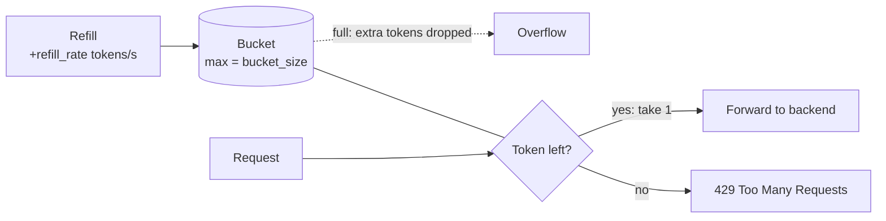
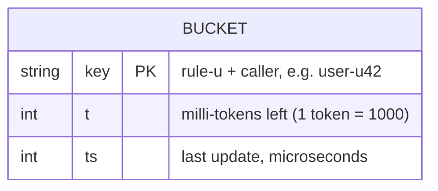

# Token bucket

[← Architecture](../../docs/architecture.md) · [Project README](../../README.md) · [Lua script](token_bucket.lua) · [Rules](rules.yaml) · [Code structure](CODE_STRUCTURE.md)

The first rate limiting algorithm. All three language servers (Python, Go, Node) run the same Lua script inside Redis, so the algorithm is identical and only the server around it differs.

| Status | Deployed and measured ([results](../../README.md#latency)) |
|---|---|

## How it works

Each bucket holds up to **bucket size** tokens and gains tokens at the **refill rate**. Every request takes one token. No token, no entry.



| Setting | Controls | Example (size 10, rate 5/s) |
|---------|----------|-----------------------------|
| Bucket size | The largest burst allowed at once | 10 requests at once |
| Refill rate | The steady rate allowed over time | then about 5 per second |

## The Lua script

[`token_bucket.lua`](token_bucket.lua) runs inside Redis, so read → refill → take → save happens as one step and two requests can never take the same last token.

| Idea | What it means |
|------|---------------|
| Lazy refill | No timer. On each request: tokens earned = seconds since last update × `refill_rate`, capped at `bucket_size` |
| All-or-nothing | One call checks every bucket for the request (e.g. `user` + `ip`). Allowed only if all have a token; if one says no, none lose a token |
| Milli-tokens | Stored as whole numbers (1 token = 1000), so no floating-point drift |
| Redis clock | Uses Redis `TIME`, so all servers agree on "now" |
| Self-cleaning | Each bucket expires once it would be full again |

Returns `[allowed, remaining, retry_after_ms, denied_by]`; the server turns a denial into `429` + `Retry-After`.

## Rules

One rule per thing we limit. Each rule has the two settings: bucket size and refill rate.

| Rule | Limits | Size | Refill/s |
|------|--------|------|----------|
| `user` | Each logged-in user, every path | 10 | 5 |
| `cookie` | Each logged-out visitor (no user id), every path | 5 | 2 |
| `ip` | Each client IP, every path (looser: IPs are shared) | 20 | 10 |
| `login` | Each IP on `/login` | 5 | 0.1 (1 every 10 s) |

<details><summary>The rules as YAML</summary>


```yaml
rules:
  - id: user               # Redis key: user-u<user id>
    match:
      key: user_id         # X-User-Id header (test only)
      path: "*"
    bucket_size: 10        # max tokens = max burst
    refill_rate: 5         # tokens added per second
  - id: cookie             # Redis key: cookie-u<session id>
    match:
      key: cookie          # session cookie, used when there is no user id
      path: "*"
    bucket_size: 5
    refill_rate: 2
  - id: ip                 # Redis key: ip-u<IPv4 as a number>
    match:
      key: ip              # client IP as seen by nginx
      path: "*"
    bucket_size: 20        # higher: many users can share one IP
    refill_rate: 10
  - id: login              # Redis key: login-u<IPv4 as a number>
    match:
      key: ip
      path: /login
    bucket_size: 5
    refill_rate: 0.1       # 1 token every 10 s
```

</details>

A rule matches on both the caller (`key`) and the endpoint (`path`). How callers are identified: [Identifying the caller](../../docs/architecture.md#identifying-the-caller). The live file is [`rules.yaml`](rules.yaml).

## Data model (Redis)

Redis is a key-value store: the key is the address, so finding a caller's bucket is one direct lookup, never a search.



| Part | Format | Example |
|------|--------|---------|
| Key | `<rule>-u<caller>` | `user-u42` (user 42), `cookie-u9f2c1a` (session cookie), `ip-u3405803783` (IP 203.0.113.7 as a number) |
| `t` | Whole milli-tokens | `7500` = 7.5 tokens |
| `ts` | Microseconds, Redis server clock | `1761580000123456` |
| Expiry | Auto-deleted once the bucket would be full again | size 10, rate 5/s → 2 s |

| Key part | Rule |
|----------|------|
| `<rule>` | The rule's short `id` from `rules.yaml`: lowercase letters and digits only, no `-`, so a key can't be read two ways |
| `<caller>` | The user id, the session cookie id, or for IP rules the IPv4 address as a number (IPv6 falls back to the address text) |
| Field names | One or two letters, to save memory per user |

## Capacity planning (Redis memory)

### Bucket expiry

Each bucket deletes itself after `bucket_size ÷ refill_rate` seconds of no requests. By then it would be full again, so deleting it changes nothing.

| Rule | Size | Refill/s | Deleted after |
|------|------|----------|---------------|
| user | 10 | 5 | 2 s |
| cookie | 5 | 2 | 2.5 s |
| ip | 20 | 10 | 2 s |
| login | 5 | 0.1 | 50 s |

### Sizing Redis memory

One bucket costs about **150–200 bytes**, much more than the data itself, because Redis adds lookup and expiry bookkeeping per key:

| Part | Bytes |
|------|-------|
| Key text (`user-u42`) | ~16 |
| Main table entry + slot | ~40–48 |
| Value object | ~16 |
| Hash data (`t`, `ts`) | ~32 |
| Expiry entry + slot | ~40–48 |
| **Total** | **~150–170** (round up to 200) |

Redis only holds buckets used in the last few seconds, so memory depends on **traffic**, not on how many users exist.

```text
buckets in Redis ≈ requests per second × seconds each bucket lives
memory           ≈ buckets × ~200 bytes × 1.5 (safety margin)
```

Example at 10,000 requests per second:

| Rule | Buckets in Redis |
|------|------------------|
| user / cookie | 10,000 × 2 s = 20,000 |
| ip | 10,000 × 2 s = 20,000 |
| login (2% of traffic) | 200 × 50 s = 10,000 |
| **Total** | **50,000 buckets ≈ 15 MB** |

So 128 MB covers about 8× this traffic. Slow-refill rules (like `login`) use the most memory, because their buckets live longest.

**How many callers fit in 128 MB:**

A caller uses ~2 buckets, not 4: `user` or `cookie` (never both) + `ip`, plus `login` only on `/login`. IP buckets are shared by everyone behind one IP.

| Step | Value |
|------|-------|
| 128 MB ÷ 200 bytes per bucket | ~671k buckets |
| ÷ 1.5 safety margin | ~447k buckets |
| ÷ ~2 buckets per caller | **~224k callers active in any 2-second window** |

"Active" means a request in the last ~2 s (50 s for `login`); callers who went quiet take no memory. Shared IPs push the real number higher; heavy `/login` traffic pushes it lower.

**Checking it on the deployed stack:**

| Command | Tells us |
|---------|----------|
| `MEMORY USAGE user-u42` | Size of one bucket (misses part of the expiry cost) |
| `used_memory` before/after creating 100k buckets ÷ 100k | True cost per bucket, everything included |
| `DBSIZE` | How many buckets exist right now |
| `INFO memory` | Total memory used |
| `INFO stats` → `evicted_keys` | Buckets deleted for lack of memory (should be 0) |

**If it's not enough:**

| Option | Notes |
|--------|-------|
| Smaller buckets | Already done (short keys, whole-number tokens) |
| More memory | A bigger instance or ElastiCache node |
| Split Redis across servers (Redis Cluster) | Catch: one request checks `user-…` and `ip-…` together, but those keys may land on different servers, so the all-or-nothing check would need redesigning |
| Shorten the expiry | Don't: deleting a bucket early gives that caller free requests |

**If Redis does run out of memory:**

| Policy | What happens |
|--------|--------------|
| `volatile-ttl` (ours) | Redis deletes the buckets closest to expiring. A deleted bucket comes back full, so that caller may get a few extra requests, but nobody is blocked by mistake |
| `noeviction` (not used) | Redis refuses new writes, so the limiter would return errors instead |

## Files

```text
token_bucket/
├── README.md            ← this file
├── CODE_STRUCTURE.md    ← Merkle-tree map of these files
├── token_bucket.lua     ← the algorithm (runs in Redis)
├── rules.yaml           ← default rules (uploaded to S3 on deploy)
├── docker-compose.yml   ← router + 3 limiters + Redis
├── router/nginx.conf    ← routes /python, /go, /node
├── python/              ← app.py, requirements.txt, Dockerfile
├── go/                  ← main.go, go.mod, Dockerfile
└── node/                ← server.js, package.json, package-lock.json, Dockerfile
```
